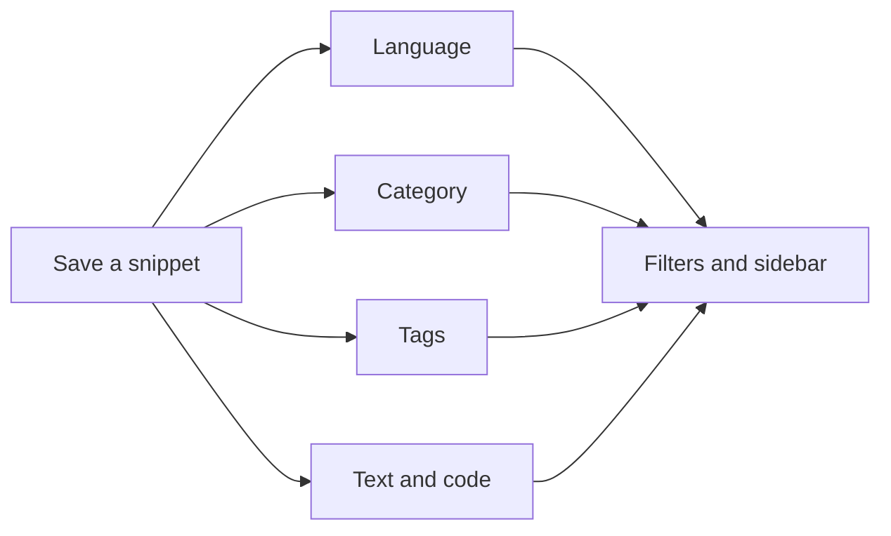
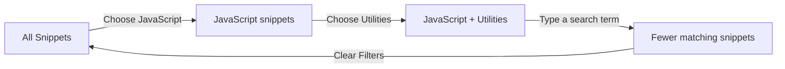

# How snippets and filters work together

CodeKnit gives every saved snippet a few identifying details: a language, a category, one or more tags, searchable text, and an optional favorite star. When you apply filters, CodeKnit narrows the visible list to snippets that match all of your active choices at the same time.

## What CodeKnit uses to organize snippets

- **Language**, one of JavaScript, Python, SQL, or Markdown
- **Category**, a folder-like grouping, such as Utilities
- **Tags**, short labels such as #react or #backend
- **Search text**, the snippet title, description, tags, and code
- **Favorite state**, whether a snippet is starred for quick access

Figure: Snippet details power the sidebar and filters

## Where you can filter

The sidebar and the area above your snippet list offer the same core controls.

- The **Categories** list shows each category in your library and how many snippets use it
- The **Languages** list shows the supported languages
- The **Search snippets** box in the header searches across titles, descriptions, tags, and code
- The **Filter…** search box above the snippet list uses the same search text
- The filter bar includes dropdowns for **All languages**, **All categories**, **All tags**, and sort order

If you prefer a broader overview, start with [Snippet Organization](doc:8367ddb8-1051-4848-a093-3b4352805aa4). For a closer look at search options, see [Search and Filter](doc:3704cb56-cf68-421d-9db0-d3816a8af756).

## How filters combine

Filters work together as a set of “and” conditions. Each new filter narrows the list further.

For example:

1. Open **All Snippets**
2. Select **JavaScript** in the sidebar or language dropdown
3. Select **Utilities** in the sidebar or category dropdown
4. Type a search term into **Filter…**

You then see only snippets that are JavaScript, belong to the Utilities category, and also match your search text.

Figure: Combining filters narrows your library step by step

## Understanding the “shown” count

The number above your snippet list, for example, **“12 shown”**, always reflects how many snippets match your current view and filters.

- As you type or select filters, the number updates immediately
- When you clear a filter, the number grows again
- When no snippets match, CodeKnit shows a **No snippets match** message with a **Clear filters** action

## Clearing filters

You can clear one filter or all filters.

- Click an active category or language in the sidebar again to return to **all**
- Set a dropdown back to **All languages**, **All categories**, or **All tags**
- Clear the text in **Search snippets** or **Filter…**
- Select **Clear Filters** in the filter bar to reset search text, language, category, and tag choices

**Clear Filters** keeps your current sort order, such as **Recently Added** or **A–Z**, and your current sidebar view.

## Favorites as a special filter

The **Favorites** view in the sidebar acts as a built-in filter.

- It shows only snippets with a star
- The sidebar count next to **Favorites** shows the total number of starred snippets in your library
- Active language, category, tag, and search filters still apply while you are in **Favorites**

You can star or unstar a snippet from the snippet card or from the snippet detail view. Learn more in [Favorites](doc:b66c5560-9b68-42eb-922d-a8aecab0dfcb).

## Recently added and recently used views

These sidebar views provide a different scope while still respecting active filters.

- **Recently Added** shows up to 10 of your newest snippets
- **Recently Used** shows only snippets you have copied at least once, ordered by most recent copy

## Saving new snippets and unsaved changes

When you open **New Snippet**, the form keeps your entries separate from your library until you save them.

1. Fill in the title, code, language, category, and any other details
2. Review the form before saving
3. Select **Save Snippet** to add the snippet to your library
4. If you do not want to keep your changes, select **Cancel** to discard them

The form stays open if you click outside it, so an accidental outside click does not discard your work.

## Navigating your library efficiently

- Start broad with **All Snippets**, then apply one filter at a time
- Use the **shown** number to confirm whether a filter combination is too narrow
- Switch to **Favorites** only when you need a short list of starred items
- Use **Recently Added** or **Recently Used** for quick, targeted views

Related guides:

- [Search and Filter](doc:3704cb56-cf68-421d-9db0-d3816a8af756)
- [Snippet Organization](doc:8367ddb8-1051-4848-a093-3b4352805aa4)
- [Favorites](doc:b66c5560-9b68-42eb-922d-a8aecab0dfcb)
- [Snippet Library](doc:9f431e10-b005-4cc0-80b1-0af4acdcb3d8)
- [Your First Snippet – Quick Start](doc:72dab710-31b9-4980-becf-be9fbd6d4d94)
