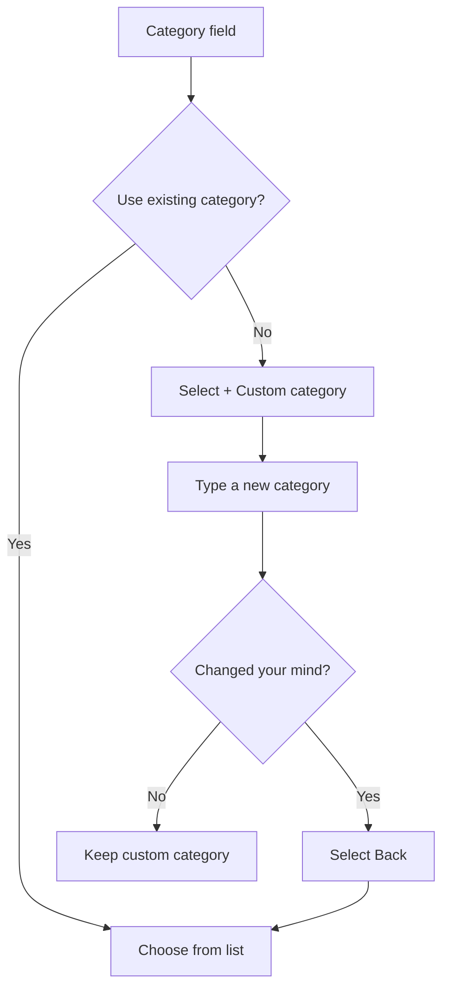
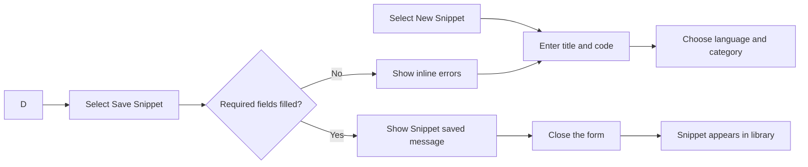
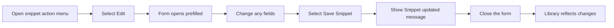

# Snippet creation and editing

CodeKnit lets you save, organize, and reuse pieces of code and Markdown. You can create a new snippet from scratch or edit any existing snippet whenever you need to refine it. This guide covers the creation and editing form, what each field does, and what happens after you save.

## What you can do

With the snippet form, you can:

- Create a code or Markdown snippet with a title, language, code, and category
- Add an optional description and tags
- Mark a snippet as a favorite while creating or editing it
- Edit an existing snippet and keep all its current details
- Use a live syntax-highlighted editor while you type

## Open the snippet form

You can open the snippet creation form in a few ways:

- Select **New Snippet** in the sidebar or in the top header
- Select **+ New Snippet** on the empty state when your library has no snippets yet
- To edit an existing snippet, open its actions menu and select **Edit**, or open the snippet in detail view and select **Edit**

The form opens as a dialog. When you are creating a new snippet, it starts with **JavaScript** selected and **Utilities** as the default category. When you are editing, it is already filled with the snippet's current information.

## The snippet form fields

### Title (required)

A short, recognizable name for your snippet, such as`Debounce utility`. Pick something that will help you find the snippet again later.

### Description (optional)

A brief explanation of what the snippet does. This text appears on the snippet card and in the snippet detail view.

### Language (required)

Choose from four languages:

- **JavaScript**
- **Python**
- **SQL**
- **Markdown**

The language you choose controls syntax highlighting in the editor and in previews.

### Category

Choose a category from the list, or select **+ Custom category…** and type your own. The default category for new snippets is **Utilities**. Categories you have already used appear in the list alongside the standard categories.

If you choose a custom category and change your mind, select **Back** to return to the category list. The form then resets the category to **Utilities**.

Here is how the category selection behaves:

Figure: Category selection behavior

### Tags

Add keywords that make the snippet easier to find later. Type a tag and press **Enter** or add a comma to create it. You can remove any tag you've added. Tags are used by search and tag filters throughout CodeKnit.

### Code (required)

Use this space to paste or write your code or Markdown. The editor shows line numbers and highlights the syntax for the selected language. You can type freely, use the **Tab** key to indent, and scroll when your content grows beyond the visible area.

### Mark as favorite

Turn on this switch to star the snippet as a favorite immediately. You can change this later from the snippet card or detail view.

## Working in the code editor

The code editor is a text area with live syntax highlighting. As you type, keywords, strings, comments, and other code elements are colorized according to the language you selected. Line numbers remain visible on the left.

The editor supports multi-line content and scrolls when needed. Pressing the **Tab** key inserts two spaces. Long lines do not wrap automatically; you can scroll horizontally to see the rest of the line.

When you select **Markdown** as the language, the same editor highlights Markdown formatting elements such as headings, bold text, and links.

## Validation and saving

When you select **Save Snippet**, CodeKnit checks that:

- The title is not empty
- The code is not empty
- The category is not empty when you are entering a custom category

If any required field is missing, the form shows a message under that field and the snippet is not saved. Fix the issue and select **Save Snippet** again.

The save button is disabled while your snippet is being saved, and its label changes to **Saving…**. When saving succeeds, you see a toast message: **Snippet saved** for new snippets or **Snippet updated** for edits. The form then closes.

> [!NOTE]
> Selecting outside the form does not close it. Use **Cancel** or **Save Snippet** to close the form, so you won't lose unsaved changes by accident.

## Creation flow

Here is how a new snippet moves from idea to saved item.

Figure: New snippet creation flow

## Editing flow

When you edit an existing snippet, the form opens with all its current details already filled in: title, description, language, category, tags, code, and favorite state. Change any field, then save.

Figure: Existing snippet edit flow

## What happens after saving

A new snippet becomes available immediately in your library:

- It appears in **All Snippets** and on the **Dashboard**
- It can be found through search, language, category, and tag filters
- Counts update in the sidebar and dashboard statistics
- It is stored in your browser on this device, so it remains available when you return

For edits, the changes take effect immediately in your library. The snippet's category, tags, language, and content update to match what you saved, and those changes are reflected in filters and search results.

## Related pages

- [How to Create and Save Your First Snippet](doc:3231f3ee-d5f2-4dc2-884c-737c2a37dccb)
- [How to Edit an Existing Code or Markdown Snippet](doc:56ffdde4-4a2f-4b13-9cc2-54423f7c58f0)
- [Code Editor](doc:a1109ff6-5fe7-437a-99ec-4d0b442bb0fd)
- [Snippet Organization](doc:8367ddb8-1051-4848-a093-3b4352805aa4)
- [Markdown Content Authoring and Editing](doc:d214b6d1-a99a-4dba-ac37-6fe9639d6387)
- [Understanding CodeKnit Snippet Storage and Data Persistence](doc:bc53c832-8a30-4641-96c2-23bf33e68fe5)
