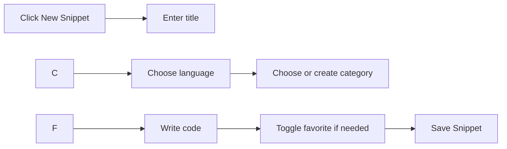
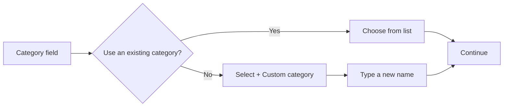
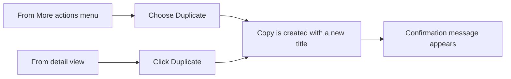
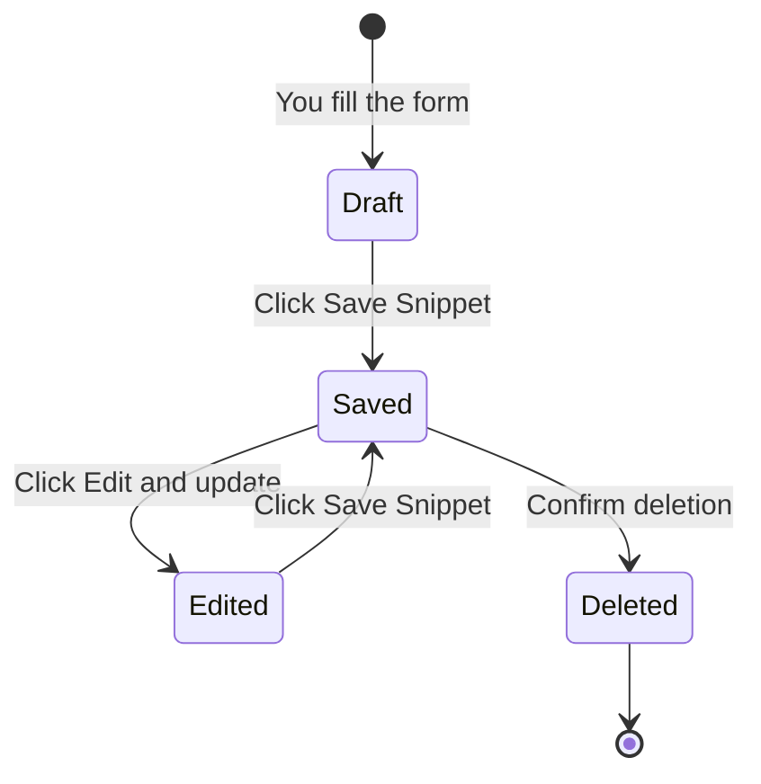

# Snippet creation and management

CodeKnit gives you a single place to save, organize, and reuse code or Markdown snippets. This page covers the full lifecycle: creating a snippet, filling in its details, editing it later, duplicating it, and deleting it when you no longer need it.

## Who this is for

Snippet creation and management is for anyone who regularly reuses pieces of code or text. Whether you're a developer saving a reusable utility function, a data analyst keeping SQL queries handy, or a writer storing Markdown formatting examples, CodeKnit helps you capture and organize those pieces so you can find them again quickly.

## Creating a new snippet

You can start a new snippet from anywhere in CodeKnit. Click **New Snippet** in the header or the sidebar. A form opens where you can enter the snippet's details.

Figure: Snippet creation flow

## Understanding the snippet form

The form has several fields, some required and some optional. Each field is described below.

### Title (required)

Give your snippet a short, descriptive name. The title appears on snippet cards and is the first thing you see when browsing your library. Examples include "Debounce utility" or "Monthly sales query."

### Description (optional)

Add a sentence or two explaining what the snippet does. This helps you remember its purpose later and shows up on snippet cards and in the full detail view.

### Language (required)

Choose one of four supported languages:

- **JavaScript**
- **Python**
- **SQL**
- **Markdown**

The language you choose controls the syntax highlighting in the editor and in snippet previews. You can change this choice at any time when editing.

### Category

Categories group related snippets together. You can choose from existing categories or create a custom one.

When you select **+ Custom category…**, a text field appears where you type a new category name. The new category becomes available in your sidebar after you save, so you can use it for future snippets too.

**Utilities** is the default category when you start a new snippet, but you can switch to any category you've already created.

Figure: Category selection decision flow

### Tags

Tags give you another way to organize and find snippets. Type a tag and press **Enter** or type a comma to add it. Tags are normalized automatically: they become lowercase, spaces are trimmed, and any leading`#` symbol is removed. You can add multiple tags and remove any tag before saving.

### Code (required)

Paste or write your code or Markdown in the editor. The editor includes:

- **Line numbers** for easy reference
- **Syntax highlighting** based on the selected language
- **Tab key support** that inserts two spaces for indentation
- A placeholder hint when empty: "Paste or write your code here"

The editor grows as you add lines, up to a comfortable maximum height, and scrolls when your content exceeds it.

### Mark as favorite

Use the **Mark as favorite** toggle to add the snippet to your Favorites list, making it quicker to find in the sidebar.

## Validation rules

CodeKnit checks your form before saving. You'll see an inline error message if any required field is missing:

- **Title is required**, enter a title before saving
- **Code is required**, add some code or text content
- **Enter a category name**, if you choose a custom category, you must provide a name

The form won't save until all required fields are filled. When everything is valid and the snippet saves successfully, you'll see a confirmation message: **"Snippet saved"** for a new snippet or **"Snippet updated"** for an edit. While saving, the button reads **"Saving…"** and is temporarily disabled.

The form stays open if you click outside it, so you won't accidentally lose your work while filling it in. Use **Cancel** to close the form without saving. If you cancel, your unsaved changes are discarded, and the next time you open a new snippet form it starts fresh.

## Editing an existing snippet

You can edit any snippet from two places:

1. On a snippet card, open the **More actions** menu (three dots icon) and choose **Edit**.
2. In the snippet's full detail view, click **Edit**.

The same form opens with all fields pre-filled. Change any field you need, then click **Save Snippet**. You'll see **"Snippet updated"** when the changes are saved.

The snippet's "Updated" date changes automatically to reflect when you last edited it. If a snippet has never been edited after creation, the card shows only a single date.

## Duplicating a snippet

You can duplicate any snippet as a starting point for a new one. Open the **More actions** menu on a snippet card and choose **Duplicate**, or click **Duplicate** in the snippet detail view.

CodeKnit creates a copy with a modified title so the new snippet is distinct. A confirmation message appears with the new title. The original snippet stays unchanged.

Figure: Duplicating a snippet

## Deleting a snippet

To delete a snippet:

1. Open the **More actions** menu on a snippet card and choose **Delete**, or click **Delete** in the snippet detail view.
2. CodeKnit shows a confirmation dialog: **"Delete this snippet?"**
3. The dialog displays the snippet title and explains that the snippet will be permanently removed.
4. Click **Delete** to confirm, or **Cancel** to keep the snippet.

When you delete a snippet, it's permanently removed from your library, including its copy count, favorite status, and tags. After deletion, you'll see **"Snippet deleted"** as a confirmation.

> [!WARNING]
> Deleting a snippet is permanent and cannot be undone. Make sure you no longer need the snippet before you confirm deletion.

## Snippet lifecycle

A snippet moves through four main states in CodeKnit: drafting, saved, edited, and deleted.

Figure: Snippet lifecycle states

Duplicating does not change the original snippet's lifecycle, it creates a new, separate snippet that starts in the saved state.

## What happens after you save

Once saved, your snippet appears in:

- **All Snippets** in the sidebar
- The **Dashboard**, which updates your total snippet count
- The category you assigned
- Language filters matching your selection
- Tag filters for any tags you added

You can immediately copy the snippet, mark it as a favorite, view it in more detail, duplicate it, or continue adding more snippets.

## Related pages

- [Concepts | Snippets and Metadata](doc:35e64ac6-cbc1-45fa-877d-d3681fd10bde)
- [How to Create and Save Your First Snippet](doc:3231f3ee-d5f2-4dc2-884c-737c2a37dccb)
- [How to Edit an Existing Code or Markdown Snippet](doc:56ffdde4-4a2f-4b13-9cc2-54423f7c58f0)
- [How to Delete a Snippet Permanently](doc:51b2df7f-976b-4f26-9b14-8dde23bb0c32)
- [Snippet Organization](doc:8367ddb8-1051-4848-a093-3b4352805aa4)
- [Markdown Content Authoring and Editing](doc:d214b6d1-a99a-4dba-ac37-6fe9639d6387)
