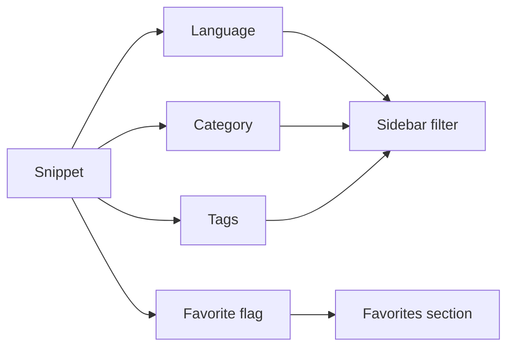
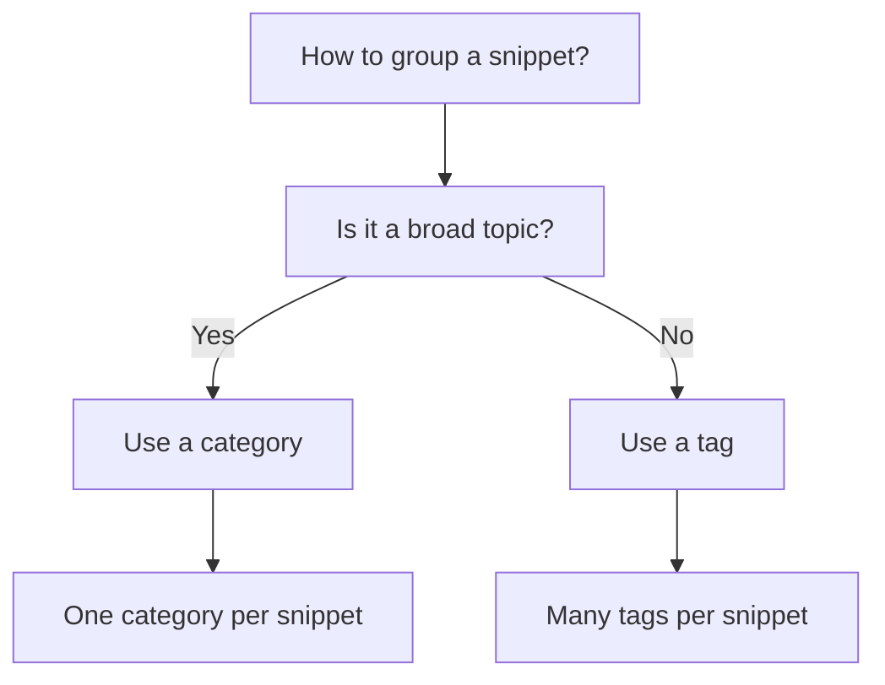
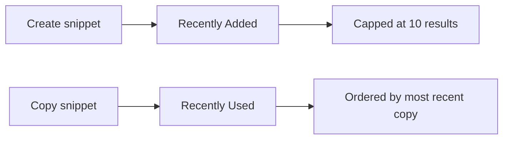
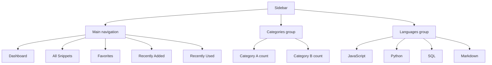

# Snippet organization

Snippet Organization is the set of tools that keeps your code library structured and easy to navigate. It's for developers managing a growing collection of saved code who need a clear way to find what they've saved without scrolling through an undifferentiated list.

With Snippet Organization, every snippet can be grouped by **category**, labeled with flexible **tags**, identified by **programming language**, marked as a **favorite**, and surfaced automatically in **Recently Added** and **Recently Used** views. A dedicated navigation pane ties all of this together so you always know where you are and what's in each group.

The main organizing tools are:

- **Categories**, broad grouping by purpose or topic
- **Tags**, free-form labels for cross-cutting details
- **Languages**, automatic grouping by the language of the saved code
- **Favorites**, a star-based quick-access list
- **Recently Added**, a time-based view of your latest saves
- **Recently Used**, a view of snippets you've copied, ordered by most recent copy
- **Sidebar navigation**, a persistent pane with sections, counts, and filters

---

## Understanding how your library is organized

Each snippet carries three independent pieces of organizing information: a language, a category, and any number of tags. Favorites, recency, and usage are added on top as ways to surface selected snippets quickly. These schemes work together—for example, a snippet can be JavaScript, saved under **Utilities**, tagged`#async`, and also marked as a favorite.

Figure: How one snippet fits into the organization system

The sidebar reflects this structure in real time. As you add, edit, or delete snippets, the category list, count badges, and available tags update automatically to match your library.

---

## Categories

Categories provide a broad grouping for snippets. They're ideal for separating different kinds of work—for example, reusable utility functions versus documentation templates. Each snippet belongs to exactly one category, so categories function like folders for your library.

### Built-in categories

When you create a snippet, you can pick from the built-in list of categories, including **Utilities**. The category field starts with **Utilities** selected by default. As you save snippets into a category, that category appears in the sidebar under **Categories**.

### Custom categories

If the built-in list doesn't fit your needs, you can create a custom category while adding or editing a snippet:

1. Open the **New snippet** or **Edit snippet** form.
2. Open the **Category** dropdown.
3. Select **+ Custom category…**.
4. Type the name you want.
5. Save the snippet.

After a custom category exists, it appears in the sidebar alongside the built-in ones and is available for future snippets. Categories are not nested—every category sits at the same level.

### Category counts

Every category in the sidebar displays a count badge showing how many snippets belong to it. This gives you an immediate sense of where your library is concentrated and helps you spot areas that might need splitting or consolidating.

Selecting a category filters the visible snippets to that category. Selecting it again switches back to all categories.

---

## Tags

Tags are flexible, user-defined labels attached to individual snippets. Unlike categories, which represent broad mutually exclusive groupings, tags capture details that cut across categories—for example,`#async`,`#optimization`, or`#testing`.

### How tagging works

Add tags while creating or editing a snippet using the **Tags** field. Type a tag and press **Enter** or type a comma to commit it. Tags are automatically converted to lowercase, and you can type any labels you want. You can attach any number of tags to a single snippet, and the same tag can appear on many snippets across different categories and languages.

When a snippet is displayed, its tags show as rounded chips with a`#` prefix. The tag filter dropdown is built from all tags across your library, so picking a tag narrows the view to snippets labeled with it.

Tags are flat—there's no hierarchy or parent-child relationship between them. They're also fully manual: the app never guesses or automatically creates tags based on code content, and there is no controlled vocabulary you're required to pick from.

Figure: How categories and tags differ

---

## Languages

Every snippet is associated with exactly one programming language: **JavaScript**, **Python**, **SQL**, or **Markdown**. You choose the language when creating or editing a snippet.

### Language badges

Each snippet shows a small language badge with a colored dot specific to that language. Every language has a distinct dot color, and the color coding is consistent across the snippet cards, the detail viewer, and the sidebar, so you can identify languages at a glance.

### Language filters

The sidebar's **Languages** section lists all four languages with their colored dots. Selecting a language filters the visible snippets to that language only. Selecting it again returns to all languages. You can also use the language dropdown in the filter bar for the same purpose.

---

## Favorites

Favorites are a quick-access list of snippets you've starred. Use them for the snippets you reach for most often—utility functions, template code, or anything worth keeping one click away. Learn more in [Favorites](doc:b66c5560-9b68-42eb-922d-a8aecab0dfcb).

### Marking a favorite

You can add or remove a snippet from favorites in three places:

- The star icon on a snippet card
- The **Favorite** button inside the snippet detail window
- The **Mark as favorite** switch on the new/edit snippet form

A filled star indicates a snippet is already a favorite.

### The favorites section

The sidebar's **Favorites** item shows a count badge with the number of starred snippets. Selecting it filters the library to only starred snippets. If you have no favorites, the view shows an empty state prompting you to clear the filter or browse elsewhere.

Favorites are manually controlled—nothing is favorited automatically, and your favorites list only changes when you explicitly add or remove stars.

---

## Recently added

The **Recently Added** section shows the most recent snippets you've added, sorted newest first. It displays up to 10 results, so the view focuses on your latest activity without overwhelming you.

This view is automatically built from your snippet creation timestamps. Whenever you save a new snippet, it appears at the top of this list. The same timestamps also drive the sort dropdown in the filter bar, where you can choose **Recently Added**, **Oldest First**, or **A–Z** for the main list.

Like favorites, the recently added view reflects what you've actually saved, not an algorithmic suggestion.

---

## Recently used

The **Recently Used** section shows snippets you've copied, ordered by most recent copy. This surfaces the snippets you actually reuse, separate from ones you merely saved recently. A snippet appears here only after you've used the **Copy** action on its card or in its detail viewer.

Figure: How a snippet moves through recently added and recently used

### Count badge and empty state

The **Recently Used** item in the sidebar shows a count badge with the number of snippets you've copied at least once. If you haven't copied any snippets yet, the section shows an empty state with a **Browse all snippets** button and a note explaining that copying a snippet adds it here.

---

## Sidebar navigation

The navigation pane on the left side of the application is the hub for Snippet Organization. It groups navigation into several areas with distinct purposes.

Figure: Sidebar navigation structure

### Main navigation

Five items anchor the top of the sidebar:

- **Dashboard**, the home view showing a heading and summary statistics
- **All Snippets**, the full library, with a count badge
- **Favorites**, starred snippets only, with a count badge
- **Recently Added**, the newest snippets, capped at 10, with no count badge
- **Recently Used**, snippets you've copied, with a count badge

### Category and language groups

Below the main navigation are two groups: **Categories** and **Languages**. Categories show each category name with a snippet count badge, and languages show each of the four supported languages with a colored dot. Categories appear in alphabetical order, and their counts reflect the current state of your library.

### Sidebar footer

The bottom of the sidebar contains the **New Snippet** button and your workspace summary. The workspace area shows that your snippets are saved on the current device, along with a settings button for backup, import, and reset options.

### Mobile navigation

On smaller screens, the sidebar is hidden by default. Open it with the navigation toggle in the header, which slides the sidebar in. After you select any item—whether a section, a category, or a language—the sidebar closes automatically so you can see the results immediately. The **New Snippet** button and settings are available at the bottom of the mobile sidebar as they are on desktop.

---

## Planning your organization system

Your choice between categories and tags depends on how you intend to find things later. Use categories as the primary, stable grouping: think of them as folders that answer "what kind of work is this?" Use tags for the details that vary across those groups: think of them as labels that answer "what other traits apply?"

A practical approach is to start with a small set of categories and let tags accumulate naturally as you save more snippets. Because tags are free-form and searchable, they're forgiving to add on the fly. Categories benefit from a little more care since moving a snippet to a different category means editing that snippet.

The **All Snippets** view with the filter bar gives you another layer of organization: you can combine a language filter, a category filter, a tag filter, and a search query to narrow the view. The filter bar's sort options let you reorder by recency or title, independent of the permanent groupings.

**Related:**
- [How Snippets and Filters Work Together](doc:5aa23d07-2c0d-44f6-8a85-df82ca070b77)
- [Snippet Library](doc:9f431e10-b005-4cc0-80b1-0af4acdcb3d8)
- [Search and Filter](doc:3704cb56-cf68-421d-9db0-d3816a8af756)
- [Favorites](doc:b66c5560-9b68-42eb-922d-a8aecab0dfcb)
- [Dashboard](doc:0cccb845-62f3-4e2b-b0ca-c7d768eaf700)
- [Your First Snippet – Quick Start](doc:72dab710-31b9-4980-becf-be9fbd6d4d94)
