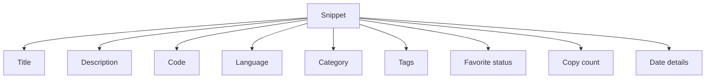
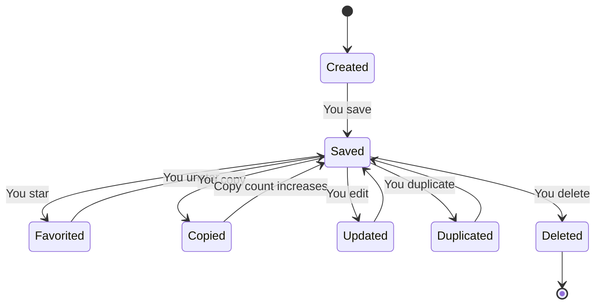

# Snippets and metadata

A snippet is a saved piece of code or Markdown text that you can reuse later. Each snippet combines your actual content with descriptive details that help you find, identify, and manage it in CodeKnit.

When you create or edit a snippet, you provide the information that makes it useful. The most important parts are the title, the code itself, and the language. Optional details like a description, category, and tags add context and make your library easier to search.

## The parts of a snippet

Every snippet has the following pieces:

- **Title** – a short, memorable name such as "Debounce utility."
- **Description** – an optional explanation of what the snippet does.
- **Code** – the actual text you want to save, which can be code or Markdown.
- **Language** – the format of the code, such as JavaScript, Python, SQL, or Markdown. This controls how CodeKnit displays and highlights the text.
- **Category** – a grouping you choose, such as Utilities or a custom category you create.
- **Tags** – optional labels that add extra search terms.
- **Favorite status** – whether the snippet is starred for quick access.
- **Copy count** – how many times the snippet's code has been copied.
- **Date details** – when the snippet was created, when it was last updated, and when it was last copied.

The following overview shows how these pieces come together to form each snippet:

Figure: The parts of a snippet

The snippet card in your library shows many of these details at a glance. You can also open a snippet to see the full metadata in the detail viewer.

## How metadata helps you

Metadata is the information that describes a snippet. It works together with CodeKnit's search and filter tools to make your library easy to navigate.

- **Language** helps CodeKnit highlight syntax correctly and lets you filter snippets by language. For more on highlighting, see [Syntax Highlighting and Code Preview in CodeKnit](doc:b67c41f8-ec7f-48e2-ac63-9599d5440993).
- **Category** groups related snippets together in the sidebar.
- **Tags** add extra searchable words, so you can find a snippet even if you don't remember its title.
- **Favorite status** lets you quickly view only your starred snippets.
- **Copy count** shows how often you reuse a snippet.
- **Updated date** tells you which version is most recent.

Your snippets and their metadata are stored in your browser on the device you use. For details on what that means, see [Local Storage and Data Persistence](doc:8c56a45c-47e9-471d-9436-d04167c9608f).

## The life of a snippet

A snippet changes state as you work with it. It starts when you create it, gains metadata as you save it, and can be starred, copied, edited, duplicated, or deleted.

Figure: A snippet's lifecycle

When you star a snippet, it appears in the **Favorites** section. Each time you use the **Copy** button, CodeKnit records the copy and updates the copy count. If you edit a snippet, its updated date changes. The **Duplicate** action creates a new snippet based on the original without changing it. Deleting a snippet removes it permanently.

## Related pages

- [How to Create and Save Your First Snippet](doc:3231f3ee-d5f2-4dc2-884c-737c2a37dccb)
- [Snippet Organization](doc:8367ddb8-1051-4848-a093-3b4352805aa4)
- [Favorites](doc:b66c5560-9b68-42eb-922d-a8aecab0dfcb)
- [How Snippets and Filters Work Together](doc:5aa23d07-2c0d-44f6-8a85-df82ca070b77)
- [Syntax Highlighting and Code Preview in CodeKnit](doc:b67c41f8-ec7f-48e2-ac63-9599d5440993)
