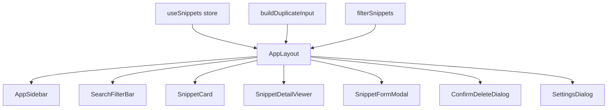
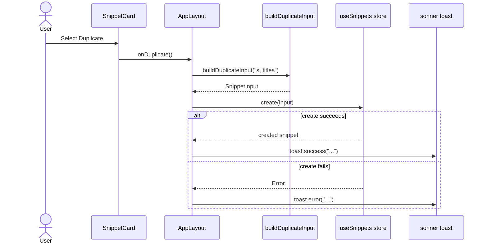
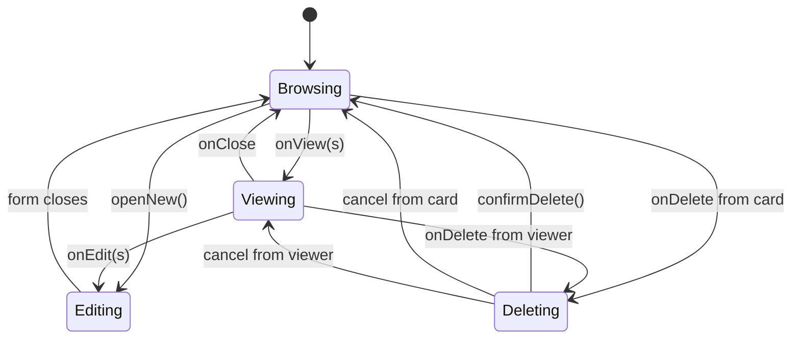

# AppLayout component: Main application state and CRUD operations

`AppLayout` in `AppLayout.tsx` is the central state owner for the CodeKnit main application screen. It connects the snippet store, sidebar navigation, search and filter controls, snippet cards, and every mutation dialog. This page details its state model, derived data, CRUD handlers, layout persistence, and how it wires child components together.

## Role in the component tree

`AppLayout` is the orchestrator. It owns all local UI state that coordinates which screen the user sees and which dialogs are open. It does not directly implement form validation or repository persistence; those responsibilities live in `SnippetFormModal`, `useSnippets`, and the snippet repository layer.

Figure: AppLayout coordinates child components and the snippet store



The component imports the data and mutation functions it coordinates from `@/lib/snippets/store`:

```tsx
const { snippets, status, error, reload, create, remove, toggleFavorite, recordCopied } = useSnippets();
```

## Local UI state

`AppLayout` keeps the following local state values:

| State | Type | Initial value | Purpose |
| --- | --- | --- | --- |
| `section` | `Section` | `"dashboard"` | Active navigation section from `AppSidebar` |
| `filters` | `SnippetFilters` | `DEFAULTS` | Query, language, category, tag, and sort filters |
| `layout` | `"grid" \| "list"` | `"grid"` | Card layout preference |
| `formOpen` | `boolean` | `false` | Whether `SnippetFormModal` is open |
| `editing` | `Snippet \| null` | `null` | Snippet being edited, or `null` when creating |
| `viewingId` | `string \| null` | `null` | ID of snippet shown in `SnippetDetailViewer` |
| `deleting` | `Snippet \| null` | `null` | Snippet pending deletion in `ConfirmDeleteDialog` |
| `settingsOpen` | `boolean` | `false` | Whether `SettingsDialog` is open |

The initial filter object is defined as:

```tsx
const DEFAULTS: SnippetFilters = { query: "", language: "all", category: "all", tag: "all", sort: "recent" };
```

Section display titles are kept in a module-level `TITLES` map and selected by `section` during render:

```tsx
const TITLES: Record<Section, string> = {
  dashboard: "Your Snippets", all: "All Snippets", favorites: "Favorites", recent: "Recently Added", used: "Recently Used",
};
```

## Derived state

`AppLayout` uses `useMemo` to derive the values it passes to the sidebar and filter bar, avoiding recalculation on every render.

### Current viewer snippet

```tsx
const viewing = snippets.find((s) => s.id === viewingId) ?? null;
```

`viewing` is kept as a `Snippet` object, not just an ID, so `SnippetDetailViewer` receives the full record.

### Categories

```tsx
const categories = useMemo(() => {
  const m = new Map<string, number>();
  snippets.forEach((s) => m.set(s.category, (m.get(s.category) ?? 0) + 1));
  return [...m].map(([name, count]) => ({ name, count })).sort((a, b) => a.name.localeCompare(b.name));
}, [snippets]);
```

This produces a sorted `{ name, count }[]` used in `AppSidebar` badges and in `SearchFilterBar` category options.

### Tags

```tsx
const tags = useMemo(() => [...new Set(snippets.flatMap((s) => s.tags))].sort(), [snippets]);
```

All tag strings from all snippets are deduplicated and sorted alphabetically.

### Visible snippets

```tsx
const visible = useMemo(() => {
  const f = {
    ...filters,
    favoritesOnly: section === "favorites",
    sort: section === "recent" ? "recent" as const : filters.sort,
  };
  const r = filterSnippets(snippets, f);

  if (section === "recent") return r.slice(0, 10);
  if (section === "used") {
    return r
      .filter((s) => Boolean(s.lastCopiedAt))
      .sort((a, b) => (b.lastCopiedAt ?? "").localeCompare(a.lastCopiedAt ?? ""));
  }
  return r;
}, [snippets, filters, section]);
```

Section-specific behavior:

- `favorites` forces `favoritesOnly: true`.
- `recent` forces newest-first sorting and caps the result at 10 snippets.
- `used` keeps only snippets with a `lastCopiedAt` value and sorts them newest-copied-first.
- All other sections use the current filter and sort values.

### Active filter check

```tsx
const hasActive =
  filters.query !== "" ||
  filters.language !== "all" ||
  filters.category !== "all" ||
  filters.tag !== "all";
```

`hasActive` decides whether the empty state should prompt the user to clear filters or create a snippet.

## Filter update and clear

Filters are updated by merging a partial object:

```tsx
const update = (p: Partial<SnippetFilters>) => setFilters((f) => ({ ...f, ...p }));
```

Clearing filters preserves the current sort selection:

```tsx
const clear = () => setFilters((f) => ({ ...DEFAULTS, sort: f.sort }));
```

## CRUD handlers

`AppLayout` directly owns delete, duplicate, toggle-favorite, and open/create/edit transitions. Actual create and update persistence happens inside `SnippetFormModal`, which receives `editing` and calls either `create` or `update`.

### Open new snippet

```tsx
const openNew = () => {
  setEditing(null);
  setFormOpen(true);
};
```

`openNew` is used by the header **New Snippet** button (desktop and mobile variants), the sidebar footer button, and `EmptyState` when there are no snippets.

### Open edit snippet

```tsx
const openEdit = (s: Snippet) => {
  setViewingId(null);
  setEditing(s);
  setFormOpen(true);
};
```

Opening the edit form clears the detail viewer so a user cannot have both the viewer and form open at the same time.

### Duplicate snippet

```tsx
const duplicate = async (s: Snippet) => {
  try {
    const created = await create(buildDuplicateInput(s, snippets.map((item) => item.title)));
    toast.success(`Created "${created.title}"`);
  } catch (e) {
    toast.error((e as Error).message);
  }
};
```

`duplicate` calls `buildDuplicateInput` from `@/lib/snippets/duplicate`, passing the selected snippet and every current snippet title. The utility returns a new `SnippetInput` with a unique title. The result is sent to `create`.

Figure: Duplicate snippet flow



### Delete snippet

```tsx
const confirmDelete = async () => {
  if (!deleting) return;
  try {
    await remove(deleting.id);
    if (viewingId === deleting.id) setViewingId(null);
    toast.success("Snippet deleted");
  } catch (e) {
    toast.error((e as Error).message);
  }
  setDeleting(null);
};
```

`confirmDelete` is triggered by `ConfirmDeleteDialog`. After a successful delete, it closes the detail viewer only if the deleted snippet was the one being viewed. The dialog is closed by resetting `deleting` to `null` in the `finally` path, meaning the dialog closes even if deletion fails.

### Toggle favorite

```tsx
const fav = (s: Snippet) => toggleFavorite(s.id).catch((e: Error) => toast.error(e.message));
```

This is passed to both `SnippetCard` and `SnippetDetailViewer`. Errors are surfaced through the toast system.

### Record copy

Card copy operations are wired with:

```tsx
onRecordCopy={() => recordCopied(s.id)}
```

The detail viewer path includes an explicit error handler:

```tsx
onRecordCopy={() =>
  viewing
    ? recordCopied(viewing.id).catch((e: Error) => {
        toast.error(e.message);
      })
    : Promise.resolve()
}
```

## Modal wiring

`AppLayout` passes the state it owns into the modal components:

| Modal | `open` | `onOpenChange` | Additional `AppLayout`-owned props |
| --- | --- | --- | --- |
| `SnippetDetailViewer` | `!!viewing` through `snippet` | `onClose={() => setViewingId(null)}` | `snippet`, callbacks for edit, delete, duplicate, favorite, record copy |
| `SnippetFormModal` | `formOpen` | `setFormOpen` | `editing`, `categories` |
| `ConfirmDeleteDialog` | `!!deleting` | `(o) => !o && setDeleting(null)` | `title={deleting?.title}`, `onConfirm={confirmDelete}` |
| `SettingsDialog` | `settingsOpen` | `setSettingsOpen` | none |

`SnippetFormModal` itself calls `useSnippets().create` or `useSnippets().update` after validating the form. Its success path closes the modal with `onOpenChange(false)` and emits a success toast.

Figure: AppLayout UI state transitions



## Layout persistence

`AppLayout` persists the grid/list layout preference to browser `localStorage` under the key `codeknit.layout`.

On mount, it restores the previously saved layout:

```tsx
useEffect(() => {
  const saved = localStorage.getItem("codeknit.layout");
  if (saved === "list" || saved === "grid") setLayout(saved);
}, []);
```

Layout changes are saved immediately:

```tsx
const changeLayout = (l: "grid" | "list") => {
  setLayout(l);
  localStorage.setItem("codeknit.layout", l);
};
```

The restore effect validates that the stored value is exactly `"list"` or `"grid"`. Any other value falls back to the default `"grid"`.

## Rendering states

The main content area renders one of four status-based states:

| `status` | Render |
| --- | --- |
| `"loading"` | Three `Skeleton` cards |
| `"error"` | `AlertTriangle`, the error message, and a **Try again** button bound to `reload` |
| `"ready"` with `visible.length === 0` | `EmptyState` |
| `"ready"` with visible snippets | `SnippetCard` grid or list |

The ready-empty branch uses the section to choose the empty-state wording. For example, the `used` section with no active filters shows **No recently used snippets** and a **Browse all snippets** action that clears filters and opens the `all` section:

```tsx
<EmptyState
  filtered={hasActive || section === "favorites" || section === "used"}
  title={section === "used" && !hasActive ? "No recently used snippets" : undefined}
  description={section === "used" && !hasActive ? "Copy a snippet to see it here, ordered by most recently copied." : undefined}
  actionLabel={section === "used" && !hasActive ? "Browse all snippets" : undefined}
  onClear={() => { clear(); setSection("all"); }}
  onCreate={openNew}
/>
```

## Card callbacks

Each visible `SnippetCard` receives these callback props from `AppLayout`:

```tsx
<SnippetCard
  key={s.id}
  snippet={s}
  layout={layout}
  onView={() => setViewingId(s.id)}
  onEdit={() => openEdit(s)}
  onDelete={() => setDeleting(s)}
  onDuplicate={() => { void duplicate(s); }}
  onToggleFavorite={() => fav(s)}
  onRecordCopy={() => recordCopied(s.id)}
/>
```

`onDuplicate` discards the returned promise from `duplicate` because `duplicate` already handles its own error and success toasts.

## Key behavioral notes

- `openEdit` clears `viewingId` before opening the form. This prevents both the edit dialog and detail viewer from referencing the same snippet at the same time.
- `confirmDelete` always closes the delete dialog, even when deletion fails, by running `setDeleting(null)` after the `try/catch`.
- Duplicate operations do not navigate or open a viewer. The new snippet appears in the current visible list after `create` resolves and the store updates.
- The `recent` section intentionally overrides the user's sort filter to enforce newest-first order.
- `clear` resets query, language, category, and tag but keeps the selected sort value.
- `recordCopied` is called only after a successful clipboard copy in both `SnippetCard` and `SnippetDetailViewer`. The card path suppresses record errors; the viewer path surfaces them with a toast.
- The delete confirmation dialog does not close the underlying detail viewer. `viewingId` is only cleared in `confirmDelete` after the repository `remove` succeeds and only if the deleted snippet matches the current viewer.

## Related pages

- [React Hooks and Custom Hooks API](doc:2366f545-fe28-4695-a91e-94a58c97ec73)
- [Snippet Duplication Utility and Copy Tracking](doc:b1f626d2-eee5-4852-9e95-72ed7d8835ee)
- [State Management and Data Persistence](doc:a56b2ef1-97bf-4ab9-a9c9-9b64405edefc)
- [Application Architecture Overview](doc:e1230eab-e95d-4cb0-afd5-54eb455d7b67)
- [Data Persistence Layer: SnippetRepository Pattern and localStorage Implementation](doc:34778b37-21c0-4087-91f0-c28fecb57477)
- [Utility Functions and Helper APIs](doc:fb85ba27-b6a0-4ce0-bb51-b6333ea652ba)