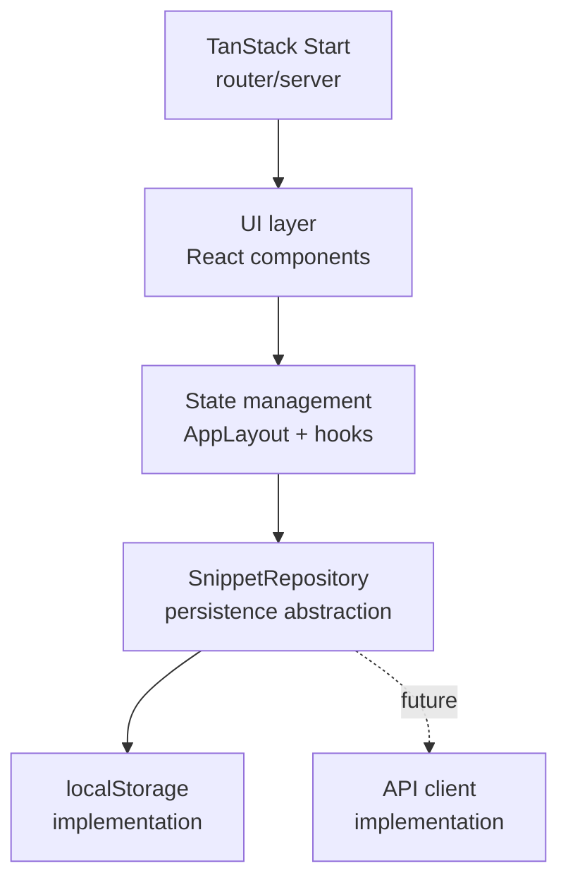
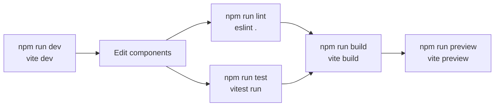
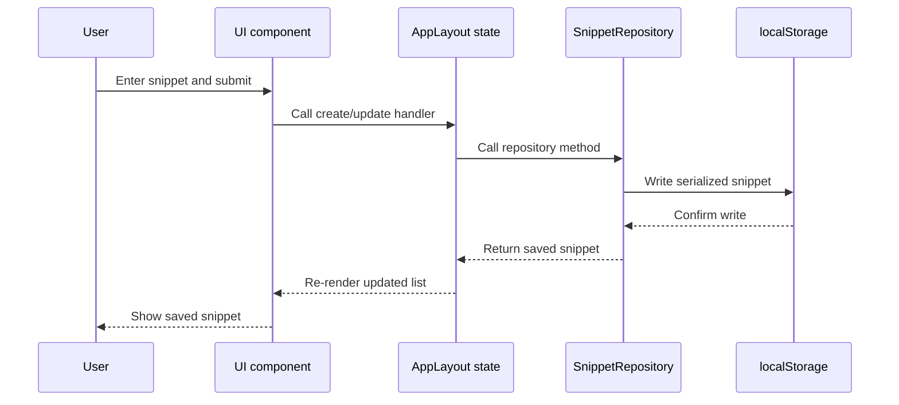

# CodeKnit: High-level architecture and key components

CodeKnit is a browser-based snippet manager built on TanStack Start with React 19 and TypeScript. This document gives new contributors a high-level map of the application's architecture, the main layers, and how data flows through the system.

## Architecture overview

CodeKnit follows a three-layer architecture: the UI layer, the state management layer, and the data persistence layer. The key design decision is that the persistence layer is abstracted behind a `SnippetRepository` interface, so the app can run entirely on browser `localStorage` today and swap to a server API later without changing UI components.

Figure: High-level architecture layers



The UI layer contains the React components that users interact with—snippet lists, editors, dialogs, and filter controls. The state management layer owns snippet state, filter state, viewing state, and all CRUD handlers. The persistence layer defines how snippets are stored and retrieved through the `SnippetRepository` interface. A localStorage implementation ships with the app; the abstraction is designed so an API-backed implementation can replace it.

The full CRUD flow and component responsibilities are documented in [AppLayout Component: Main Application State and CRUD Operations](doc:31e17a28-3f9f-40e4-9d13-8cebe8e9836b). The repository pattern is covered in depth in [Data Persistence Layer: SnippetRepository Pattern and localStorage Implementation](doc:34778b37-21c0-4087-91f0-c28fecb57477).

## Technology stack

The stack is defined in `package.json`. Production dependencies include:

| Category | Packages | Version in `package.json` |
|---|---|---|
| Framework | `@tanstack/react-start` | `1.168.60` |
| Router | `@tanstack/react-router` | `1.170.41` |
| Server/client data | `@tanstack/react-query` | `^5.101.1` |
| UI runtime | `react`, `react-dom` | `^19.2.0` |
| Styling | `tailwindcss`, `@tailwindcss/vite` | `^4.2.1` |
| Primitives | `@radix-ui/react-*` (26 packages) | various |
| Forms and validation | `react-hook-form`, `@hookform/resolvers`, `zod` | `^7.71.2`, `^5.2.2`, `^3.25.76` |
| Icons | `lucide-react` | `^0.575.0` |
| Charts | `recharts` | `^2.15.4` |
| Toasts | `sonner` | `^2.0.7` |

The project is an ES module (`"type": "module"`), declares `"sideEffects": false`, and uses Vite 8 with the Lovable TanStack Start configuration package. TypeScript `^5.8.3` and the `rolldown` override pinned to `1.2.1` are declared in `devDependencies` and `overrides`, respectively. Nitro generates the server bundle.

## Build system and tooling

CodeKnit uses Lovable as its development environment. The build is driven by `vite.config.ts`, which imports `defineConfig` from `@lovable.dev/vite-tanstack-config`.

### Lovable vite config

The `vite.config.ts` file delegates to the Lovable wrapper, which preconfigures the plugins that a TanStack Start app needs:

```ts
import { defineConfig } from "@lovable.dev/vite-tanstack-config";

export default defineConfig({
  tanstackStart: {
    server: { entry: "server" },
  },
});
```

The comment in `vite.config.ts` documents that the Lovable config already includes these plugins, and warns not to add them manually:

- TanStack devtools (development only, loaded first)
- `tanstackStart`
- `viteReact`
- `tailwindcss`
- `tsConfigPaths`
- Nitro (build-only, using Cloudflare as the default target)
- `VITE_*` environment variable injection
- The `@` path alias
- React/TanStack dependency dedupe
- Error logger plugin
- Sandbox detection for port, host, and `strictPort`

The only explicit override in `vite.config.ts` is `tanstackStart.server.entry: "server"`, which points TanStack Start's server entry at `src/server.ts`. That file contains the SSR error wrapper. Nitro and Vite build from this entry.

### npm scripts

The `package.json` scripts define the developer workflow:

```json
"scripts": {
  "dev": "vite dev",
  "build": "vite build",
  "build:dev": "vite build --mode development",
  "preview": "vite preview",
  "lint": "eslint .",
  "format": "prettier --write .",
  "test": "vitest run",
  "test:watch": "vitest"
}
```

Developers run `npm run dev` to start the Vite development server, `npm run build` to produce a production bundle, and `npm run build:dev` to produce a development-mode bundle. `npm run preview` previews the built output. `npm run test` runs the Vitest suite once; `npm run test:watch` runs it in watch mode.

Figure: Development workflow commands



## Main layers in detail

### UI layer

The UI layer is React 19 with function components and hooks. Radix UI supplies accessible primitives for dialogs, dropdowns, menus, tabs, and form controls. Styling uses Tailwind CSS 4, installed through `@tailwindcss/vite`.

The main application shell is `AppLayout.tsx`. It manages the top-level state for snippets, filters, and the viewing state, and it renders all primary UI interactions. Key UI actions include:

- `openNew`, open the editor for a new snippet
- `openEdit`, open the editor for an existing snippet
- `confirmDelete`, show a confirmation dialog and delete
- `duplicateSnippet`, clone an existing snippet

These handlers connect UI events to state changes, which then call persistence operations through the repository.

The `AppLayout` component detail is documented in [AppLayout Component: Main Application State and CRUD Operations](doc:31e17a28-3f9f-40e4-9d13-8cebe8e9836b).

### State management

State lives inside React components and hooks, not in a global store. The `AppLayout` component keeps the source of truth for:

- The list of snippets
- Active filter values
- Which snippet is currently open for editing
- Dialog visibility

All mutations go through handler functions in `AppLayout`. The handlers update React state and then call the repository to persist the change. TanStack React Query is available as a dependency, but the core snippet state is managed locally in the component because the default repository is synchronous local storage.

### Data persistence layer

All persistence goes through a `SnippetRepository` abstraction. The application ships with a `localStorage` implementation, meaning all snippets stay in the user's browser. This makes CodeKnit a zero-backend application: no server stores snippet data.

The abstraction boundary is the crucial architectural decision. UI components call repository methods such as create, read, update, and delete without knowing whether the data is in `localStorage` or behind a network API. To swap implementations, you provide a new repository that satisfies the same interface. The storage details and user-facing persistence behavior are covered in [Local Data Storage and Persistence](doc:8ac3e7b1-9b83-4aed-9705-427ba72c7c1e) and [Data Persistence Layer: SnippetRepository Pattern and localStorage Implementation](doc:34778b37-21c0-4087-91f0-c28fecb57477).

## Data flow

When a user creates or edits a snippet, data flows through the layers in a consistent order.

Figure: Snippet creation data flow



The repository returns the persisted entity to the state layer. The state layer updates React state, which triggers a re-render of the affected UI components. Because all reads initially come from local storage through the repository, the UI state and persisted state stay consistent.

## Server and router

TanStack Start provides file-based routing, server functions, and SSR. The project structure includes `src/server.ts` as the server entry point, selected explicitly in `vite.config.ts`. This file wraps SSR errors for the application.

The path alias `@` is configured by the Lovable Vite config and resolves to the source root, so imports use `@/components/...` style paths rather than relative paths.

Nitro is the server runtime for the build. The default Nitro target is Cloudflare, per the Lovable config comments in `vite.config.ts`. This matters when deploying the built server bundle.

## Testing setup

Testing uses Vitest with the jsdom environment and React Testing Library.

Dev dependencies verify these choices:

- `vitest` `^4.1.10`
- `@testing-library/react` `^16.0.0`
- `@testing-library/jest-dom` `^6.6.0`
- `jsdom` `^20.0.3`

The test runner is wired through the `test` and `test:watch` npm scripts. Because the default repository is synchronous and browser-based, component tests can run in jsdom without a server. Testing patterns and example tests are on [Unit Testing Strategy: Vitest, jsdom, and Test Examples](doc:79ef8d7b-27d7-41ff-b361-9721a150f157).

## Code quality and contribution standards

Linting uses ESLint 9 with TypeScript support via `typescript-eslint` and React-specific rules via `eslint-plugin-react-hooks` and `eslint-plugin-react-refresh`. Formatting uses Prettier, wired with `eslint-plugin-prettier` and `eslint-config-prettier` to avoid rule conflicts.

The `npm run lint` script runs `eslint .`, and `npm run format` runs `prettier --write .` across the repository. Contribution workflows, branch conventions, and commit message standards are on [Contributing to CodeKnit: Code Standards and GitHub Workflow](doc:8ec33934-0dfd-429e-88a1-89fbed259d51).

## Where to go next

- [Setting Up CodeKnit for Local Development](doc:c0ebfbd6-9278-4326-a87a-bde159a8a795), clone the repository, install dependencies, and run the dev server
- [AppLayout Component: Main Application State and CRUD Operations](doc:31e17a28-3f9f-40e4-9d13-8cebe8e9836b), detailed look at the main stateful component
- [Data Persistence Layer: SnippetRepository Pattern and localStorage Implementation](doc:34778b37-21c0-4087-91f0-c28fecb57477), how the storage abstraction works and how to implement a new backend