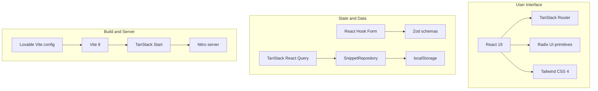
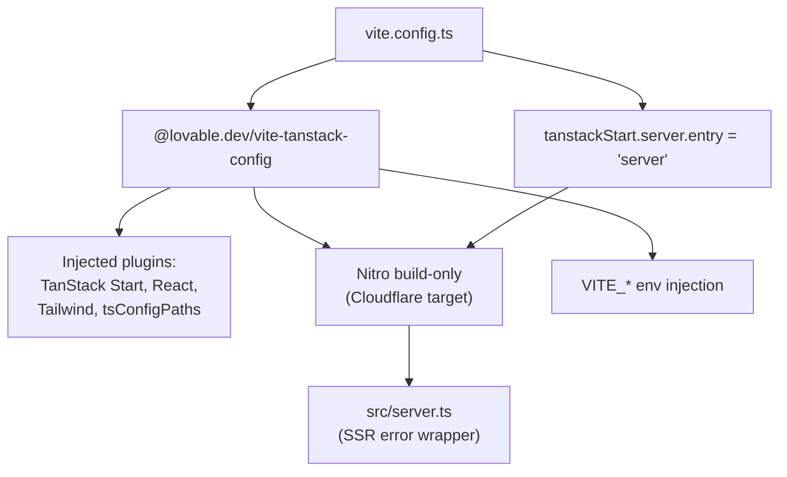
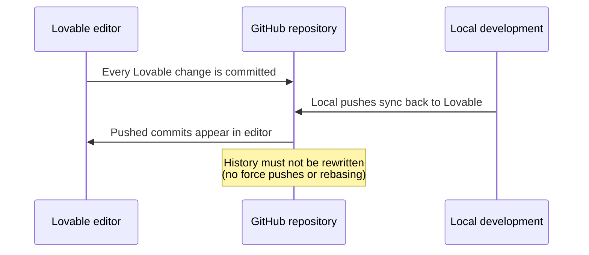
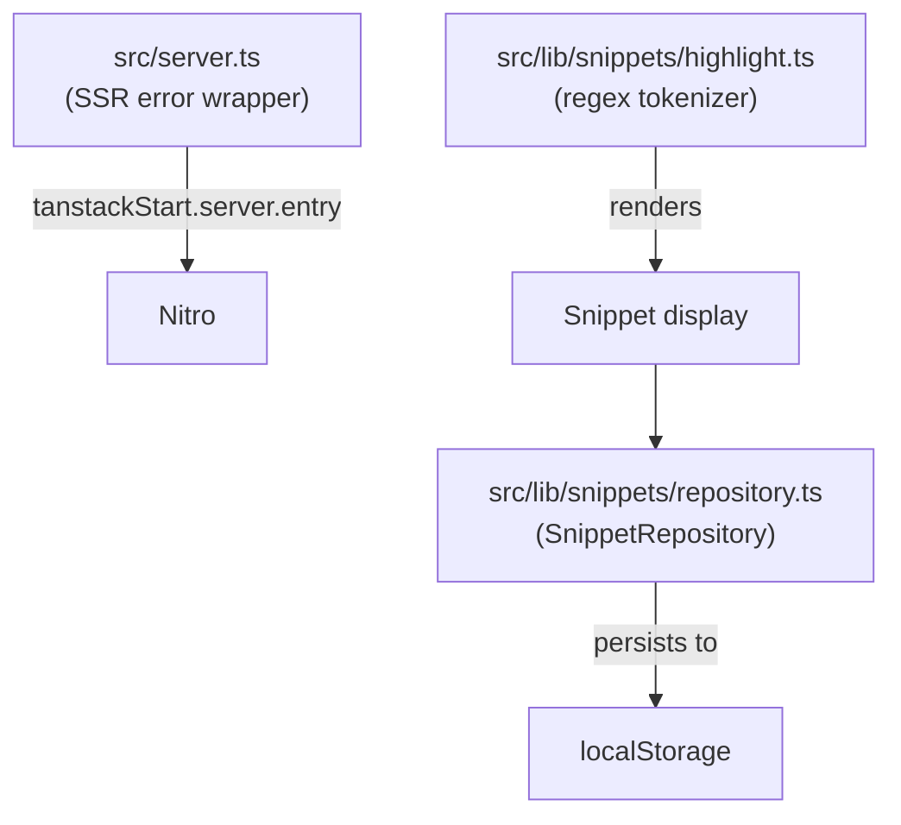

# CodeKnit project architecture and technology stack

CodeKnit is a snippet manager application built on **TanStack Start**, **TypeScript**, and **React**. This guide explains the high-level architecture, technology stack, build system, and the key design decisions that shape the project.

The project is generated and managed through **Lovable**, with local development supported via the standard Vite toolchain. CodeKnit is architecturally a client-side snippet manager: snippet data lives in `localStorage` behind a repository abstraction, with no persistent server database. TanStack Start provides the React application shell and development/build infrastructure through its Vite integration.

## Technology stack at a glance

The following table summarizes the core technologies, drawn from `package.json`:

| Layer                  | Technology                                   | Version         | Purpose                                                        |
| ---------------------- | -------------------------------------------- | --------------- | -------------------------------------------------------------- |
| Application framework  | `@tanstack/react-start`                      | 1.168.60        | TanStack Start server-rendered React application shell         |
| Router                 | `@tanstack/react-router`                     | 1.170.41        | File-based routing for the application                         |
| UI runtime             | `react`, `react-dom`                         | 19.2.0           | UI component model                                             |
| Language               | `typescript`                                 | 5.8.3           | Static typing across the codebase                              |
| Styling                | `tailwindcss` / `@tailwindcss/vite`          | 4.2.1            | Utility-first CSS, integrated through the Vite plugin          |
| Build tool             | `vite`                                       | 8.1.5           | Dev server and production bundler                               |
| Server runtime         | `nitro`                                      | 3.0.260603-beta | Server runtime bundled by TanStack Start for SSR               |
| Server state           | `@tanstack/react-query`                      | 5.101.1         | Asynchronous state management                                  |
| Forms and validation   | `react-hook-form`, `zod`, `@hookform/resolvers` | 7.71.2 / 3.25.76 | Form state and schema validation                              |
| UI primitives          | Radix UI packages                            | various         | Accessible headless components (dialog, dropdown, tabs.) |
| Icons                  | `lucide-react`                               | 0.575.0         | Icon set                                                        |
| Testing                | `vitest`, `jsdom`, Testing Library           | 4.1.10 / 20.0.3  | Unit and component testing                                      |

Figure: CodeKnit technology stack by layer



The dependency set is intentionally broad because the project was scaffolded from a Lovable template that includes common UI building blocks. The core CodeKnit-specific code, however, focuses on a narrow path: snippet state, persistence, and syntax highlighting.

## Application architecture

CodeKnit follows a layered architecture with clear separation between UI components, application state, and data persistence. The most important architectural decision is the **repository pattern** that isolates persistence from presentation.

### Repository pattern and data flow

`AGENTS.md` records the key architectural rule for working with snippet data:

> Snippet data goes through `SnippetRepository` (`src/lib/snippets/repository.ts`), currently `localStorage`; swap the implementation for an API/database without touching UI components.

This means UI components and hooks never interact with `localStorage` directly. They call methods on the repository abstraction. The current implementation is localStorage-backed, but a future API-backed implementation could replace it without requiring changes to the consuming UI layer.

Figure: Snippet data flow through the repository abstraction

```mermaid
graph LR
    UI["UI components<br/>and hooks"] --> Repo["SnippetRepository<br/>("src/lib/snippets/repository.ts")"]
    Repo --> Local["localStorage<br/>implementation"]
    Future["Future API/database<br/>implementation"] -. swap-in .-> Repo
```

This design pattern has three practical benefits for the project:

- **Persistence is swappable.** Moving from browser storage to a backend API only requires a new repository implementation.
- **Components stay simple.** UI code operates against a stable interface, not against storage mechanics.
- **Testing is cleaner.** A mock repository can be substituted for unit tests without touching `localStorage` or mocking browser APIs.

### Syntax highlighting design

Snippet highlighting is handled by a small, custom tokenizer rather than a third-party library. `AGENTS.md` states:

> Syntax highlighting is a small in-house regex tokenizer (`src/lib/snippets/highlight.ts`), no Prism dependency, keeps SQL/Markdown support simple.

The project chose to avoid adding Prism or another highlighting dependency. Instead, the tokenizer is a focused regex-based implementation that supports the languages CodeKnit targets, notably SQL and Markdown. This keeps the bundle smaller and the highlighting logic fully controlled by the project.

For a deep dive into the tokenizer design, token types, and supported languages, see [Syntax Highlighting System: In-House Tokenizer Design and Language Support](doc:db2c8782-a2ae-438d-977e-ab175069baec). The persistence layer is covered in detail in [Data Persistence Layer: SnippetRepository Pattern and localStorage Implementation](doc:34778b37-21c0-4087-91f0-c28fecb57477).

## Build system: Vite, TanStack start, and lovable

The build configuration is intentionally minimal because most of the tooling is centralized in the Lovable-managed Vite config.

### Centralized vite configuration

`vite.config.ts` imports `defineConfig` from `@lovable.dev/vite-tanstack-config` and adds only one custom option:

```ts
import { defineConfig } from "@lovable.dev/vite-tanstack-config";

export default defineConfig({
  tanstackStart: {
    // Redirect TanStack Start's bundled server entry to src/server.ts
    // (our SSR error wrapper). nitro/vite builds from this.
    server: { entry: "server" },
  },
});
```

The comment in `vite.config.ts` explains that the Lovable package already injects the entire TanStack/Vite/Tailwind pipeline. Developers must not add these plugins manually:

> `@lovable.dev/vite-tanstack-config` already includes the following, do NOT add them manually or the app will break with duplicate plugins:
> - TanStack devtools (dev-only, first), `tanstackStart`, `viteReact`, `tailwindcss`, `tsConfigPaths`
> - `nitro` (build-only using `cloudflare` as a default target)
> - `VITE_*` env injection
> - `@` path alias
> - React/TanStack dedupe
> - error logger plugins
> - sandbox detection (`port`/`host`/`strictPort`)

The only project-specific configuration is redirecting the server entry to `src/server.ts`, which is described in the repository as an SSR error wrapper. This single override is what allows the project to customize server behavior without duplicating the rest of the pipeline.

Figure: Build pipeline configuration flow



### Available scripts

The `package.json` `scripts` block defines the commands for development, build, linting, formatting, and testing:

| Command                  | Script                              | Purpose                                              |
| ------------------------ | ----------------------------------- | ---------------------------------------------------- |
| Start dev server         | `npm run dev`                       | Runs `vite dev`                                      |
| Production build         | `npm run build`                     | Runs `vite build`                                    |
| Development build        | `npm run build:dev`                 | Runs `vite build --mode development`                 |
| Preview production build | `npm run preview`                   | Runs `vite preview`                                  |
| Lint                     | `npm run lint`                      | Runs `eslint .`                                      |
| Format                   | `npm run format`                    | Runs `prettier --write .`                            |
| Run tests once           | `npm run test`                      | Runs `vitest run`                                    |
| Watch mode for tests     | `npm run test:watch`                | Runs `vitest`                                        |

The build system leans on standard Vite commands. TanStack Start, Nitro, and Tailwind are all integrated through Vite plugins rather than standalone CLIs, which is why there are no separate start or Tailwind build scripts.

### Nitro as the server runtime

TanStack Start bundles applications through **Nitro**, which provides a portable server runtime. The `nitro` dev dependency at version `3.0.260603-beta` is the underlying server infrastructure. Per the Lovable config comments, the build targets `cloudflare` by default, but the actual output is determined by the injected build configuration rather than by any code in the repository.

`src/server.ts` serves as the SSR error wrapper. The configuration explicitly routes the bundled server entry to this file through the `tanstackStart.server.entry` option, which means Nitro builds from this custom entry point instead of TanStack Start's default server bundle.

### Important override: Rolldown

`package.json` includes an `overrides` block that pins `rolldown` to version `1.2.1`:

```json
"overrides": {
  "rolldown": "1.2.1"
}
```

This override exists to lock the rolldown bundler (used by the Vite/TanStack toolchain) to a compatible version. Any upgrade or dependency change that removes this override should be tested against the full build.

## Lovable integration

CodeKnit is connected to the **Lovable** editor as its primary authoring environment. `README.md` explains the workflow:

- **Ship faster**: describe what to build in the Lovable editor, and Lovable generates the code.
- **Stay in sync**: connecting the project to GitHub means every Lovable change is committed directly to the repository.
- **Full ownership**: the repository code is entirely owned by the user, and changes pushed from local development sync back into Lovable.

The `AGENTS.md` file carries an important constraint for contributors working in this Lovable-managed repository:

> [!IMPORTANT]
> This project is connected to Lovable. Avoid rewriting published git history, force pushing, or rebasing/amending/squashing commits that are already pushed, as it rewrites history on Lovable's side and the user will likely lose their project history.
>
> Commits you push to the connected branch sync back to Lovable and show up in the editor, so keep the branch in a working state.

Figure: Lovable-to-repository synchronization flow



## Code organization by concern

The source files referenced in `AGENTS.md` and `vite.config.ts` establish a `src/lib/snippets/` module area dedicated to snippet domain logic. The confirmed file paths are:

| Path                              | Responsibility                                    |
| --------------------------------- | ------------------------------------------------- |
| `src/lib/snippets/repository.ts`  | Snippet persistence abstraction (localStorage)    |
| `src/lib/snippets/highlight.ts`   | In-house regex-based syntax highlighting tokenizer |
| `src/server.ts`                   | SSR error wrapper, used as the Nitro entry point  |

The full component tree, hook structure, and route layout are not documented in the pre-fetched files, so this overview limits file-level claims to these verified paths. The architecture can, however, be inferred at a higher level from the dependency set: routes are managed by TanStack Router, server state by React Query, forms by React Hook Form with Zod validation, and UI composition by React with Radix and Tailwind.

Figure: Confirmed CodeKnit module relationships



## Key design decisions

The design decisions that most affect how contributors work with CodeKnit are:

1. **Repository pattern as the persistence boundary.** Snippet data flows only through `SnippetRepository`. This is the most important architectural rule, because it makes the entire backend replaceable without a UI refactor.

2. **No third-party syntax highlighting library.** The in-house tokenizer keeps highlighting lightweight and focused on the snippets CodeKnit actually manages (SQL, Markdown), at the cost of not supporting every language a mature library like Prism would.

3. **Centralized Lovable toolchain.** The build, dev server, Tailwind, Nitro, environment injection, and devtools are all configured centrally by `@lovable.dev/vite-tanstack-config`. Contributors should add project-specific Vite config only through the `defineConfig` options, not by installing or registering duplicate plugins.

4. **localStorage as the current runtime persistence.** The data survives only in the browser and is not shared across devices or sessions unless the browser retains it. The repository abstraction is the explicit seam for changing this later.

## Development workflow

To run the project locally:

1. Install Node.js and npm, for example with nvm.
2. Clone the repository and navigate into its directory.
3. Run `npm i` to install dependencies.
4. Run `npm run dev` to start the Vite dev server.

For a product-level introduction and first-run guidance, see [CodeKnit at a Glance](doc:b3df12da-fa68-4b4a-b3a7-3e00676bcf75) and [CodeKnit Quick Start Guide](doc:41505f41-83d3-4d30-a339-3621e671d025). The full local environment setup is described in [Setting Up CodeKnit for Local Development](doc:c0ebfbd6-9278-4326-a87a-bde159a8a795) and [Setting Up CodeKnit Development Environment](doc:4250b87f-66ca-457d-9f4c-995cbfb65108).

## Testing and quality tooling

Testing is built on **Vitest** with a `jsdom` environment, supported by Testing Library packages:

- `vitest` at `4.1.10`, invoked with `npm run test` (`vitest run`) or `npm run test:watch` (`vitest`)
- `jsdom` at `20.0.3` for DOM simulation in unit tests
- `@testing-library/react` at `16.0.0` and `@testing-library/jest-dom` at `6.6.0`

Code quality is enforced through **ESLint** (`eslint` at `9.32.0`, plus the TypeScript ESLint, React Hooks, and React Refresh plugins) and **Prettier** (`prettier` at `3.7.3`). The `lint` script runs `eslint .`, and `format` runs `prettier --write .` across the project.

For test strategies and examples, see [Unit Testing Strategy: Vitest, jsdom, and Test Examples](doc:79ef8d7b-27d7-41ff-b361-9721a150f157). For code style guidance, see [Contributing to CodeKnit: Code Standards and GitHub Workflow](doc:8ec33934-0dfd-429e-88a1-89fbed259d51) and [Contributing Guide for CodeKnit](doc:54c5e42e-e273-4dda-b615-36127efe39d4).

## Troubleshooting

Startup and build issues are covered in [Troubleshooting and Debugging](doc:1b203822-fd22-4fd1-ba44-1c369f176899). Common concerns specific to the architecture:

- **Duplicate plugin errors**: If you add a plugin such as Tailwind, TanStack Start, React, Nitro, or `vite-tsconfig-paths` manually to `vite.config.ts`, it will conflict with the Lovable-injected plugins. Keep custom configuration limited to the `defineConfig` options as shown in the existing `vite.config.ts`.
- **Rolldown version mismatch**: The `rolldown` override pins a specific compatible version. If you add a dependency that pulls in a different rolldown version, check `npm ls rolldown` to confirm the override is still effective.
- **Lovable and Git history**: Never rewrite history on a Lovable-connected branch. Force pushes, rebases, amends, and squashes of already-pushed commits can cause loss of project history in the Lovable editor.