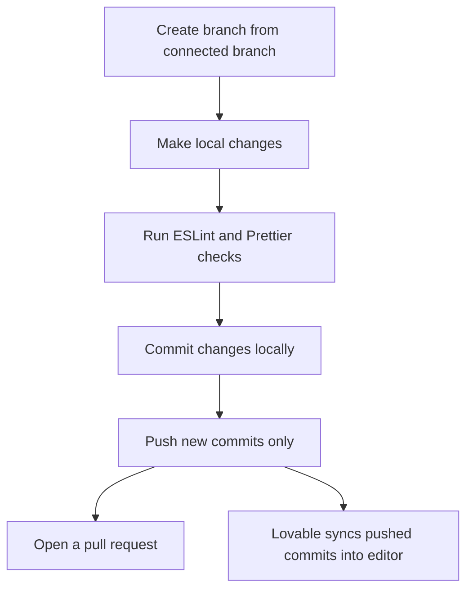

# Contributing guide for CodeKnit

CodeKnit contributions follow the lint and formatting rules in `eslint.config.js` and the history constraints in `AGENTS.md`. This guide covers the code standards, Prettier integration, Git workflow, and architecture boundaries that help you keep the project healthy.

## Before you start

Set up CodeKnit locally before making changes. For environment setup, see [Setting Up CodeKnit for Local Development](doc:c0ebfbd6-9278-4326-a87a-bde159a8a795). For project context, see [CodeKnit Project Architecture and Technology Stack](doc:95102f25-859a-4a05-98f5-7919e6f0235f).

## ESLint configuration

CodeKnit uses a flat ESLint config in `eslint.config.js`. The config is created with `tseslint.config` and targets TypeScript and TSX files.

| Setting | Value |
| --- | --- |
| Target files | `**/*.{ts,tsx}` |
| Ignored directories | `dist`, `.output`, `.vinxi` |
| ECMAScript version | 2020 |
| Browser globals | `globals.browser` |

The config includes:

- `js.configs.recommended`
- `...tseslint.configs.recommended`
- React Hooks recommended rules from `eslint-plugin-react-hooks`
- React Refresh rules from `eslint-plugin-react-refresh`
- Prettier recommended rules from `eslint-plugin-prettier/recommended`
- A custom `no-restricted-imports` rule

Because `eslintPluginPrettier` is added as the final config entry, Prettier formatting violations are reported as ESLint errors.

### Restricted imports

CodeKnit explicitly blocks the Next.js `server-only` package. TanStack Start uses its own server-only convention.

```js
"no-restricted-imports": [
  "error",
  {
    paths: [
      {
        name: "server-only",
        message:
          "TanStack Start does not use the Next.js `server-only` package. Rename the module to `*.server.ts` or mark it with `@tanstack/react-start/server-only`.",
      },
    ],
  },
],
```

Instead of importing `server-only`, rename server modules to `*.server.ts` or use `@tanstack/react-start/server-only`.

### React-specific rules

The config enables these React rules:

- React Hooks recommended rules from `eslint-plugin-react-hooks`
- `react-refresh/only-export-components` as a warning, with `allowConstantExport: true`

The TypeScript ESLint unused variables rule is disabled:

```js
"@typescript-eslint/no-unused-vars": "off",
```

Do not rely on ESLint to flag unused variables through `@typescript-eslint/no-unused-vars`.

## Prettier integration

Prettier is wired into ESLint through:

```js
import eslintPluginPrettier from "eslint-plugin-prettier/recommended";
```

The config appends `eslintPluginPrettier` at the end. No separate Prettier configuration file appears in the provided source files, so formatting is controlled through the recommended Prettier plugin.

Run ESLint from the repository root to check both lint and Prettier rules:

```bash
npx eslint .
```

To auto-fix lint and formatting issues where possible:

```bash
npx eslint . --fix
```

## Lovable history constraints

CodeKnit is connected to Lovable, so Git history is shared with the editor. The `AGENTS.md` file contains this critical rule:

> [!IMPORTANT]
> Avoid rewriting published Git history. Do not force push, rebase, amend, or squash commits that are already pushed. Commits you push to the connected branch sync back to Lovable and appear in the editor.

Keep the connected branch in a working state because pushed commits appear in the Lovable editor.

Figure: Safe contribution flow with Lovable



## Pull request workflow

1. Create a branch from the connected branch.
2. Make your changes and keep the branch in a working state.
3. Run `npx eslint .` to check lint and formatting.
4. Commit your changes with a clear, descriptive message.
5. Push new commits only. Never force push, rebase, amend, or squash pushed history.
6. Open a pull request for review.

## Maintain architecture boundaries

`AGENTS.md` defines two boundaries that matter for contributions:

- Snippet data flows through `SnippetRepository` in `src/lib/snippets/repository.ts`. The current implementation uses `localStorage`, but you can swap the implementation for an API or database without changing UI components. For more details, see [Data Persistence Layer: SnippetRepository Pattern and localStorage Implementation](doc:34778b37-21c0-4087-91f0-c28fecb57477).
- Syntax highlighting uses the in-house regex tokenizer in `src/lib/snippets/highlight.ts`. There is no Prism dependency, and the tokenizer keeps SQL and Markdown support simple. For more details, see [Syntax Highlighting System: In-House Tokenizer Design and Language Support](doc:db2c8782-a2ae-438d-977e-ab175069baec).

Keep UI components decoupled from storage and tokenizer details.

## Pre-submit checklist

- [ ] `npx eslint .` passes.
- [ ] You did not import `server-only`.
- [ ] React refresh export warnings are addressed when relevant.
- [ ] Snippet data changes go through `SnippetRepository`.
- [ ] No force push, rebase, amend, or squash of pushed commits.
- [ ] Pushed commits keep the connected branch in a working state.