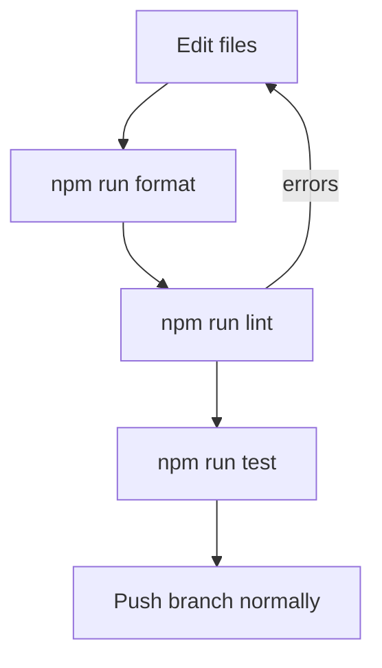
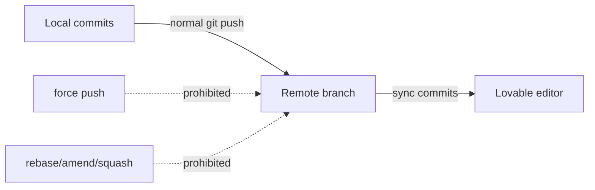

# Contributing to CodeKnit: Code standards and GitHub workflow

Use this guide to keep contributions compatible with CodeKnit's tooling and the Lovable sync constraint. It documents the commands in `package.json`, the rules in `eslint.config.js`, and the git history constraints in `AGENTS.md`.

> [!NOTE]
> The provided source files do not define a pull request template, a commit message hook, or an enforced branch naming policy. Steps marked as recommended are safe defaults around the enforced Lovable constraint.

## Code quality commands

Run these commands from the repository root.

| Command | Script | Purpose |
| --- | --- | --- |
| `npm run lint` | `eslint .` | Run ESLint across the project, including the Prettier integration |
| `npm run format` | `prettier --write .` | Format files with Prettier and write the changes |
| `npm run test` | `vitest run` | Run the Vitest test suite once |
| `npm run test:watch` | `vitest` | Run tests in watch mode |
| `npm run build` | `vite build` | Create a production build |

The expected local quality gate is format, lint, and test before pushing:

Figure: Code quality gate before pushing a branch



Run `npm run test` when your change touches tested behavior. Lint and format are always expected because the ESLint configuration includes Prettier.

## ESLint configuration

Code style is enforced through `eslint.config.js`, a flat ESLint configuration. The key settings are:

- JavaScript and TypeScript recommended rules from `@eslint/js` and `typescript-eslint` apply to `**/*.{ts,tsx}`.
- Browser globals are enabled, with `ecmaVersion: 2020`.
- `dist`, `.output`, and `.vinxi` are ignored.
- Recommended `react-hooks` rules are enabled.
- Prettier is integrated through `eslint-plugin-prettier/recommended`, so formatting differences are reported during lint.

```js
rules: {
  ...reactHooks.configs.recommended.rules,
  "no-restricted-imports": [
    "error",
    {
      paths: [
        {
          name: "server-only",
          message:
            "TanStack Start does not use the Next.js `server-only` package. Rename the module to `*.server.ts` or mark it with `@tanstack/react-start/server-only`.",
        },
      ],
    },
  ],
  "react-refresh/only-export-components": ["warn", { allowConstantExport: true }],
  "@typescript-eslint/no-unused-vars": "off",
}
```

### Rules to know before you start

- Do not import Next.js `server-only`. Use a `*.server.ts` file or the TanStack Start server-only marker instead.
- `react-refresh/only-export-components` is a warning, not an error.
- `@typescript-eslint/no-unused-vars` is intentionally turned off.

## GitHub workflow and the lovable sync constraint

The repository is connected to Lovable. `AGENTS.md` defines the only hard git-history rule for this repository:

> [!WARNING]
> Do not force push, rebase, amend, or squash commits that are already pushed. Rewriting history on a Lovable-connected branch can erase project history in the Lovable editor.

Pushes to the connected branch sync back to Lovable and appear in the editor. Keep the branch in a working state.

Figure: Safe branch sync under the Lovable constraint



### Recommended branch workflow

1. Create a branch for your work.
2. Edit files and run the quality gate.
3. Commit your changes.
4. Push with `git push`, never `git push --force`.
5. Open a pull request from your branch to the connected branch.
6. If you need to change a pushed commit, create a new commit instead of amending, rebasing, or squashing.

The provided files do not name the connected branch, so treat your project's configured Lovable branch as the branch that must never have its history rewritten.

## Pull request process

The repository does not include a pull request template or a required checklist in the provided files. Use this recommended checklist when opening a pull request:

1. Run `npm run format`.
2. Run `npm run lint`.
3. Run `npm run test` if your change touches tested behavior.
4. Remove any accidental `server-only` imports.
5. Verify the branch remains in a working state before and after push, because commits sync back to Lovable.
6. Describe the change and any manual verification steps in the pull request body.

## Commit message standards

The repository does not include a commit message hook or `commitlint` configuration in `package.json`. Commit messages are not enforced by tooling. Use Conventional Commits as a safe default:

```text
<type>(<scope>): <description>
```

Where `type` is `feat`, `fix`, `docs`, `refactor`, `test`, or `chore`, and `description` is in imperative, present tense. For example:

```text
feat(snippets): add repository stub for API-backed storage
```

Because the repository is Lovable-connected, never amend or reword a commit that has already been pushed. If you need to correct a message or content after pushing, create a new commit instead.

## Architecture rules for contributors

`AGENTS.md` records two design decisions you must preserve when contributing:

- Snippet data flows through `SnippetRepository` (`src/lib/snippets/repository.ts`). It is currently backed by `localStorage`; an API or database implementation must be swapable without modifying UI components.
- Syntax highlighting uses the small in-house regex tokenizer at `src/lib/snippets/highlight.ts`. Do not add a Prism dependency; the current design keeps SQL and Markdown support simple.

These constraints keep the persistence and highlighting layers isolated, so contributions should avoid importing data-layer or tokenizer details directly into UI components.

## Related

- [Setting Up CodeKnit Development Environment](doc:4250b87f-66ca-457d-9f4c-995cbfb65108)
- [Unit Testing Strategy: Vitest, jsdom, and Test Examples](doc:79ef8d7b-27d7-41ff-b361-9721a150f157)
- [CodeKnit Project Architecture and Technology Stack](doc:95102f25-859a-4a05-98f5-7919e6f0235f)