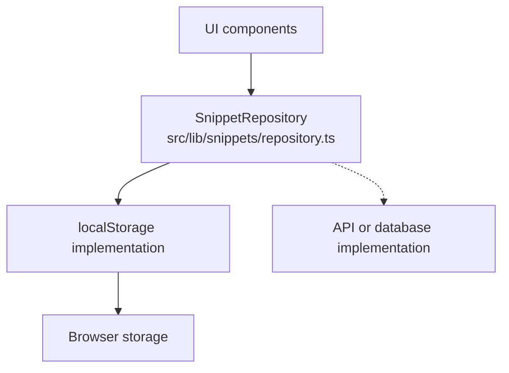
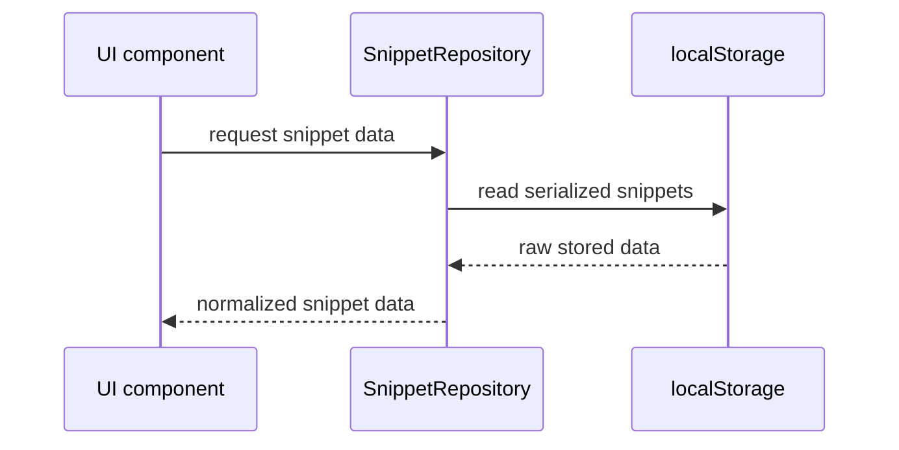
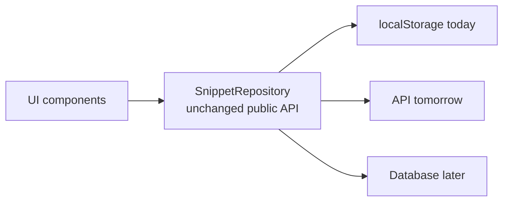

# Data persistence layer: SnippetRepository pattern and localStorage implementation

CodeKnit isolates UI components from storage details by routing all snippet data access through `SnippetRepository`. The repository is the single persistence boundary in the codebase.

## Architecture decision

The project-level guidance in `AGENTS.md` defines the architectural rule:

> Snippet data goes through `SnippetRepository` (`src/lib/snippets/repository.ts`), currently localStorage; swap the implementation for an API/database without touching UI components.

This means components never read from or write to `localStorage` directly. They call the repository, and the repository decides how to persist data.

Figure: SnippetRepository as the persistence boundary

### What this buys you

- **Swap-friendly persistence**, a future API or database implementation can replace the localStorage body without changing UI code.
- **One place to manage storage**, serialization, key names, and storage reads stay inside the repository.
- **Easier testing**, the repository surface can be tested independently from React components.
- **Less coupling**, UI state and persistence concerns remain separate.

## Runtime data flow

The repository is the only path from the UI layer to persisted snippet data.

Figure: Read path through the repository

Write, update, and delete operations follow the same direction: the UI invokes the repository, and the repository handles the storage side.

## Implementation rules

- Keep all direct `localStorage` access inside `src/lib/snippets/repository.ts`.
- Do not call `localStorage` from UI components such as `AppLayout`.
- When you need snippet data, import from the repository module rather than reading browser storage yourself.

> [!NOTE]
> The provided `AGENTS.md` source identifies the repository path and current backend, but does not list the repository's exported method signatures. Use `src/lib/snippets/repository.ts` as the authoritative source for the exact API names, parameters, and return types.

## Swapping to an API or database

The architecture is designed so the swap happens behind the repository boundary, not in the UI.

1. Open `src/lib/snippets/repository.ts`.
2. Keep the repository's public exported functions unchanged: same names, same parameters, and same return shapes.
3. Replace the localStorage implementation inside each function with API calls or database queries.
4. Return the same data shape the UI already consumes.
5. Verify the UI still imports only from `src/lib/snippets/repository.ts`.
6. Test create, read, update, and delete flows from the existing UI without changing UI components.

Figure: Swapping storage backends without changing UI components

> [!WARNING]
> Adding `localStorage` calls directly inside UI components bypasses the repository boundary and prevents the planned backend swap.

## Related pages

- [CodeKnit: High-Level Architecture and Key Components](doc:340f5bee-cd7e-4946-98d5-67f804ecdd26)
- [Local Data Storage and Persistence](doc:8ac3e7b1-9b83-4aed-9705-427ba72c7c1e)
- [Application Architecture Overview](doc:e1230eab-e95d-4cb0-afd5-54eb455d7b67)
- [AppLayout Component: Main Application State and CRUD Operations](doc:31e17a28-3f9f-40e4-9d13-8cebe8e9836b)