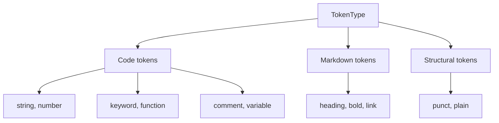
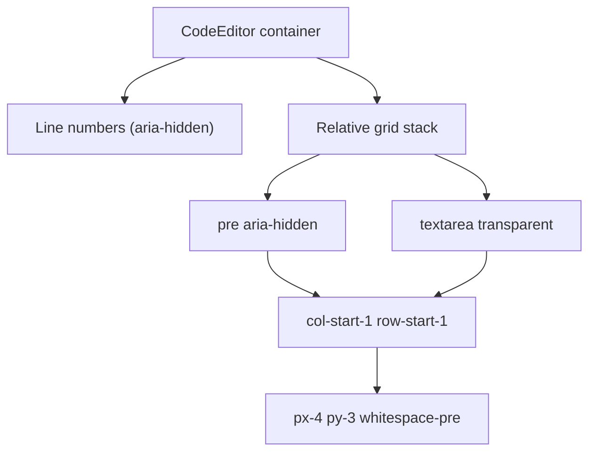
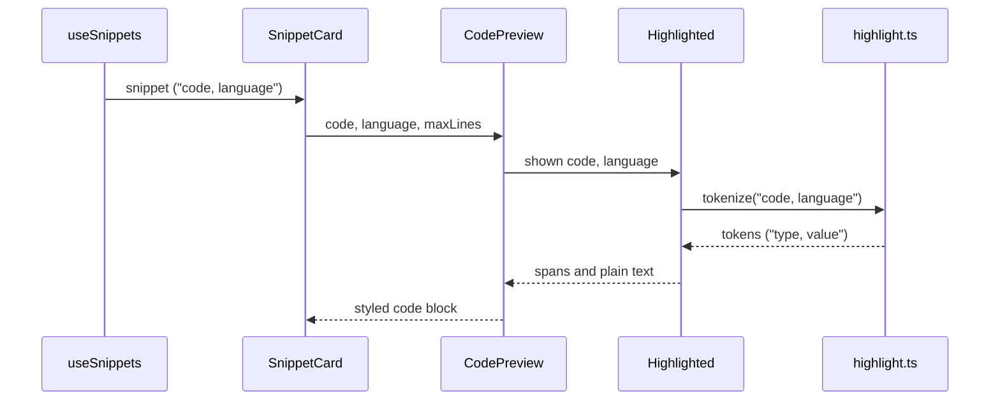
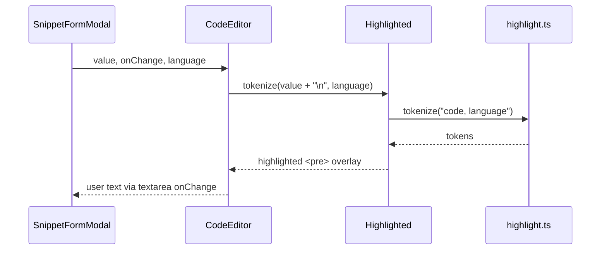

# In-House syntax highlighting tokenizer architecture

## Overview

CodeKnit renders syntax highlighting through a small, dependency-free regex tokenizer at `src/lib/snippets/highlight.ts`. The `package.json` manifest lists no syntax highlighting library, no Prism, highlight.js, Shiki, or `react-syntax-highlighter`, confirming that highlighting is implemented entirely in-house.

The tokenizer converts a source string and a `Language` into an array of typed tokens. Two UI components consume those tokens:

- `CodePreview` (`src/components/CodePreview.tsx`) for read-only snippet cards and the detail viewer
- `CodeEditor` (`src/components/CodeEditor.tsx`) for the snippet form's live-editing overlay

The goal is to keep rendering predictable and lightweight across the four supported languages: JavaScript, Python, SQL, and Markdown.

> [!NOTE]
> The prefetched source context did not include the implementation body of `src/lib/snippets/highlight.ts`. The contract below is verified from the importing components and the package manifest. Regex rule details inside the tokenizer are not reproduced here.

## Public contract

The tokenizer exports two pieces used by `CodePreview.tsx`:

```ts
import { tokenize, type TokenType } from "@/lib/snippets/highlight";
```

`tokenize` has the shape:

```ts
tokenize(code: string, language: Language): Array<{ type: TokenType; value: string }>
```

The return element shape is verified by how `Highlighted` reads each token:

```tsx
tokens.map((t, i) =>
  t.type === "plain" ? t.value : <span key={i} className={CLASS[t.type]}>{t.value}</span>,
)
```

`Language` comes from `@/lib/snippets/types` and is the same type used by the form, filter bar, and sidebar language lists.

## Token type catalog

`CodePreview.tsx` defines a complete `CLASS` record mapping every `TokenType` member to its Tailwind classes. This record is the verified enumeration of the token vocabulary:

```ts
const CLASS: Record<TokenType, string> = {
  comment: "text-syn-comment italic",
  string: "text-syn-string",
  keyword: "text-syn-keyword",
  function: "text-syn-function",
  number: "text-syn-number",
  variable: "text-syn-variable",
  heading: "text-syn-heading font-semibold",
  bold: "text-foreground font-semibold",
  link: "text-syn-function underline",
  punct: "text-muted-foreground",
  plain: "",
};
```

The 11 types split into three families:

Figure: Token type families



- `heading`, `bold`, and `link` are Markdown-specific and only occur for `Markdown` snippets.
- `string`, `keyword`, `number`, and `variable` serve the code languages.
- `comment`, `function`, `punct`, and `plain` are shared or structural.
- `plain` gets no wrapper element in `Highlighted`; its raw text is emitted directly.

## Supported languages

`LanguageBadge.tsx` pins the `Language` union to four values through `LANG_DOT`:

```ts
export const LANG_DOT: Record<Language, string> = {
  JavaScript: "bg-syn-number",
  Python: "bg-syn-function",
  SQL: "bg-syn-string",
  Markdown: "bg-syn-keyword",
};
```

The same four values are iterated as `LANGUAGES` in `AppSidebar.tsx`, `SearchFilterBar.tsx`, and `SnippetFormModal.tsx`. The `language` parameter drives language-specific behavior inside `tokenize`.

Figure: Language routing into the tokenizer

```mermaid
graph TD
    tokenize["tokenize("code, language")"] --> JS["JavaScript"]
    tokenize --> PY["Python"]
    tokenize --> SQ["SQL"]
    tokenize --> MD["Markdown"]
```

The editor's placeholder confirms JavaScript syntax conventions: `"// Paste or write your code here"`.

## Rendering pipeline

`Highlighted` is the memoization boundary. The full source string is tokenized only when `code` or `language` changes:

```tsx
const tokens = useMemo(() => tokenize(code, language), [code, language]);
```

Figure: Tokenizer pipeline from source to DOM

```mermaid
graph LR
    Source["Source code string"] --> Tokenize["tokenize("code, language")"]
    Tokenize --> Tokens["Token array ("type, value")"]
    Tokens --> Render["Highlighted component"]
    Render --> Spans["span elements per token"]
    Spans --> CSS["text-syn-* palette"]
```

The render function emits plain text for `plain` tokens and a styled `<span>` for every other token type using `CLASS[t.type]`. Consumers never interact with raw regex matches.

## CodePreview integration

`CodePreview` is the read-only surface. It is used by:

- `SnippetCard` (`src/components/SnippetCard.tsx`) with `maxLines={list ? 6 : 8}`
- `SnippetDetailViewer` (`src/components/SnippetDetailViewer.tsx`) with a max-height wrapper for focused viewing

`CodePreview` splits the source into lines and manages:

- Optional line numbers through `showLineNumbers` (default `true`)
- Truncation through `maxLines` with a `+N more lines` gradient overlay
- Horizontal scrolling via `overflow-x-auto`
- Shared monospace framing with `font-mono text-[12.5px] leading-6` and `bg-code-bg`

The highlighted content is wrapped in `<pre><code>` for semantic correctness:

```tsx
<pre className="flex-1 whitespace-pre px-4 py-3 text-foreground/90"><code><Highlighted code={shown} language={language} /></code></pre>
```

## CodeEditor overlay

`CodeEditor` is the editing surface inside `SnippetFormModal`. Instead of `contentEditable`, it renders a transparent `<textarea>` over a highlighted `<pre>` that shares the same grid cell.

Figure: CodeEditor overlay stack



The key overlay mechanics:

- Both layers sit in the same grid cell with `col-start-1 row-start-1`.
- Both use identical padding `px-4 py-3` and `whitespace-pre`, so characters stay aligned.
- The textarea is visually transparent: `bg-transparent text-transparent caret-foreground`.
- The caret and selection remain visible via `caret-foreground` and `selection:bg-primary/30`.
- The `<pre>` is `aria-hidden`, so assistive technology reads only the textarea, not duplicated rendered text.

The textarea passes `value + "\n"` to the highlight layer:

```tsx
<Highlighted code={value + "\n"} language={language} />
```

The trailing newline keeps the highlight output aligned with the line-number gutter, whose count is derived separately as `Math.max(value.split("\n").length, 8)`.

The textarea also handles Tab-to-indent locally:

```tsx
if (e.key === "Tab" && !e.shiftKey) {
  e.preventDefault();
  const el = e.currentTarget;
  const { selectionStart: s, selectionEnd: end } = el;
  onChange(value.slice(0, s) + "  " + value.slice(end));
  requestAnimationFrame(() => {
    el.selectionStart = el.selectionEnd = s + 2;
  });
}
```

Two spaces are inserted, and the caret is restored after React re-renders the controlled value.

## Styling contract

The token classes reference a dedicated syntax palette:

- `text-syn-comment`
- `text-syn-string`
- `text-syn-keyword`
- `text-syn-function`
- `text-syn-number`
- `text-syn-variable`
- `text-syn-heading`
- `bg-code-bg` for the editor and preview background

The same palette also drives non-highlighting UI: `LanguageBadge` reuses syntax color tokens for each language's status dot. For example, `JavaScript: "bg-syn-number"` and `SQL: "bg-syn-string"`. The visual identity of a language is therefore tied to the tokenizer palette rather than to a separate language color map.

## Design decisions and trade-offs

**Dependency-free by design.** `package.json` contains no highlighting dependency, avoiding bundle cost and version risk from third-party grammars. The trade-off is that grammar coverage is intentionally shallow and tuned to four languages.

**Structured token output.** The tokenizer returns typed tokens rather than HTML strings. This keeps the tokenizer testable and leaves rendering ownership with the UI layer.

**Single memoization point.** `useMemo` in `Highlighted` prevents re-tokenization during keystrokes unless the source or language changes. Larger libraries pay tokenization cost only on content changes, not on every parent re-render.

**Overlay instead of contentEditable.** Delegating editing to a native textarea avoids cursor-management bugs common in rich-text editing. The highlight layer is purely presentational and hidden from assistive technology.

**Small token set.** The 11-token vocabulary is shared across languages. Markdown-specific tokens (`heading`, `bold`, `link`) are simply unused by the code languages, so token classification stays simple and the renderer never needs per-language branching.

## Data flow through the UI

The tokenizer is invoked from two distinct user journeys.

Figure: Snippet rendering flow



Figure: Snippet editing flow



## Integration points

`src/lib/snippets/highlight.ts` is imported only where highlighting is needed:

- `src/components/CodePreview.tsx` imports `tokenize` and `TokenType`
- `src/components/CodeEditor.tsx` imports `Highlighted` from `CodePreview`

No other component touches the tokenizer directly. `SnippetCard`, `SnippetDetailViewer`, and `SnippetFormModal` all route highlighting through `CodePreview` or `CodeEditor`.

## Extending to a new language or token type

The extension surface is localized to two files:

1. Add or adjust the `Language` union in `src/lib/snippets/types.ts` and update `LANGUAGES`. This change flows automatically to `AppSidebar`, `SearchFilterBar`, and `SnippetFormModal`, all of which iterate `LANGUAGES`.
2. Update `LANG_DOT` in `src/components/LanguageBadge.tsx` with a color class for the new language.
3. Add language-specific rules inside `tokenize` in `src/lib/snippets/highlight.ts`.
4. If a new token type is introduced, add its `TokenType` member and a corresponding entry in the `CLASS` record in `src/components/CodePreview.tsx`. Without the `CLASS` entry, TypeScript's `Record<TokenType, string>` contract fails compilation, which acts as a completeness check.

## Testing considerations

The tokenizer's contract is a pure function from `(string, Language)` to `Token[]`, making it well suited for table-driven unit tests. Tests can assert, for example, that a SQL keyword produces a `keyword` token, or that plain text produces `plain`. Existing test infrastructure is covered in [Test Strategy and Coverage Guide](doc:96a2d5ff-0db2-4d85-b234-174bbf729513).

## Related pages

- [Syntax Highlighting System Design](doc:f61a6d46-c460-4460-b318-2258ec30ceca), detailed tokenization pipeline and UI-layer integration
- [Application Architecture Overview](doc:e1230eab-e95d-4cb0-afd5-54eb455d7b67), component hierarchy and data flow
- [Test Strategy and Coverage Guide](doc:96a2d5ff-0db2-4d85-b234-174bbf729513), Vitest coverage and testing approach
- [Utility Functions and Helper APIs](doc:fb85ba27-b6a0-4ce0-bb51-b6333ea652ba), related helper utilities