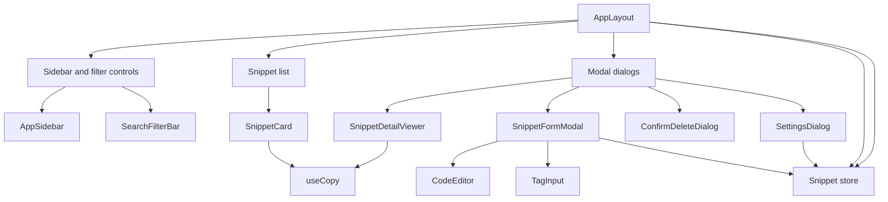
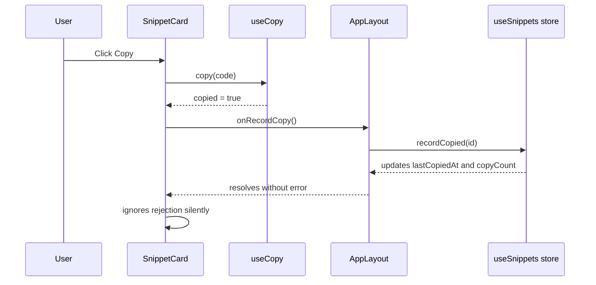
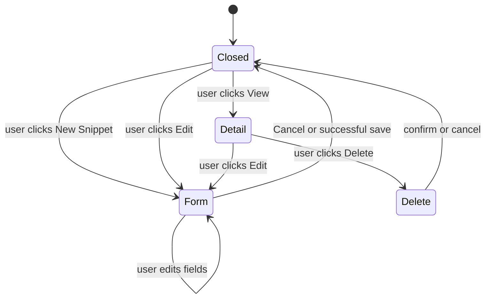

# Key components and internal state management

CodeKnit is a client-side snippet manager built with React and TanStack Start. This page documents the main React components, the state each component owns, and how they communicate through props and custom hooks.

For the overall application architecture, see [Application Architecture Overview](doc:e1230eab-e95d-4cb0-afd5-54eb455d7b67). For the full hook API, see [React Hooks and Custom Hooks API](doc:2366f545-fe28-4695-a91e-94a58c97ec73).

> [!NOTE]
> The implementations of `useSnippets` and `useCopy` are outside the source excerpt used here. Their contracts in this page are derived from the component call sites shown below.

## Component and state ownership map

Figure: Component and data ownership graph



`AppLayout.tsx` acts as the UI orchestrator. It owns the top-level UI state and sends controlled props to the sidebar, filter bar, cards, and dialogs. The `useSnippets` store hook owns the domain snippet data and mutation methods.

## Main components and responsibilities

### `AppLayout.tsx` — the UI orchestrator

`src/components/AppLayout.tsx` is the central component. It reads the snippet domain from `useSnippets`:

```ts
const {
  snippets, status, error, reload,
  create, remove, toggleFavorite, recordCopied,
} = useSnippets();
```

It owns these UI state values:

| State | Type | Purpose |
| --- | --- | --- |
| `section` | `Section` | Current sidebar section: `dashboard`, `all`, `favorites`, `recent`, or `used` |
| `filters` | `SnippetFilters` | Search query, language, category, tag, and sort filters |
| `layout` | `"grid" \| "list"` | Card layout preference, persisted to `localStorage` |
| `formOpen` | `boolean` | Whether `SnippetFormModal` is open |
| `editing` | `Snippet \| null` | Snippet being edited, or `null` for a new snippet |
| `viewingId` | `string \| null` | Snippet shown in `SnippetDetailViewer` |
| `deleting` | `Snippet \| null` | Snippet pending deletion in `ConfirmDeleteDialog`.
| `settingsOpen` | `boolean` | Whether `SettingsDialog` is open |

`AppLayout` also derives several values with `useMemo`:

- `viewing`, the snippet whose `id` matches `viewingId`.
- `categories`, a sorted array of `{ name, count }` built from each snippet's `category`.
- `tags`, a sorted unique list of all tags across snippets.
- `visible`, the filtered list for the current section:

```ts
const f = {
  ...filters,
  favoritesOnly: section === "favorites",
  sort: section === "recent" ? "recent" as const : filters.sort,
};
const r = filterSnippets(snippets, f);
if (section === "recent") return r.slice(0, 10);
if (section === "used") {
  return r
    .filter((s) => Boolean(s.lastCopiedAt))
    .sort((a, b) => (b.lastCopiedAt ?? "").localeCompare(a.lastCopiedAt ?? ""));
}
return r;
```

The `hasActive` flag is `true` when any filter or search differs from the defaults. It controls whether the filter bar shows the **Clear Filters** button and whether `EmptyState` uses the filtered variant.

Layout persistence uses `localStorage` with the key `codeknit.layout`. The initial value is read in a `useEffect` and updated in `changeLayout`:

```ts
const changeLayout = (l: "grid" | "list") => {
  setLayout(l);
  localStorage.setItem("codeknit.layout", l);
};
```

Mutation handlers wrap `useSnippets` methods with toast feedback:

```ts
const fav = (s: Snippet) => toggleFavorite(s.id).catch((e: Error) => toast.error(e.message));

const duplicate = async (s: Snippet) => {
  try {
    const created = await create(buildDuplicateInput(s, snippets.map((item) => item.title)));
    toast.success(`Created "${created.title}"`);
  } catch (e) {
    toast.error((e as Error).message);
  }
};

const confirmDelete = async () => {
  if (!deleting) return;
  try {
    await remove(deleting.id);
    if (viewingId === deleting.id) setViewingId(null);
    toast.success("Snippet deleted");
  } catch (e) {
    toast.error((e as Error).message);
  }
  setDeleting(null);
};
```

`AppLayout` renders the provider hierarchy and passes controlled props to each child. The loading, error, and ready states are handled inline: three `Skeleton` cards during `loading`, an error panel with a **Try again** button during `error`, and either `EmptyState` or the card grid during `ready`.

### `AppSidebar.tsx` — navigation and filters

`src/components/AppSidebar.tsx` receives the current `section`, `language`, `category`, and `categories` from `AppLayout` and renders the navigation.

It uses `useSidebar` from the sidebar primitive to close the mobile drawer after any navigation action:

```ts
const { setOpenMobile } = useSidebar();
const go = (fn: () => void) => () => {
  fn();
  setOpenMobile(false);
};
```

Each navigation item maps to a `Section`:

```ts
const nav = [
  { id: "dashboard" as const, label: "Dashboard", icon: LayoutDashboard },
  { id: "all" as const, label: "All Snippets", icon: Library, count: p.counts.all },
  { id: "favorites" as const, label: "Favorites", icon: Star, count: p.counts.favorites },
  { id: "recent" as const, label: "Recently Added", icon: Clock },
  { id: "used" as const, label: "Recently Used", icon: History, count: p.counts.used },
];
```

Category and language entries are rendered with toggle behavior: clicking an already active item resets the filter to `"all"`:

```tsx
<SidebarMenuButton
  isActive={p.category === c.name}
  onClick={go(() => p.onCategory(p.category === c.name ? "all" : c.name))}
>
```

The footer contains a **New Snippet** button, a static workspace indicator, and a **Settings** button that calls `onSettings`.

### `SnippetCard.tsx` — individual snippet display

`src/components/SnippetCard.tsx` renders one snippet as either a grid card or a horizontal list card, and triggers copy tracking.

It uses the `useCopy` hook for clipboard feedback:

```ts
const { copied, copy } = useCopy();
```

Card actions include:

- View: the whole card is a click target, plus an explicit **View** button.
- Edit, Duplicate, Delete: available from the "More actions" dropdown and routed to callbacks.
- Favorite: an `IconAction` with `aria-pressed` reflecting `s.isFavorite`.
- Copy: the **Copy** button calls `useCopy.copy(s.code)`, and on success calls the `onRecordCopy` callback provided by `AppLayout`.

The copy button stops event propagation and awaits the copy before recording:

```tsx
<Button
  size="sm"
  variant="secondary"
  onClick={async (e) => {
    e.stopPropagation();
    if (await copy(s.code)) {
      onRecordCopy().catch(() => undefined);
    }
  }}
>
  {copied ? <Check /> : <Copy />}
  {copied ? "Copied!" : "Copy"}
</Button>
```

The footer displays the updated timestamp and copy count:

```tsx
{updatedAt !== createdAt ? "Updated " : ""}{formatDate(updatedAt)}
```

### `CodeEditor.tsx` — controlled textarea with syntax overlay

`src/components/CodeEditor.tsx` combines a transparent `<textarea>` layered over a highlighted `<pre>`.

Its props are minimal:

```ts
interface Props {
  id: string;
  value: string;
  onChange: (v: string) => void;
  language: Language;
  invalid?: boolean;
}
```

The component owns a `useRef` to the textarea and computes line numbers from the value:

```ts
const lines = Math.max(value.split("\n").length, 8);
```

The Tab key inserts two spaces instead of moving focus:

```ts
const onKeyDown = (e: KeyboardEvent<HTMLTextAreaElement>) => {
  if (e.key === "Tab" && !e.shiftKey) {
    e.preventDefault();
    const el = e.currentTarget;
    const { selectionStart: s, selectionEnd: end } = el;
    onChange(value.slice(0, s) + "  " + value.slice(end));
    requestAnimationFrame(() => {
      el.selectionStart = el.selectionEnd = s + 2;
    });
  }
};
```

The overlay layer uses the `Highlighted` component from `CodePreview.tsx` to render tokens returned by `tokenize(code, language)`.

### `SettingsDialog.tsx` — import, export, and reset

`src/components/SettingsDialog.tsx` consumes `snippets`, `reset`, and `importSnippets` from the same `useSnippets` hook:

```ts
const { snippets, reset, importSnippets } = useSnippets();
```

It exposes three operations:

1. **Export** creates a Blob URL and triggers a download named `codeknit-snippets.json`. The JSON includes every snippet with two-space indentation.
2. **Import** reads a file, calls `parseSnippetImport` on the text to validate the file before touching saved data, then calls `importSnippets` with the resulting snippets. It reports imported and skipped counts with toast messages.
3. **Reset** uses a two-step confirm: the first click sets `confirm` to `true`, the second calls `reset()`.

## Custom hooks

The implementations of `useSnippets` and `useCopy` are not included in the provided source excerpt. Their interfaces below are reconstructed from call sites in the components.

### `useSnippets` — snippet store access

`src/lib/snippets/store.ts` exposes the `useSnippets` hook. Based on `AppLayout`, `SnippetFormModal`, and `SettingsDialog`, it provides:

```ts
{
  snippets: Snippet[];
  status: "loading" | "ready" | "error";
  error: unknown;
  reload: () => Promise<void>;
  create: (input: SnippetInput) => Promise<Snippet>;
  update: (id: string, input: SnippetInput) => Promise<void>;
  remove: (id: string) => Promise<void>;
  toggleFavorite: (id: string) => Promise<void>;
  recordCopied: (id: string) => Promise<void>;
  reset: () => Promise<void>;
  importSnippets: (snippets: Snippet[]) => Promise<{ imported: number; skipped: number }>;
}
```

`recordCopied` updates the snippet's `copyCount` and `lastCopiedAt`. The `status` value drives the UI states in `AppLayout`.

### `useCopy` — clipboard interaction

`src/components/use-copy.ts` (inferred from imports) returns:

```ts
{
  copied: boolean;
  copy: (text: string) => Promise<boolean>;
}
```

`copy` calls the browser clipboard API and sets `copied` to `true` for a short period to show the **Copied!** feedback. `SnippetCard` and `SnippetDetailViewer` use this hook independently; the copied state is local to each component instance.

## Snippet copy and copy-count flow

Figure: Copy action and copy count recording



The `onRecordCopy` error is intentionally swallowed in `SnippetCard`. In `SnippetDetailViewer`, `AppLayout` passes a callback that shows `toast.error` on failure.

## Modal state flow

Figure: Snippet creation and editing flow



`AppLayout` coordinates the form and viewer by manipulating `formOpen`, `editing`, and `viewingId`. The form modal receives `editing` to decide whether to create or update, and its `useEffect` resets the form when `open` or `editing` changes:

```ts
useEffect(() => {
  if (!open) return;
  if (editing) {
    const { id, createdAt, updatedAt, ...rest } = editing;
    setForm(rest);
  } else {
    setForm(empty());
  }
  setCustomCat(false);
  setErrors({});
}, [open, editing]);
```

## Summary

`AppLayout` is the single source of truth for UI state, while the snippet data lives in the `useSnippets` store hook. Child components stay controlled and receive their data and callbacks through props. The only local state outside `AppLayout` is in `SnippetFormModal` (form values and validation), `SettingsDialog` (confirm/importing flags), and the `useCopy` hook (clipboard feedback).

## Related pages

- [Application Architecture Overview](doc:e1230eab-e95d-4cb0-afd5-54eb455d7b67)
- [React Hooks and Custom Hooks API](doc:2366f545-fe28-4695-a91e-94a58c97ec73)
- [Snippet Duplication Utility and Copy Tracking](doc:b1f626d2-eee5-4852-9e95-72ed7d8835ee)
- [Features | Settings, Import, and Export Features](doc:93828d7d-aee1-4332-b449-4a96a92ccff0)