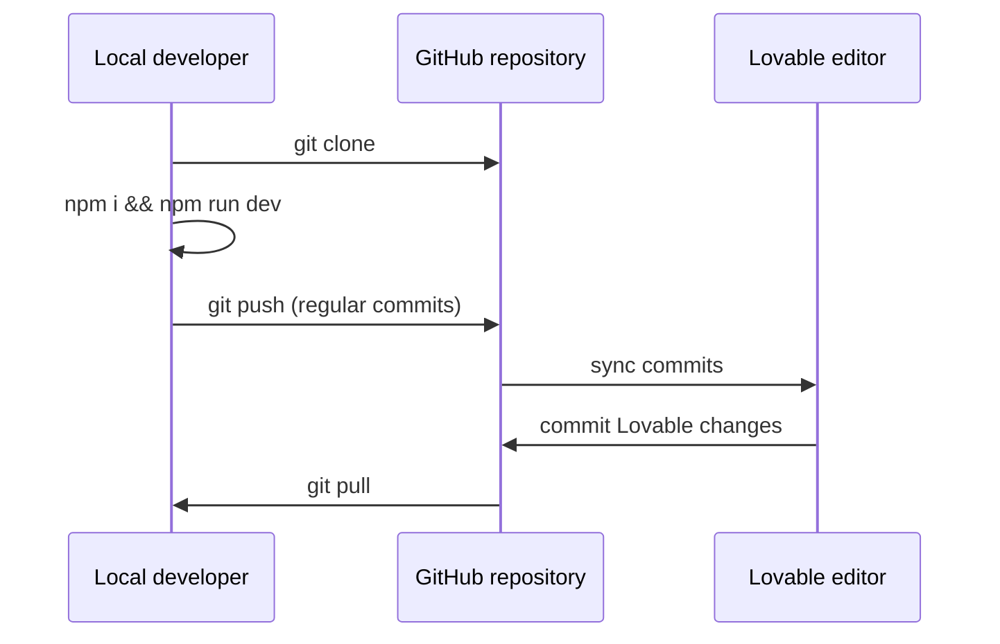
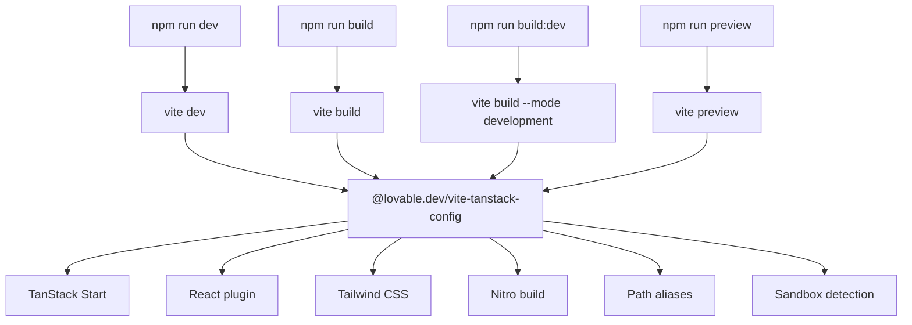

# Setting up CodeKnit development environment

This guide walks you through cloning the CodeKnit repository, installing dependencies, running the Vite dev server, building for production, and understanding how the local environment interacts with Lovable.

## Prerequisites

Before you start, make sure you have the following installed:

- **Node.js and npm**. The project uses npm as its package manager. The README recommends installing Node.js with nvm.
- **Git**, to clone the repository from GitHub.

The `package.json` file does not declare an `engines` field, so no specific Node.js version is enforced by the project. If your Vite or TanStack Start tooling reports an unsupported Node version, upgrade to a recent Node.js LTS release.

## Clone the repository

1. Open a terminal.
2. Clone the repository with:

   ```sh
   git clone https://github.com/Mohita111/API2.git
   ```

3. Move into the project directory:

   ```sh
   cd API2
   ```

The repository is a Lovable-connected project, so the git history includes changes made from the Lovable editor as well as from local development.

## Install dependencies

Run the following command from the project root:

```sh
npm i
```

This installs both `dependencies` and `devDependencies` listed in `package.json`. Key runtime dependencies include:

- `@tanstack/react-start` `1.168.60`
- `@tanstack/react-router` `1.170.41`
- `react` and `react-dom` `19.2.0`
- `tailwindcss` `4.2.1`

Key development dependencies include:

- `vite` `8.1.5`
- `typescript` `5.8.3`
- `vitest` `4.1.10`
- `@lovable.dev/vite-tanstack-config` `2.26.5`

The `package.json` also includes an `overrides` entry that pins `rolldown` to `1.2.1`:

```json
"overrides": {
  "rolldown": "1.2.1"
}
```

This override applies to transitive dependencies and should not be removed unless you fully understand the downstream effect on Vite builds.

## Run the development server

Start the local dev server with:

```sh
npm run dev
```

This executes the `dev` script from `package.json`, which is `vite dev`. The Vite configuration is provided by `@lovable.dev/vite-tanstack-config`, so the dev server automatically includes:

- TanStack Start dev server
- React refresh via `@vitejs/plugin-react`
- Tailwind CSS integration
- TypeScript path aliases
- Vite environment variable injection for `VITE_*` variables
- Sandbox detection for port, host, and `strictPort` settings
- Nitro build integration for production builds

The dev server usually opens at `http://localhost:5173` by default, but the exact port may vary because the Lovable Vite config includes sandbox detection that can adjust the port, host, and `strictPort` settings.

## Build for production

To create a production build, run:

```sh
npm run build
```

This executes `vite build`. The Vite config redirects TanStack Start's server entry to `src/server.ts`:

```ts
// vite.config.ts
import { defineConfig } from "@lovable.dev/vite-tanstack-config";

export default defineConfig({
  tanstackStart: {
    server: { entry: "server" },
  },
});
```

The comment in `vite.config.ts` notes that the Lovable config already includes Nitro, which uses Cloudflare as the default target for the production build. Do not manually add duplicate plugins such as TanStack devtools, React, Tailwind, or path alias plugins, because that can break the app with duplicate plugin registrations.

To build with development settings, use:

```sh
npm run build:dev
```

To preview a production build locally, use:

```sh
npm run preview
```

## Other npm scripts

The following scripts are defined in `package.json`:

| Script | Command | Purpose |
| --- | --- | --- |
| `dev` | `vite dev` | Start the local development server |
| `build` | `vite build` | Create a production build |
| `build:dev` | `vite build --mode development` | Create a development-mode build |
| `preview` | `vite preview` | Preview the production build locally |
| `lint` | `eslint .` | Run ESLint across the project |
| `format` | `prettier --write .` | Format all files with Prettier |
| `test` | `vitest run` | Run unit tests once with Vitest |
| `test:watch` | `vitest` | Run tests in watch mode with Vitest |

## Lovable integration

CodeKnit is connected to Lovable. This means changes flow in both directions:

- Changes made in the Lovable editor are committed directly to the connected GitHub repository.
- Commits you push from your local environment to the connected branch sync back to Lovable and appear in the editor.

The `AGENTS.md` file includes an important warning for anyone working with the repository:

> [!IMPORTANT]
> This project is connected to Lovable. Avoid rewriting published git history, force pushing, or rebasing/amending/squashing commits that are already pushed, as it rewrites history on Lovable's side and the user will likely lose their project history.
>
> Commits you push to the connected branch sync back to Lovable and show up in the editor, so keep the branch in a working state.

In practice, this means:

- Do not force push to the connected branch.
- Do not rebase, amend, or squash commits that have already been pushed.
- Keep the connected branch in a working state at all times.

The following diagram shows the typical local development and Lovable sync workflow.

Figure: Local development and Lovable sync flow



The same `AGENTS.md` file also includes two architecture notes for contributors:

- Snippet data goes through `SnippetRepository` (`src/lib/snippets/repository.ts`), currently backed by localStorage; swap the implementation for an API or database without touching UI components.
- Syntax highlighting uses a small in-house regex tokenizer (`src/lib/snippets/highlight.ts`) with no Prism dependency, keeping SQL and Markdown support simple.

## Development environment architecture

The npm scripts and Vite configuration work together as shown in the next diagram.

Figure: npm scripts and Vite configuration relationship



## Next steps

- To understand the high-level architecture and data flow, see [CodeKnit: High-Level Architecture and Key Components](doc:340f5bee-cd7e-4946-98d5-67f804ecdd26).
- To learn how snippet data is stored and swapped, see [Data Persistence Layer: SnippetRepository Pattern and localStorage Implementation](doc:34778b37-21c0-4087-91f0-c28fecb57477).
- To run and write unit tests, see [Unit Testing Strategy: Vitest, jsdom, and Test Examples](doc:79ef8d7b-27d7-41ff-b361-9721a150f157).
- For troubleshooting common setup and build failures, see [Troubleshooting and Debugging](doc:1b203822-fd22-4fd1-ba44-1c369f176899).