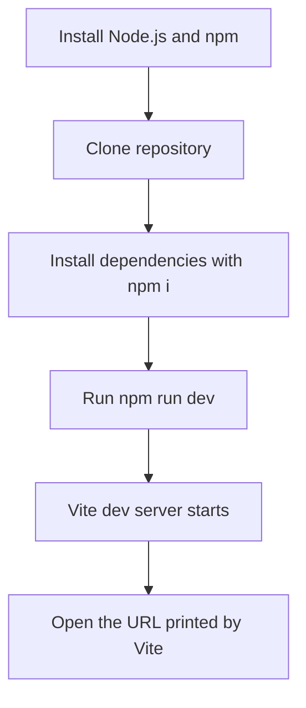
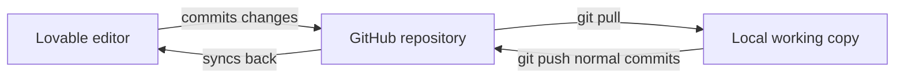
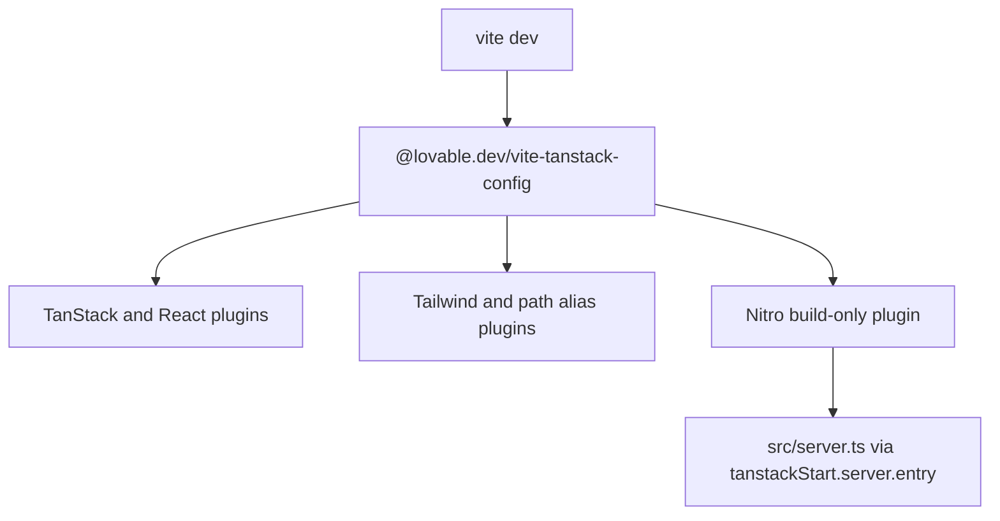

# Setting up CodeKnit for local development

This guide covers two supported ways to work with the CodeKnit repository:

- **Local npm workflow**, clone the repository, install dependencies, and run the Vite dev server on your machine.
- **Lovable editor workflow**, use the Lovable IDE with GitHub sync, then optionally switch to local development.

The project is built with TanStack Start, TypeScript, React, and Tailwind CSS. The Vite configuration is provided by `@lovable.dev/vite-tanstack-config`, so most plugin setup is already handled for you.

---

## Prerequisites

The README states that local development requires Node.js and npm and recommends installing them with nvm.

`package.json` does not declare an `engines` field, so there is no pinned Node.js version in the repository. Use a current LTS Node.js release unless your environment requires otherwise.

Key tooling versions from `package.json`:

| Dependency | Version |
| --- | --- |
| React | `^19.2.0` |
| TanStack Start | `1.168.60` |
| Vite | `8.1.5` |
| TypeScript | `^5.8.3` |
| Tailwind CSS | `^4.2.1` |
| Vitest | `^4.1.10` |
| `@lovable.dev/vite-tanstack-config` | `2.26.5` |

---

## Local npm workflow

The following commands come directly from the repository `README.md`.

Figure: Local setup and first run flow



1. Install Node.js and npm with nvm.
2. Clone the repository:

   ```sh
   ```

3. Move into the project directory:

   ```sh
   ```

4. Install dependencies:

   ```sh
   npm i
   ```

5. Start the local development server:

   ```sh
   npm run dev
   ```

Vite prints the local development URL after startup.

---

## Lovable editor workflow

CodeKnit is a Lovable project. You can build directly in the Lovable editor and keep the repository in sync with GitHub.

1. Open the project in the Lovable editor.
2. Connect the project to GitHub.
3. Make changes in Lovable. Each change is committed to the connected repository.
4. To switch to local development, clone the same repository and run the local npm workflow.
5. Push local commits back to the connected branch. Lovable syncs those commits back into the editor.

Figure: Lovable and local Git sync flow



> [!WARNING]
> Do not force push, rebase, amend, or squash commits that have already been pushed. This rewrites published Git history, rewrites history on Lovable's side, and the project may lose its history in Lovable.

Keep the connected branch in a working state because commits pushed to the branch sync back to Lovable and appear in the editor.

---

## npm scripts

All scripts are defined in `package.json`.

| Command | Description |
| --- | --- |
| `npm run dev` | Starts the Vite development server with `vite dev` |
| `npm run build` | Creates a production build with `vite build` |
| `npm run build:dev` | Creates a development build with `vite build --mode development` |
| `npm run preview` | Previews the built application with `vite preview` |
| `npm run lint` | Runs ESLint with `eslint .` |
| `npm run format` | Formats code with `prettier --write .` |
| `npm run test` | Runs all tests once with `vitest run` |
| `npm run test:watch` | Runs Vitest in watch mode |

Run `npm run lint` and `npm run test` before opening a pull request.

---

## Vite dev server configuration

The Vite configuration lives in `vite.config.ts` and imports `defineConfig` from `@lovable.dev/vite-tanstack-config`.

Figure: Plugin pipeline behind the Vite dev server



The Lovable Vite wrapper already includes these plugins:

- TanStack devtools, loaded first and in development only
- `tanstackStart`
- `viteReact`
- `tailwindcss`
- `tsConfigPaths`
- `nitro`, build-only with Cloudflare as the default target
- Vite `VITE_*` environment variable injection
- The `@` path alias
- React and TanStack dependency deduplication
- Error logger plugins
- Sandbox detection for port, host, and strict port settings

Do **not** manually add the same plugins, such as `@vitejs/plugin-react` or `@tailwindcss/vite`, to `vite.config.ts`. The `vite.config.ts` comment warns that duplicate plugins can break the app.

The current custom configuration is:

```ts
import { defineConfig } from "@lovable.dev/vite-tanstack-config";

export default defineConfig({
  tanstackStart: {
    // Redirect TanStack Start's bundled server entry to src/server.ts (our SSR error wrapper).
    // nitro/vite builds from this
    server: { entry: "server" },
  },
});
```

The `tanstackStart.server.entry` value points to `src/server.ts`, the SSR error wrapper. Nitro and Vite build from this entry.

---

## Dependency installation notes

The package manager used in the documented commands is npm. `package.json` includes both regular dependencies and dev dependencies.

The repository overrides `rolldown` to version `1.2.1`:

```json
"overrides": {
  "rolldown": "1.2.1"
}
```

If you encounter installation warnings related to peer dependencies, verify that your npm version is current before changing the configured overrides.

---

## Verifying a working local setup

After running `npm run dev`, confirm that Vite starts without duplicate-plugin errors. In a healthy setup, the Lovable wrapper initializes the dev server by loading the configured TanStack, React, Tailwind, and path alias plugins once.

To confirm that tests and code quality checks pass locally:

```sh
npm run test
npm run lint
```

For watch-mode unit testing during development:

```sh
npm run test:watch
```

---

## Related

- [Troubleshooting and Debugging](doc:1b203822-fd22-4fd1-ba44-1c369f176899)
- [Unit Testing Strategy: Vitest, jsdom, and Test Examples](doc:79ef8d7b-27d7-41ff-b361-9721a150f157)
- [Contributing to CodeKnit: Code Standards and GitHub Workflow](doc:8ec33934-0dfd-429e-88a1-89fbed259d51)
- [CodeKnit: High-Level Architecture and Key Components](doc:340f5bee-cd7e-4946-98d5-67f804ecdd26)
- [Data Persistence Layer: SnippetRepository Pattern and localStorage Implementation](doc:34778b37-21c0-4087-91f0-c28fecb57477)