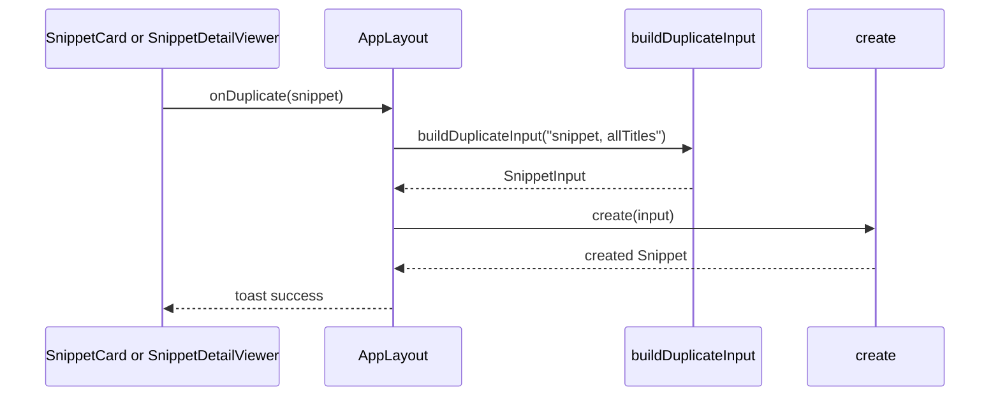
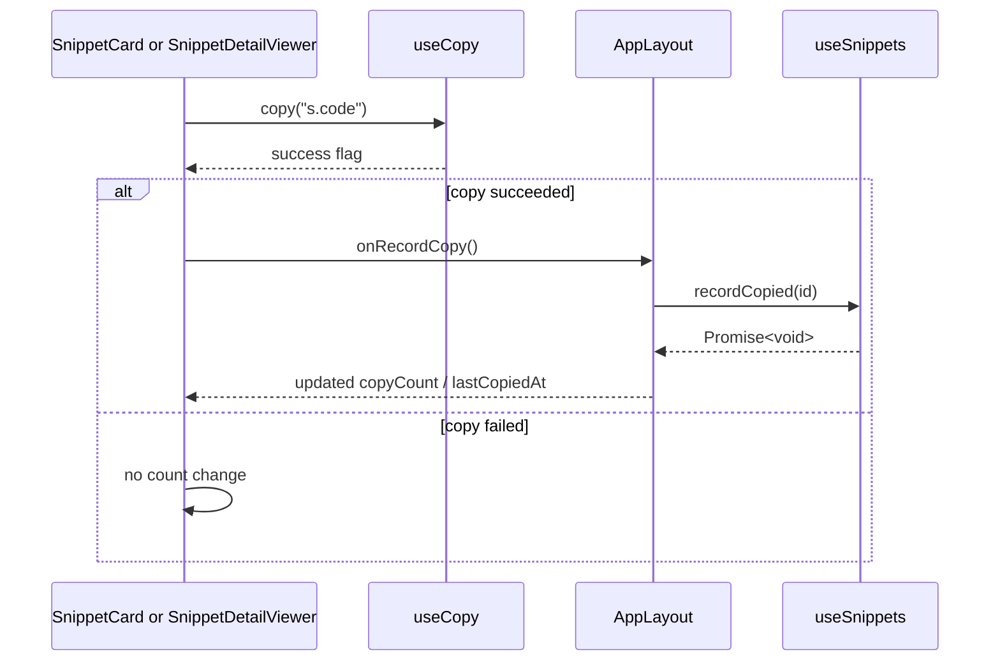

# Snippet duplication utility and copy tracking

This page documents how CodeKnit creates snippet duplicates with unique titles and how clipboard copy attempts are recorded as copy counts. The duplication flow is centered on `buildDuplicateInput`, and the copy tracking flow is centered on the `onRecordCopy` callback and the `recordCopied` store method.

> [!NOTE]
> The source snapshot for this page includes the consumer components `AppLayout.tsx`, `SnippetCard.tsx`, and `SnippetDetailViewer.tsx`, but not `src/lib/snippets/duplicate.ts` or `src/lib/snippets/store.ts`. The utility and store contracts are documented from the verified call sites.

## Duplication architecture

Duplication is available in two places:
- The actions dropdown on each `SnippetCard`
- The **Duplicate** button in `SnippetDetailViewer`

Both paths funnel into the same `AppLayout` handler.

Figure: Snippet duplication request flow



The `AppLayout` handler is defined as:

```ts
const duplicate = async (s: Snippet) => {
  try {
    const created = await create(buildDuplicateInput(s, snippets.map((item) => item.title)));
    toast.success(`Created "${created.title}"`);
  } catch (e) {
    toast.error((e as Error).message);
  }
};
```

This call site appears in `AppLayout.tsx`. The function receives the original `Snippet` and the list of every current snippet title. The result is passed directly to `create`, which means the return value must satisfy the same `SnippetInput` shape used by the form modal and repository layer.

### buildDuplicateInput contract

`buildDuplicateInput` is imported from:

```ts
import { buildDuplicateInput } from "@/lib/snippets/duplicate";
```

From the verified call site, the function signature is inferred as:

```ts
buildDuplicateInput(original: Snippet, existingTitles: string[]): SnippetInput
```

- `original`: the snippet being duplicated
- `existingTitles`: all current titles, used to avoid title collisions
- Return value: a snippet input accepted by `create`

The exact title-uniqueness strategy is not visible in the provided source set. The caller passes every current title, so the utility has the information needed to append or increment a suffix while keeping the duplicate title unique across the library.

The duplicate handler catches any failure from `create`, including repository errors and any title-generation errors, and surfaces it through a `sonner` toast. The success toast displays the generated title returned by `create`.

## Copy tracking mechanism

Copy tracking records both how often a snippet has been copied and the last time it was copied. This drives the **Recently Used** section and the "Copied N times" metadata shown on snippet cards and the detail viewer.

Figure: Copy tracking flow after a successful clipboard write



The copy count is stored on snippet metadata. Consumers read two fields:

- `copyCount`: numeric count of successful clipboard copies. Rendered with `s.copyCount ?? 0`.
- `lastCopiedAt`: ISO timestamp used to populate the **Recently Used** view.

### onRecordCopy contract

Both `SnippetCard` and `SnippetDetailViewer` accept an `onRecordCopy` prop:

```ts
onRecordCopy: () => Promise<void>
```

`AppLayout` supplies `onRecordCopy` for each surface.

For snippet cards:

```tsx
<SnippetCard
  onRecordCopy={() => recordCopied(s.id)}
/>
```

For the detail viewer, the same handler includes error reporting:

```tsx
<SnippetDetailViewer
  onRecordCopy={() =>
    viewing
      ? recordCopied(viewing.id).catch((e: Error) => {
          toast.error(e.message);
        })
      : Promise.resolve()
  }
/>
```

`recordCopied` comes from the `useSnippets` store hook:

```ts
const { snippets, status, error, reload, create, remove, toggleFavorite, recordCopied } = useSnippets();
```

### Copy button invocation

`SnippetCard` invokes the copy handler only after the clipboard write succeeds:

```tsx
onClick={async (e) => {
  e.stopPropagation();
  if (await copy(s.code)) {
    onRecordCopy().catch(() => undefined);
  }
}}
```

The equivalent flow in `SnippetDetailViewer` is:

```tsx
onClick={async () => {
  if (await copy(s.code)) {
    onRecordCopy().catch(() => undefined);
  }
}}
```

`copy` is provided by the component-level `useCopy` hook:

```ts
const { copied, copy } = useCopy();
```

The hook returns a `copied` boolean for UI feedback and a `copy` function. The consumer treats the awaited result of `copy` as a success flag. If the clipboard write fails, the success flag is falsy and `onRecordCopy` is never called. This prevents failed copies from inflating the copy count.

### Error-handling differences

The two copy surfaces handle store errors differently.

- On `SnippetCard`, any `recordCopied` rejection is swallowed with `.catch(() => undefined)`. The user still sees `Copied!` because the clipboard write succeeded.
- In `SnippetDetailViewer`, `AppLayout` already attaches a `.catch` that shows a `toast.error`. The extra `.catch(() => undefined)` in the viewer therefore does not hide that toast; it only prevents an unhandled rejection after the first catch resolves.

## Copy count rendering

The copy count is only shown on a card after at least one successful copy:

```tsx
{(s.copyCount ?? 0) > 0 && (
  <span className="text-[11px] text-muted-foreground">
    Copied {s.copyCount} {(s.copyCount ?? 0) === 1 ? "time" : "times"}
  </span>
)}
```

The detail viewer always includes copy metadata in its footer line:

```tsx
Created {formatDate(s.createdAt)} · Updated {formatDate(s.updatedAt)} · Copied {s.copyCount ?? 0} {(s.copyCount ?? 0) === 1 ? "time" : "times"}{s.lastCopiedAt ? ` · Last copied ${formatDate(s.lastCopiedAt)}` : ""}
```

This shows the last copy date only when `lastCopiedAt` exists.

## Recently used integration

`lastCopiedAt` is not only metadata. `AppLayout` uses it to build the **Recently Used** section:

```ts
if (section === "used") {
  return r
    .filter((s) => Boolean(s.lastCopiedAt))
    .sort((a, b) => (b.lastCopiedAt ?? "").localeCompare(a.lastCopiedAt ?? ""));
}
```

`AppSidebar` also uses the same predicate for its `used` badge:

```ts
counts={{
  all: snippets.length,
  favorites: snippets.filter((s) => s.isFavorite).length,
  used: snippets.filter((s) => Boolean(s.lastCopiedAt)).length,
}}
```

A successful `recordCopied` therefore has three visible effects:

1. `copyCount` increases.
2. `lastCopiedAt` updates.
3. The snippet appears or moves to the top of **Recently Used**.

## Related documentation

- [buildDuplicateInput Duplicate Utility Function API](doc:5006b12b-eb08-41c3-be34-0a4aa6bb987c)
- [How to Duplicate Code Snippets and Manage Copies](doc:abcba59a-d04f-454b-af35-17edd3fe0503)
- [AppLayout Component: Main Application State and CRUD Operations](doc:31e17a28-3f9f-40e4-9d13-8cebe8e9836b)
- [Understanding Snippet Metadata and Properties](doc:83ad6eea-198e-4ef0-8796-8820c3ef129a)
- [React Custom Hooks and Utility Modules](doc:c50e5c77-1500-47ce-b0e7-4529ddc3bb92)
- [SnippetRepository API Reference](doc:4d908553-70fe-424f-b628-aeb29e8b3bca)