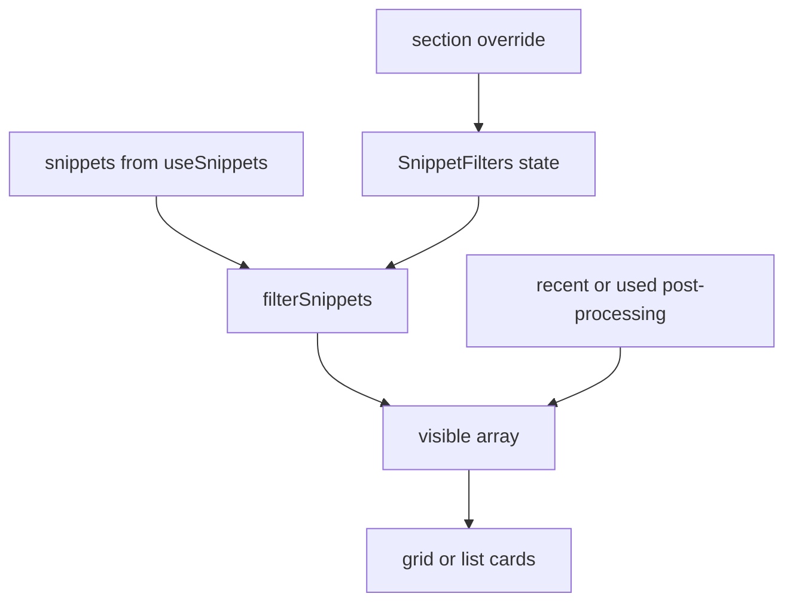
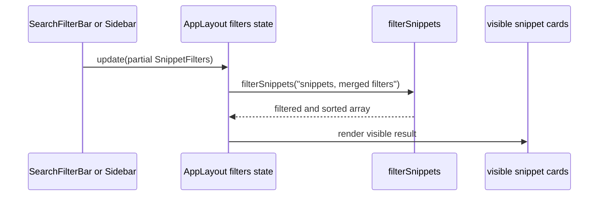

# Snippet filtering and query API design

This document describes how CodeKnit filters, queries, and sorts snippets in the main library view. The system is centralized around the `filterSnippets` function in `src/lib/snippets/filter.ts`, the `SnippetFilters` query model, and derived filter dimensions from the current snippet collection.

## Source coverage note

The pre-fetched source set includes the filter’s call sites and type usage but not the body of `src/lib/snippets/filter.ts`. The API contract below is therefore derived from `AppLayout.tsx`, `SearchFilterBar.tsx`, `AppSidebar.tsx`, and the import statements in those files. Where internals are not available, that limitation is called out explicitly.

## Filtering architecture at a glance

`AppLayout` owns one `filters` state object. Every filter change updates a partial slice of that object, and a single `visible` memo derives the current result set by passing `snippets` and a merged filter object into `filterSnippets`.

Figure: Snippet filtering data flow



The two UI entry points that change filters are:

- `SearchFilterBar` for query, language, category, tag, and sort
- `AppSidebar` for language and category sidebar shortcuts

Both call the same `update` helper in `AppLayout`:

```tsx
const update = (p: Partial<SnippetFilters>) =>
  setFilters((f) => ({ ...f, ...p }));
```

## Query model: `SnippetFilters`

The defaults are defined in `AppLayout.tsx`:

```tsx
const DEFAULTS: SnippetFilters = {
  query: "",
  language: "all",
  category: "all",
  tag: "all",
  sort: "recent",
};
```

This defines the effective query API contract:

| Field | Type | Purpose |
| --- | --- | --- |
| `query` | `string` | Free-text search term. The search input placeholder is `Search snippets, tags, or code...` |
| `language` | `Language \| "all"` | Language dimension selector. The literal `"all"` means no language filter is active. |
| `category` | `string` | Category dimension selector. `"all"` means no category filter is active. |
| `tag` | `string` | Tag dimension selector. `"all"` means no tag filter is active. |
| `sort` | `"recent" \| "oldest" \| "az"` | Result ordering. These values map to the options in `SearchFilterBar`. |

The system uses the string sentinel `"all"` consistently across language, category, and tag instead of `null` or `undefined`. This simplifies UI binding because every `<Select>` always has a concrete string value.

`SnippetFilters` also supports a `favoritesOnly` override at runtime. `AppLayout` constructs it when the active sidebar section is `favorites`:

```tsx
const f = {
  ...filters,
  favoritesOnly: section === "favorites",
  sort: section === "recent" ? "recent" as const : filters.sort,
};
```

Because this object is passed directly to `filterSnippets`, `favoritesOnly` is part of the accepted filter payload even though it is not exposed in the default search bar.

## Core query API: `filterSnippets`

The function is imported in `AppLayout.tsx`:

```tsx
import { filterSnippets } from "@/lib/snippets/filter";
```

The single call site establishes the following contract:

```tsx
const r = filterSnippets(snippets, f);
```

Where:

- `snippets` is the full `Snippet[]` collection from `useSnippets`
- `f` is a merged `SnippetFilters` object
- `r` is the filtered and sorted result array passed to rendering

The operation is synchronous and in-memory. There is no async query layer, API request, or server-side filter pipeline. This matches the localStorage-backed persistence model described in [State Management and Data Persistence](doc:a56b2ef1-97bf-4ab9-a9c9-9b64405edefc).

Because `section === "recent"` overrides `sort` to `"recent"` before calling `filterSnippets`, the function is responsible for applying the sort value. The external `used` section performs additional post-processing after `filterSnippets` returns:

```tsx
if (section === "used") {
  return r
    .filter((s) => Boolean(s.lastCopiedAt))
    .sort((a, b) => (b.lastCopiedAt ?? "").localeCompare(a.lastCopiedAt ?? ""));
}
```

## Derived filter dimensions

Language, category, and tag options are not hardcoded globally. They are derived from the current snippet collection.

Categories are counted and sorted alphabetically:

```tsx
const categories = useMemo(() => {
  const m = new Map<string, number>();
  snippets.forEach((s) => m.set(s.category, (m.get(s.category) ?? 0) + 1));
  return [...m]
    .map(([name, count]) => ({ name, count }))
    .sort((a, b) => a.name.localeCompare(b.name));
}, [snippets]);
```

Tags are flattened, deduplicated, and sorted:

```tsx
const tags = useMemo(
  () => [...new Set(snippets.flatMap((s) => s.tags))].sort(),
  [snippets],
);
```

The language list is a static registry from `@/lib/snippets/types`:

```tsx
import { LANGUAGES, type Language } from "@/lib/snippets/types";
```

This separation means only languages are a fixed product constraint. Categories and tags follow whatever exists in the user’s local library.

## Query state flow

A query change from the main search input updates only the `query` field:

```tsx
<Input
  aria-label="Search snippets"
  value={filters.query}
  onChange={(e) => update({ query: e.target.value })}
  placeholder="Search snippets, tags, or code..."
/>
```

The filter bar exposes the same state through its own input and three selects:

```tsx
<Input
  aria-label="Filter snippets"
  value={filters.query}
  onChange={(e) => onChange({ query: e.target.value })}
  placeholder="Filter…"
/>
```

Figure: Query and filter selection flow



Each select binds a single dimension:

```tsx
<Select
  value={filters.language}
  onValueChange={(v) => onChange({ language: v as SnippetFilters["language"] })}
>
```

Category and tag selects follow the same pattern with `filters.category` and `filters.tag`.

## Sort API

The sort selector has three values:

```tsx
<Select value={filters.sort} onValueChange={(v) => onChange({ sort: v as SnippetFilters["sort"] })}>
  <SelectContent>
    <SelectItem value="recent">Recently Added</SelectItem>
    <SelectItem value="oldest">Oldest First</SelectItem>
    <SelectItem value="az">A–Z</SelectItem>
  </SelectContent>
</Select>
```

This makes `sort` a first-class part of the query model rather than a separate display concern.

## Active filter detection and clearing

The UI decides whether any filter is active separately from `filterSnippets`:

```tsx
const hasActive =
  filters.query !== "" ||
  filters.language !== "all" ||
  filters.category !== "all" ||
  filters.tag !== "all";
```

Sort is deliberately excluded from `hasActive`. Clearing filters resets the query dimensions but preserves the currently selected sort:

```tsx
const clear = () => setFilters((f) => ({ ...DEFAULTS, sort: f.sort }));
```

This is a small but important design decision: a user’s sort preference is treated as a display preference, while query, language, category, and tag are treated as actual filters.

## Section-specific behavior

The sidebar defines five sections:

```tsx
export type Section = "dashboard" | "all" | "favorites" | "recent" | "used";
```

Each section composes with the base query model differently:

| Section | Filter behavior |
| --- | --- |
| `dashboard` | Uses `filterSnippets` with the user’s current filters. |
| `all` | Uses `filterSnippets` with the user’s current filters. |
| `favorites` | Adds `favoritesOnly: true` to the filter payload. |
| `recent` | Forces `sort: "recent"`, then limits the result to 10 items. |
| `used` | Filters by `lastCopiedAt` after `filterSnippets` and sorts by most recently copied. |

The merged construction in `AppLayout` shows this composition directly:

```tsx
const visible = useMemo(() => {
  const f = {
    ...filters,
    favoritesOnly: section === "favorites",
    sort: section === "recent" ? "recent" as const : filters.sort,
  };
  const r = filterSnippets(snippets, f);

  if (section === "recent") return r.slice(0, 10);
  if (section === "used") {
    return r
      .filter((s) => Boolean(s.lastCopiedAt))
      .sort((a, b) => (b.lastCopiedAt ?? "").localeCompare(a.lastCopiedAt ?? ""));
  }
  return r;
}, [snippets, filters, section]);
```

`recent` limit and `used` recency handling remain outside `filterSnippets`. This keeps `filterSnippets` a generic filter-and-sort primitive instead of coupling it to sidebar navigation.

## Design decisions

- **Single query object**: `SnippetFilters` is one state object. All dimensions change through one `update` function, which keeps re-render behavior predictable.
- **In-memory synchronous filtering**: The dataset lives in localStorage and is small enough that no async query interface is required.
- **`"all"` as a sentinel**: Language, category, and tag all use the same no-op value. The UI can always bind selects without nullable-value handling.
- **Derived facets**: Category and tag options are computed from existing snippets, so the filter UI never offers a dimension that cannot produce results.
- **Sort preservation on clear**: Reset clears query dimensions but does not discard the user’s sort choice.
- **Composition over special cases**: Sidebar sections merge overrides into the base filter object rather than creating a separate filtering path.
- **Post-filter section logic**: Recent limit and recently-used ordering are applied by `AppLayout`, not by `filterSnippets`.

## Query dimensions: Current behavior and missing internals

The exact matching rules inside `filterSnippets` are not available in the provided files. Based on call sites and UI copy:

- `query` targets snippets, tags, or code, as indicated by the placeholder `Search snippets, tags, or code...`.
- `language`, `category`, and `tag` are exact-select dimensions because they bind to select values.
- `sort` must be applied by `filterSnippets` because the recent section overrides it before the call.

If you modify matching semantics, keep them inside `filterSnippets`. Do not add matching logic in `SearchFilterBar` or `AppLayout`; those components should remain state and composition boundaries.

## Extension points

### Add a new filter dimension

To add a new dimension, you must change four boundaries:

1. Extend the defaults in `AppLayout.tsx`:

```tsx
const DEFAULTS: SnippetFilters = {
  query: "",
  language: "all",
  category: "all",
  tag: "all",
  sort: "recent",
  // newField: "all",
};
```

2. Add a control in `SearchFilterBar`:

```tsx
<Select
  value={filters.newField}
  onValueChange={(v) => onChange({ newField: v })}
>
```

3. Extend active-filter detection:

```tsx
const hasActive =
  filters.query !== "" ||
  filters.language !== "all" ||
  filters.category !== "all" ||
  filters.tag !== "all" ||
  filters.newField !== "all";
```

4. Handle the new field in `filterSnippets`.

### Add a new sort option

Change the `sort` union in `SnippetFilters`, add a `<SelectItem>` in `SearchFilterBar`, and add the corresponding sort branch in `filterSnippets`.

### Add a new sidebar section

Define the section in `AppSidebar.tsx`, add navigation metadata, and override or post-process the result in the `visible` memo. Use the existing `favoritesOnly` and forced-sort patterns as templates.

## Related pages

- [Understanding Snippet Metadata and Properties](doc:83ad6eea-198e-4ef0-8796-8820c3ef129a)
- [How to Use Advanced Search and Multi-Filter Workflows](doc:41bcd2ac-8788-4305-af23-e43ee3861cb8)
- [SnippetRepository API Reference](doc:4d908553-70fe-424f-b628-aeb29e8b3bca)
- [State Management and Data Persistence](doc:a56b2ef1-97bf-4ab9-a9c9-9b64405edefc)