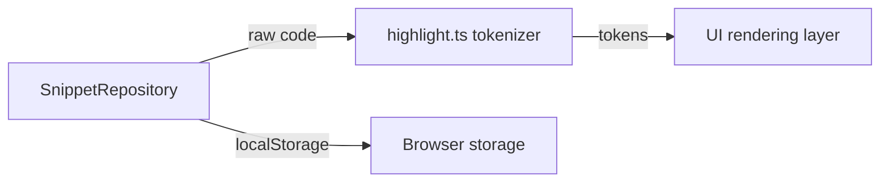
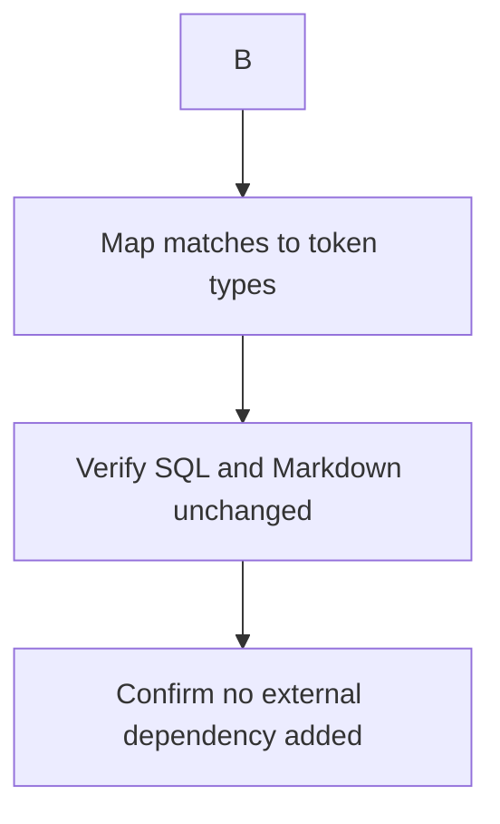

# Syntax highlighting system: In-house tokenizer design and language support

## Purpose

CodeKnit highlights snippet code with a small in-house regex tokenizer. The tokenizer lives in `src/lib/snippets/highlight.ts` and replaces heavier syntax highlighting libraries such as Prism or Shiki.

> [!NOTE]
> The captured repository snapshot includes `AGENTS.md` only. The source confirms the tokenizer's location, its regex-based nature, and its high-level language support. For exact rule definitions, token type names, and function signatures, review `src/lib/snippets/highlight.ts` directly.

## How the tokenizer fits into the application

CodeKnit separates snippet persistence from snippet presentation. The `SnippetRepository` abstraction returns raw snippet data, and the syntax highlighting layer transforms raw code into categorized tokens for rendering. `SnippetRepository` currently uses `localStorage` as its backing store, while `highlight.ts` operates independently on the raw code strings that the repository supplies.

Figure: Component flow for syntax highlighting


The exact call site between the UI and `highlight.ts` is not present in the captured source, but the documented separation is clear: `SnippetRepository` is the data boundary, and `highlight.ts` is the presentation-side tokenizer.

## Why the tokenizer is in-house

`AGENTS.md` states the design decision directly:

```
Syntax highlighting is a small in-house regex tokenizer (src/lib/snippets/highlight.ts) — no Prism dependency, keeps SQL/Markdown support simple.
```

The main goals are:

- Avoid an external dependency such as Prism
- Keep SQL and Markdown highlighting simple
- Maintain a lightweight, readable tokenizer that is easy to extend

Keeping the tokenizer dependency-free means the highlighting layer stays small, avoids version drift from third-party grammars, and remains straightforward to modify when the supported languages need targeted rule updates.

## Supported languages

The repository documentation explicitly names two supported languages:

- SQL
- Markdown

The project planning notes also mention JavaScript and other languages as supported or intended. However, the captured `AGENTS.md` content does not include a complete language registry. Treat SQL and Markdown as the confirmed baseline and verify the full language list in `src/lib/snippets/highlight.ts`.

## Token model

The tokenizer produces tokens by applying regex-based rules to source text. Each token represents a categorized span of the input, such as a keyword, string, comment, or punctuation.

The exact token type schema is not included in the captured `AGENTS.md` source. To extend or verify the token model:

1. Open `src/lib/snippets/highlight.ts`
2. Locate the token type definition or union type used by the tokenizer
3. Review the regex rule map for each supported language

Because the implementation is deliberately small and in-house, the token model is expected to remain simple rather than introducing a full parser.

## Adding a new language

`src/lib/snippets/highlight.ts` is the extension point for new language support. Adding a language should maintain the existing design goals: dependency-free operation, regex-based rules, and stable behavior for SQL and Markdown.

Figure: Workflow for adding a new language


To add a language:

1. Add a regex-based rule set for the new language in `src/lib/snippets/highlight.ts`
2. Map each regex match to the tokenizer's existing token type model
3. Keep the implementation free of external syntax highlighting dependencies such as Prism
4. Verify that the new language keeps SQL and Markdown behavior unchanged

The captured source does not expose the internal function structure of `highlight.ts`, so review the existing tokenizer before adding a new language. The core constraint is to preserve the simple, dependency-free approach documented in `AGENTS.md`.

## Source snapshot limitations

The available source snapshot includes only `AGENTS.md`. The following details are therefore not documented here and require direct confirmation from the repository:

- Exact function and type names in `src/lib/snippets/highlight.ts`
- Exact regex patterns for SQL and Markdown
- The complete list of token types
- The rendering integration point in the UI
- Whether JavaScript and other languages are already implemented or only planned

## Related documentation

- [Data persistence layer: SnippetRepository pattern and localStorage implementation](doc:34778b37-21c0-4087-91f0-c28fecb57477)
- [React hooks and custom hooks API](doc:2366f545-fe28-4695-a91e-94a58c97ec73)
- [CodeKnit project architecture and technology stack](doc:95102f25-859a-4a05-98f5-7919e6f0235f)
- [In-house syntax highlighting tokenizer architecture](doc:24ac1801-d2e0-4ad2-b23b-5680ff203b41)
- [Syntax highlighting system design](doc:f61a6d46-c460-4460-b318-2258ec30ceca)