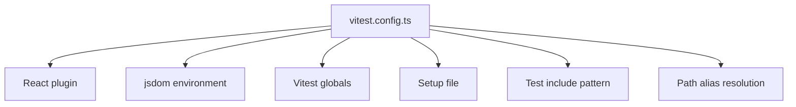

## Configuration file

The root configuration file is `vitest.config.ts`. It imports Vitest, the React plugin, and Node's `path` module, then exports a merged Vite and Vitest configuration.

```ts
import { defineConfig } from "vitest/config";
import react from "@vitejs/plugin-react";
import path from "node:path";

export default defineConfig({
  plugins: [react()],
  test: {
    environment: "jsdom",
    globals: true,
    setupFiles: ["./src/test/setup.ts"],
    include: ["src/**/*.{test,spec}.{ts,tsx}"],
  },
  resolve: {
    alias: { "@": path.resolve(__dirname, "./src") },
  },
});
```

Because the configuration is written in TypeScript, Vitest reads it directly when the test runner starts.

## How the configuration connects the pieces

The following diagram shows the main configuration roles in `vitest.config.ts`.

Figure: Vitest and jsdom configuration flow



## Key configuration options

| Option | Value | Effect |
| --- | --- | --- |
| `plugins` | `[react()]` | Enables React and JSX/TSX support during test execution. |
| `test.environment` | `"jsdom"` | Simulates a browser DOM so React components can render in tests. |
| `test.globals` | `true` | Makes Vitest APIs such as `describe`, `it`, and `expect` available globally without imports. |
| `test.setupFiles` | `["./src/test/setup.ts"]` | Loads global test setup before each test file. |
| `test.include` | `["src/**/*.{test,spec}.{ts,tsx}"]` | Limits test discovery to TypeScript and TSX test or spec files under `src/`. |
| `resolve.alias` | `{ "@": path.resolve(__dirname, "./src") }` | Resolves `@` imports to the `src/` directory. |

## jsdom environment

The configuration sets `test.environment` to `"jsdom"`. This means every test file runs in a simulated browser-like environment that provides DOM APIs such as `document`, `window`, and `HTMLElement`.

Use jsdom for tests that render React components or interact with browser APIs. Utilities that do not depend on the DOM still run in this environment, but jsdom is most important for component-level tests.

## Global test APIs

With `globals: true`, test files do not need to import `describe`, `it`, `expect`, or related Vitest functions. The globals are available directly in any file that matches the include pattern.

For example, a test file can use the global form:

```ts
describe("component behavior", () => {
  it("runs a test", () => {
    expect(true).toBe(true);
  });
});
```

Without the global setting, you would need to import these functions from `vitest`.

## Test file discovery

Vitest searches for files matching the include glob:

```text
src/**/*.{test,spec}.{ts,tsx}
```

The pattern matches files such as:

- `src/components/button.test.ts`
- `src/components/button.test.tsx`
- `src/utils/format.spec.ts`
- `src/hooks/useCounter.test.tsx`

Only test or spec files under `src/` are included. Test files outside `src/` are not picked up by this configuration.

## Setup file

The configuration registers one setup file:

```text
./src/test/setup.ts
```

Vitest runs this file before each test file. It is the standard place for global test configuration such as custom matchers, test utilities, global mocks, or DOM cleanup.

The provided source context does not include the contents of `src/test/setup.ts`. Vitest expects the file to exist at that path because it is referenced directly by `setupFiles`.

> [!NOTE]
> Keep `src/test/setup.ts` in place. If the file is missing, the test runner continues only if Vitest can resolve the setup file; otherwise, test startup may fail before tests execute.

## Module aliases in tests

The alias `@` maps to the absolute `src/` directory:

```ts
resolve: {
  alias: { "@": path.resolve(__dirname, "./src") },
}
```

Test files can use the same alias as application code:

```ts
import { formatDate } from "@/utils/date";
```

This keeps imports consistent between tests and the source modules they exercise.

## Concrete test examples

The provided source context contains the Vitest configuration only. It does not include example component, hook, or utility tests. For concrete examples of unit tests in this codebase, see [Unit Testing Strategy: Vitest, jsdom, and Test Examples](doc:79ef8d7b-27d7-41ff-b361-9721a150f157).

## Related pages

- [Unit Testing Strategy: Vitest, jsdom, and Test Examples](doc:79ef8d7b-27d7-41ff-b361-9721a150f157)
- [Test Strategy and Coverage Guide](doc:96a2d5ff-0db2-4d85-b234-174bbf729513)
- [Local Development Environment Setup](doc:5929d286-9a77-4a87-8a3d-2657875a6884)