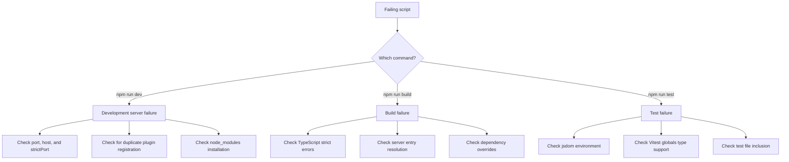
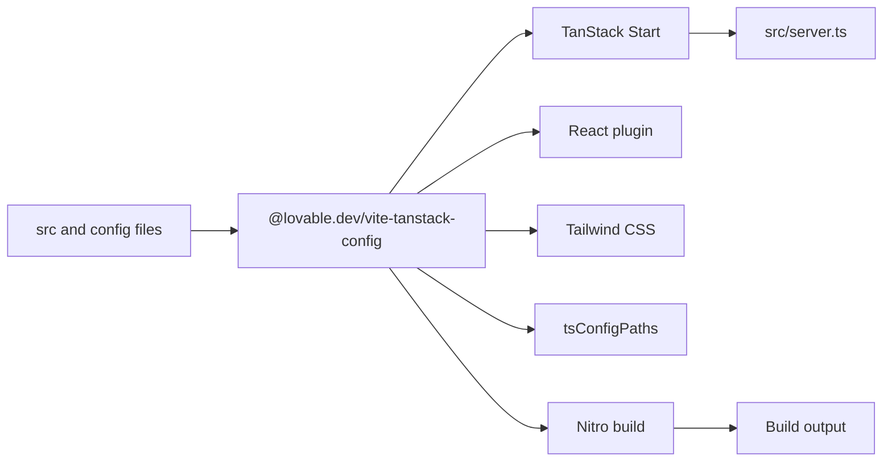

# Troubleshooting and debugging

This guide covers the startup, build, dependency, configuration, runtime, and test failures you can diagnose from the CodeKnit/API2 project configuration. The failure modes below are grounded in `package.json`, `tsconfig.json`, and `vite.config.ts`.

## Quick command reference

These are the scripts defined in `package.json`.

| Command | Actual script | Purpose |
| --- | --- | --- |
| `npm run dev` | `vite dev` | Start the Vite development server |
| `npm run build` | `vite build` | Create a production build |
| `npm run build:dev` | `vite build --mode development` | Create a development-mode build |
| `npm run preview` | `vite preview` | Preview the production build |
| `npm run lint` | `eslint .` | Run ESLint across the repository |
| `npm run format` | `prettier --write .` | Format files with Prettier |
| `npm run test` | `vitest run` | Run Vitest once |
| `npm run test:watch` | `vitest` | Run Vitest in watch mode |

The project has no dedicated `typecheck` script. Because `tsconfig.json` sets `"noEmit": true`, you can still type-check manually with `npx tsc --noEmit`.

## Diagnosis flow

Figure: Common script failure diagnosis flow



## Build and plugin pipeline

The entire Vite pipeline is wrapped by `@lovable.dev/vite-tanstack-config`. The configuration comment in `vite.config.ts` states that the wrapper already registers TanStack devtools, `tanstackStart`, `viteReact`, Tailwind CSS, `tsConfigPaths`, Nitro, `VITE_*` environment injection, the `@` path alias, React/TanStack deduplication, error logger plugins, and sandbox detection.

Figure: Vite plugin and build pipeline



## Development server failures

### Port, host, and strictPort issues

The Lovable Vite wrapper applies sandbox detection that controls `port`, `host`, and `strictPort`. If the development server cannot bind to its expected port, the likely causes are another process using that port or `strictPort` rejecting an alternate port.

Diagnosis steps:

1. Run `npm run dev` and read the Vite terminal output.
2. If the port is occupied, stop the conflicting process or clear the assigned port.
3. If `strictPort` blocks fallback, check the environment configuration supplied by the sandbox or Lovable runtime.
4. Re-run `npm run dev`.

### Duplicate plugin failures

The largest known build and development failure risk is manually adding plugins that the Lovable wrapper already registers.

The `vite.config.ts` file warns against manually adding these plugins:

- TanStack devtools
- `tanstackStart`
- `viteReact`
- Tailwind CSS
- `tsConfigPaths`
- Nitro
- `VITE_*` environment injection
- React and TanStack dedupe
- error logger plugins
- sandbox detection

> [!WARNING]
> Do not add these plugins manually to `vite.config.ts`. The `@lovable.dev/vite-tanstack-config` wrapper registers them automatically, and manual registration causes duplicate plugin build failures.

The correct Vite entry point is:

```ts
import { defineConfig } from "@lovable.dev/vite-tanstack-config";

export default defineConfig({
  tanstackStart: {
    server: { entry: "server" },
  },
});
```

If a build reports duplicate plugin errors, remove any manually registered plugin that appears in the warning list.

## Build failures

### TanStack start server entry

`vite.config.ts` redirects TanStack Start's server entry to `src/server.ts`:

```ts
tanstackStart: {
  server: { entry: "server" },
},
```

The comment in `vite.config.ts` describes this file as the SSR error wrapper. If the build cannot resolve the server entry, ensure `src/server.ts` exists and exports the expected server handler.

### TypeScript strict compile errors

`tsconfig.json` enables strict checking. Many build failures trace back to one of these compiler options:

| Compiler option | Value | Failure mode |
| --- | --- | --- |
| `strict` | `true` | Enables all strict type-checking rules |
| `noImplicitReturns` | `true` | A function path fails to return a value |
| `noFallthroughCasesInSwitch` | `true` | A `switch` case falls through without `break` or `return` |
| `noPropertyAccessFromIndexSignature` | `true` | Accessing an index signature with dot notation instead of brackets |
| `noUncheckedIndexedAccess` | `true` | Indexed access may produce `undefined` |
| `exactOptionalPropertyTypes` | `true` | An optional property receives an explicit `undefined` value |
| `noUncheckedSideEffectImports` | `true` | A side-effect import is not explicitly recognized |

The following options are part of the strict configuration but are not enabled as separate restrictions:

```json
{
  "noUnusedLocals": false,
  "noUnusedParameters": false
}
```

Diagnosis steps:

1. Run `npx tsc --noEmit` from the project root.
2. Read each reported TypeScript error.
3. Match the error to the compiler option in the table.
4. Fix the source code path or add the missing return, bracket access, or optional property handling.
5. Re-run `npm run build`.

## Dependency and installation failures

### Rolldown override

`package.json` includes an override for `rolldown`:

```json
{
  "overrides": {
    "rolldown": "1.2.1"
  }
}
```

If the package lock file is not refreshed after dependency changes, the override may not apply. Run `npm install` from the project root to regenerate dependency resolution that respects the override.

### Beta nitro build

Nitro is pinned to a beta release:

```json
{
  "devDependencies": {
    "nitro": "3.0.260603-beta"
  }
}
```

Do not float this dependency. Use the exact version from `package.json` to avoid unexpected Nitro behavior during the build.

### Exact TanStack package versions

Several TanStack packages are pinned to exact versions:

```json
{
  "@tanstack/react-router": "1.170.41",
  "@tanstack/react-start": "1.168.60",
  "@tanstack/router-plugin": "1.168.42"
}
```

> [!NOTE]
> Keep these TanStack versions aligned. Mixing `@tanstack/react-router`, `@tanstack/react-start`, and `@tanstack/router-plugin` versions can cause runtime and build compatibility errors.

Other relevant locked dependencies include `vite` `8.1.5`, `react` `^19.2.0`, and `react-dom` `^19.2.0`.

## Configuration failures

### Path alias

`tsconfig.json` defines the `@` path alias:

```json
{
  "paths": {
    "@/*": ["./src/*"]
  }
}
```

The `tsconfig.json` `include` array covers:

- `src/**/*.ts`
- `src/**/*.tsx`
- `vite.config.ts`
- `vitest.config.ts`
- `eslint.config.js`

If an import such as `@/components/Example` cannot be resolved, verify that:

- The file exists under `src/`
- `vite-tsconfig-paths` is installed as a dependency
- The `@` alias is not manually redefined in Vite configuration

### Strict TypeScript settings

The full strict TypeScript block is defined in `tsconfig.json`:

```json
{
  "compilerOptions": {
    "target": "ES2022",
    "jsx": "react-jsx",
    "module": "ESNext",
    "lib": ["ES2022", "DOM", "DOM.Iterable"],
    "types": ["vite/client", "vitest/globals"],
    "moduleResolution": "Bundler",
    "allowImportingTsExtensions": true,
    "verbatimModuleSyntax": false,
    "noEmit": true,
    "skipLibCheck": true,
    "strict": true
  }
}
```

`react-jsx` is the required JSX mode for React 19. If TSX files fail to compile, confirm this value is present in `tsconfig.json`.

## Test failures

`package.json` provides two Vitest scripts:

```json
{
  "test": "vitest run",
  "test:watch": "vitest"
}
```

The test environment uses `jsdom` from `devDependencies`:

```json
{
  "jsdom": "^20.0.3"
}
```

Vitest global types are declared in `tsconfig.json`:

```json
{
  "types": ["vite/client", "vitest/globals"]
}
```

Diagnosis steps for test failures:

1. Run `npm run test` for a single pass.
2. If tests cannot access DOM APIs, confirm `jsdom` is installed and the Vitest configuration selects `jsdom` as the test environment.
3. If `describe`, `it`, `expect`, or other Vitest globals show as missing types, confirm `vitest/globals` is present in the `types` array in `tsconfig.json`.
4. If tests are not discovered, verify the test files match the include patterns in `vitest.config.ts`.
5. Use `npm run test:watch` to isolate a failing test file during debugging.

The project includes these testing libraries in `devDependencies`:

```json
{
  "@testing-library/jest-dom": "^6.6.0",
  "@testing-library/react": "^16.0.0"
}
```

## Runtime failure routes

Runtime failures during SSR are routed through `src/server.ts` because the configured TanStack Start server entry is `server`. The comment calls this file the SSR error wrapper. If a runtime SSR error occurs, begin diagnosis at `src/server.ts`, then trace the failing route or server handler back into the application.

## Related pages

- [Setting Up CodeKnit Development Environment](doc:4250b87f-66ca-457d-9f4c-995cbfb65108)
- [Unit Testing Strategy: Vitest, jsdom, and Test Examples](doc:79ef8d7b-27d7-41ff-b361-9721a150f157)
- [Build, Deployment, and CI/CD Pipeline](doc:8f1afe44-379f-4bc0-95dd-ea0856776048)
- [Code Style, Pull Request, and Review Guidelines](doc:670dbb7b-1d60-41aa-a474-dc3e1aeb2045)