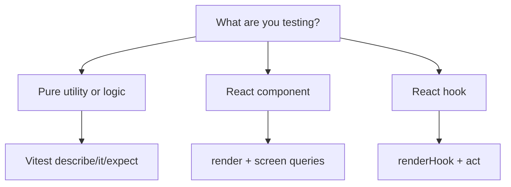

# Unit testing strategy: Vitest, jsdom, and test examples

This guide covers how CodeKnit runs unit tests with Vitest, the jsdom DOM environment, and React Testing Library. It shows the exact test configuration, the commands for running tests, and patterns for testing React components, hooks, and utility functions.

> [!NOTE]
> The source files included for this analysis are `vitest.config.ts` and `package.json`. Test files from the repository are not included in this source set, so the code examples below are representative patterns that match the configured stack. Adapt imports and component APIs to the actual files in your checkout.

## Testing stack at a glance

The project uses Vitest as the test runner and jsdom as the browser-like DOM environment for component and hook tests.

| Dependency | Version | Role |
| --- | --- | --- |
| `vitest` | `^4.1.10` | Test runner and assertion library |
| `jsdom` | `^20.0.3` | Lightweight DOM environment for non-browser test execution |
| `@testing-library/react` | `^16.0.0` | React component and hook rendering utilities |
| `@testing-library/jest-dom` | `^6.6.0` | Custom Jest-compatible DOM matchers |
| `@vitejs/plugin-react` | `^5.2.0` | JSX and React Fast Refresh support during tests |
| `@types/react` | `^19.2.0` | React TypeScript types |
| `@types/react-dom` | `^19.2.0` | React DOM TypeScript types |

Before writing tests, make sure you have the local development environment installed. See [Setting Up CodeKnit for Local Development](doc:c0ebfbd6-9278-4326-a87a-bde159a8a795).

## Running tests

The `package.json` file defines two test scripts:

```json
"scripts": {
  "test": "vitest run",
  "test:watch": "vitest"
}
```

Run the full suite once with:

```bash
npm test
```

Run Vitest in watch mode for iterative development with:

```bash
npm run test:watch
```

`vitest run` executes all matching test files and exits. `vitest` without `run` starts the interactive watch process.

## Vitest configuration

The root `vitest.config.ts` file configures the test environment, file discovery, setup files, and module resolution.

```ts
import { defineConfig } from "vitest/config";
import react from "@vitejs/plugin-react";
import path from "node:path";

export default defineConfig({
  plugins: [react()],
  test: {
    environment: "jsdom",
    globals: true,
    setupFiles: ["./src/test/setup.ts"],
    include: ["src/**/*.{test,spec}.{ts,tsx}"],
  },
  resolve: {
    alias: { "@": path.resolve(__dirname, "./src") },
  },
});
```

### Configuration keys

- **`plugins: [react()]`** enables JSX and TypeScript transforms through the React Vite plugin.
- **`test.environment: "jsdom"`** provides a DOM API such as `document`, `window`, and `HTMLElement`.
- **`test.globals: true`** makes Vitest functions like `describe`, `it`, and `expect` available without explicit imports. You can still import them for clarity or to satisfy lint rules.
- **`test.setupFiles`** points to `src/test/setup.ts`, which runs before each test file.
- **`test.include`** limits discovery to `src/**/*.{test,spec}.{ts,tsx}`.
- **`resolve.alias`** maps the `@` prefix to `./src`, so test files can import through the same alias as application code.

## Setup file

The setup file is expected to register Testing Library DOM matchers. If `src/test/setup.ts` does not yet exist in a new checkout, create it with:

```ts
import "@testing-library/jest-dom/vitest";
```

This gives you matchers such as `toBeInTheDocument()` and `toHaveValue()` inside Vitest tests.

## Test discovery and execution flow

The following diagram shows how `npm test` reads the Vitest configuration, applies the jsdom environment, registers DOM matchers, and runs the discovered test files.

Figure: Vitest test discovery and execution flow

```mermaid
graph TD
  A["npm test"] --> B["vitest run"]
  B --> C["Load vitest.config.ts"]
  C --> D["test.environment: jsdom"]
  C --> E["test.setupFiles: src/test/setup.ts"]
  C --> F["test.include: src/**/*.{"test,spec"}.{"ts,tsx"}"]
  E --> G["Register jest-dom matchers"]
  F --> H["Discover test files"]
  D --> I["Run tests in DOM environment"]
  G --> I
  H --> I
  I --> J["Component, hook, or utility assertions"]
```

## Choosing a test pattern

The type of code you are testing determines which Testing Library utilities you use.

Figure: Test pattern selection



## Utility function tests

Utility tests are the most direct form of unit testing. They typically import a pure function and assert its return value.

Example for a filtering utility in `src/utils/filter.test.ts`:

```ts
import { describe, it, expect } from "vitest";
import { filterBySearch } from "@/utils/filter";

describe("filterBySearch", () => {
  it("returns items that match the search query", () => {
    const items = ["apple", "avocado", "banana"];
    const result = filterBySearch(items, "av");

    expect(result).toEqual(["avocado"]);
  });
});
```

Example for a duplicate-detection utility in `src/utils/duplicate.test.ts`:

```ts
import { describe, it, expect } from "vitest";
import { hasDuplicate } from "@/utils/duplicate";

describe("hasDuplicate", () => {
  it("detects duplicate values", () => {
    expect(hasDuplicate([1, 2, 2])).toBe(true);
  });

  it("returns false when all values are unique", () => {
    expect(hasDuplicate([1, 2, 3])).toBe(false);
  });
});
```

Because the test configuration sets `globals: true`, you can omit the imports for `describe`, `it`, and `expect`. However, explicit imports make the test file more readable and avoid lint or TypeScript environment confusion.

## React component tests

Component tests use `render` and `screen` from `@testing-library/react`. They assert the DOM output from the perspective of a user or an accessibility tree.

Example for an `AppLayout` component:

```tsx
import { render, screen } from "@testing-library/react";
import { describe, it, expect } from "vitest";
import { AppLayout } from "@/components/AppLayout";

describe("AppLayout", () => {
  it("renders its children", () => {
    render(<AppLayout>CodeKnit content</AppLayout>);

    expect(screen.getByText("CodeKnit content")).toBeInTheDocument();
  });
});
```

The `toBeInTheDocument()` matcher comes from `@testing-library/jest-dom` and is available after the setup file runs.

### Modal visibility tests

Modal components often receive an `open` or similar prop. Use `queryByText` when the element is expected to be absent, and `getByText` when it is expected to be present.

```tsx
import { render, screen } from "@testing-library/react";
import { describe, it, expect } from "vitest";
import { MyModal } from "@/components/MyModal";

describe("MyModal", () => {
  it("does not render its body when closed", () => {
    render(<MyModal open={false}>Modal body</MyModal>);

    expect(screen.queryByText("Modal body")).not.toBeInTheDocument();
  });

  it("renders its body when open", () => {
    render(<MyModal open>Modal body</MyModal>);

    expect(screen.getByText("Modal body")).toBeInTheDocument();
  });
});
```

### Form tests with react hook form

The project includes `react-hook-form` and `zod`. You can test form components by rendering a component that uses `useForm`, then interacting with inputs through `fireEvent`.

```tsx
import { render, screen, fireEvent } from "@testing-library/react";
import { useForm } from "react-hook-form";
import { describe, it, expect } from "vitest";

function ContactForm() {
  const { register } = useForm<{ email: string }>();
  return (
    <input aria-label="Email address" {...register("email")} />
  );
}

describe("ContactForm", () => {
  it("updates the email input value", () => {
    render(<ContactForm />);

    const emailInput = screen.getByRole("textbox", {
      name: /email address/i,
    });

    fireEvent.change(emailInput, {
      target: { value: "dev@codeknit.app" },
    });

    expect(emailInput).toHaveValue("dev@codeknit.app");
  });
});
```

`toHaveValue()` is another matcher registered by the Testing Library setup file.

## React hook tests

For hooks that manage state or side effects, use `renderHook` and `act` from `@testing-library/react`.

Example for a copy-to-clipboard hook such as `useCopy`:

```tsx
import { renderHook, act } from "@testing-library/react";
import { describe, it, expect } from "vitest";
import { useCopy } from "@/hooks/useCopy";

describe("useCopy", () => {
  it("updates copied state after copy is called", () => {
    const { result } = renderHook(() => useCopy("CodeKnit"));

    act(() => {
      result.current.copy();
    });

    expect(result.current.copied).toBe(true);
  });
});
```

If the hook updates state asynchronously, wrap the action with `await act(async () => { ... })` and assert after the promise resolves.

## Mocking dependencies

When testing a component that imports a custom hook or external function, use `vi.mock` to isolate the unit under test. The following example mocks a `useAuth` hook before rendering a protected route component.

```tsx
import { vi, describe, it, expect } from "vitest";
import { render, screen } from "@testing-library/react";
import { ProtectedRoute } from "@/components/ProtectedRoute";

vi.mock("@/hooks/useAuth", () => ({
  useAuth: () => ({ user: { name: "Dev" }, loading: false }),
}));

describe("ProtectedRoute", () => {
  it("renders children for authenticated users", () => {
    render(<ProtectedRoute>Dashboard</ProtectedRoute>);

    expect(screen.getByText("Dashboard")).toBeInTheDocument();
  });
});
```

The `vi.mock` factory returns the exact shape the component expects. For hooks with changing state, use `vi.fn()` inside the factory and configure return values per test.

## Best practices

- Keep test files next to the source file they test under the pattern `src/**/*.test.ts` or `src/**/*.test.tsx`.
- Use the `@` alias for imports to keep them consistent with application code.
- Prefer `getByRole` and `getByText` over `getByTestId`; add test IDs only when no accessible query works.
- Use `act` when a hook updates state outside of React’s normal render cycle.
- Mock only what is necessary to isolate the unit; let utilities and pure functions run without mocks.

For debugging failing test runs, build issues, or configuration problems, see [Troubleshooting and Debugging](doc:1b203822-fd22-4fd1-ba44-1c369f176899).

## Related

- [Test Strategy and Coverage Guide](doc:96a2d5ff-0db2-4d85-b234-174bbf729513)
- [Setting Up CodeKnit for Local Development](doc:c0ebfbd6-9278-4326-a87a-bde159a8a795)
- [Contributing to CodeKnit: Code Standards and GitHub Workflow](doc:8ec33934-0dfd-429e-88a1-89fbed259d51)
- [Troubleshooting and Debugging](doc:1b203822-fd22-4fd1-ba44-1c369f176899)