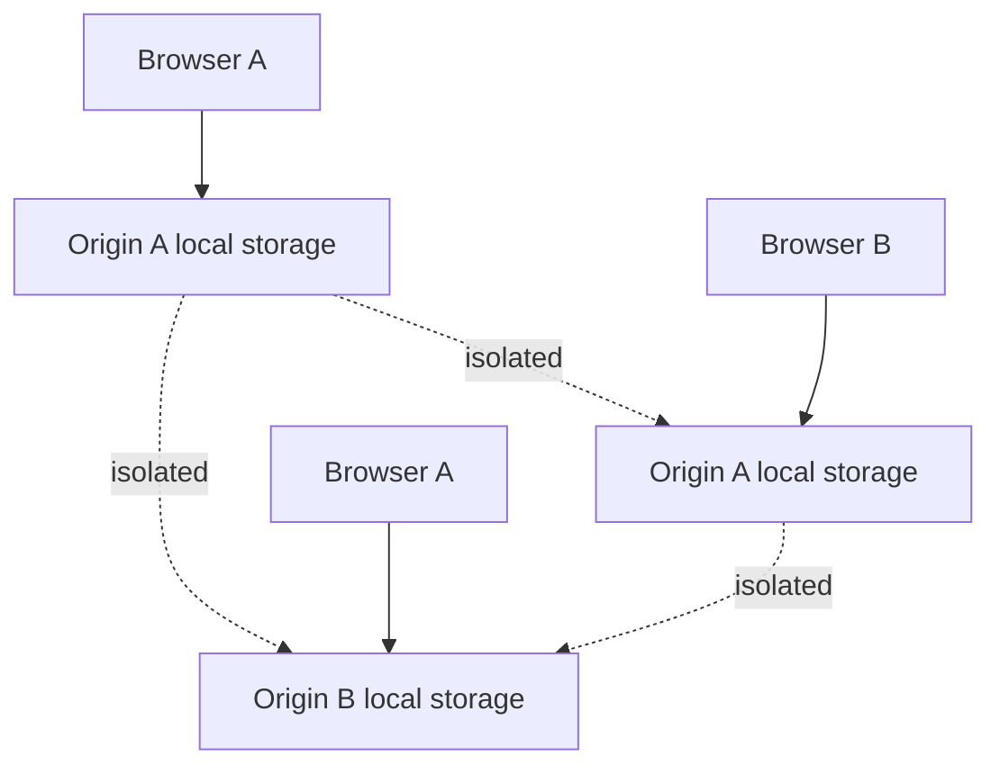
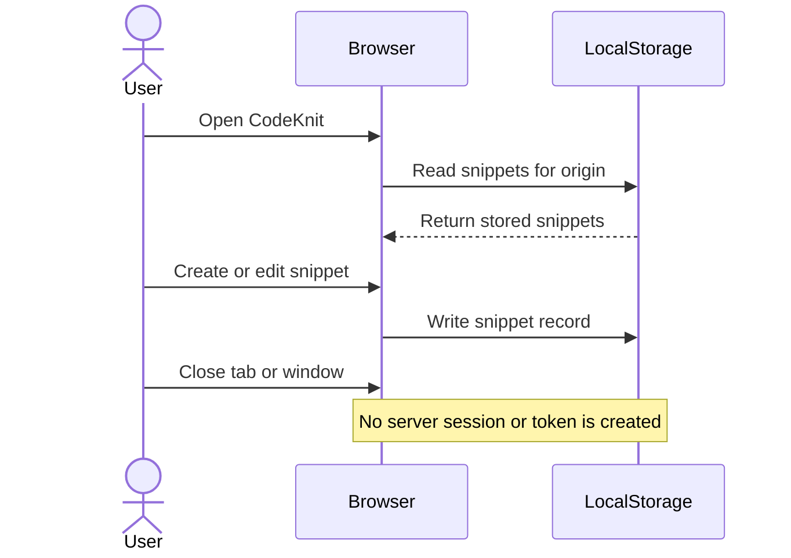

# Authentication and access control

CodeKnit is a client-side-only application with no traditional server-based authentication layer. Access to your snippet library is controlled entirely by the browser you use and the origin you open CodeKnit from. All data storage and access rules operate within the browser's own storage and security model.

## Overview

CodeKnit does not require a login, password, or account credentials. Instead, access is enforced through browser and origin isolation:

- **Per-browser isolation**: Data saved in CodeKnit in one browser or browser profile is not accessible from another browser or profile on the same device, because browser storage is profile-specific.
- **Per-origin isolation**: Data saved at one domain or origin is isolated from data at another, enforced by the browser's same-origin policy.
- **No cross-device sync**: Snippets stored in one browser are not synced to another device. Each device and browser profile maintains its own separate library.
- **No user accounts**: There is no login flow, password recovery, or remote library access. To move snippets between devices, you must export and import data manually.

The dependency manifest for CodeKnit confirms this model. `package.json` includes UI and state libraries such as React, Vite, TanStack Router, Radix UI, and Tailwind CSS, but it does not include any authentication or identity-provider packages such as NextAuth, Firebase Authentication, Supabase Auth, Passport, or similar libraries.

The following diagram shows the storage and access isolation model:

Figure: Data isolation boundaries in CodeKnit

This architecture means your access to CodeKnit is defined entirely by which browser profile and origin you use to open it. Closing the browser tab ends the active view of the app, but your data remains in browser storage until you or the browser explicitly clears it.

## Browser-based access control

### Session and state persistence

When you open CodeKnit in your browser:

1. The application loads your saved snippets from browser storage for the current origin.
2. Your library and UI state are restored from the previous session.
3. Any change you make—creating, editing, or deleting a snippet—is written to browser storage.
4. When you close the browser tab or window, the visible session ends, but your data persists in browser storage.

There is no login session timeout, session token, or server-side session to expire. Your access to your data depends only on whether you can access the browser profile where it was stored.

### Browser cache and private or incognito mode

If you open CodeKnit in private browsing mode, also called incognito mode, your snippets are stored in a temporary, isolated browser storage area. This storage is deleted when you close all private browsing windows. If you switch to a regular, non-private window in the same browser, you will not see snippets created in private mode because private mode uses separate storage.

### Browser storage as the sole data store

CodeKnit stores all snippet data, metadata, and user preferences in browser storage. There is:

- No encryption of data at rest in browser storage.
- No server-side backup or cloud sync.
- No automatic data recovery if browser storage is cleared.
- No data expiration or session timeout.

For detailed privacy and data-protection information, see [LocalStorage data protection and user privacy controls](doc:b57f1991-f1c0-4aa2-80cb-241d6c85f4ec).

## Domain and origin isolation

CodeKnit respects the browser's same-origin policy. This means:

- Snippets saved at `https://example.com/codeknit` are stored in that origin's browser storage.
- Opening CodeKnit at `https://other-domain.com/codeknit` creates a separate, isolated storage area with no access to data from `example.com`.
- Subdomains are treated as separate origins: `app.example.com` and `example.com` have separate storage.
- Switching between HTTP and HTTPS also creates a separate origin, so data is not shared across the two protocols.

This is a fundamental browser security feature and cannot be overridden by the application. It prevents one website's JavaScript from reading another website's stored data.

## No cross-browser data sharing

Each browser engine maintains its own storage database. If you use:

- **Chrome** to access CodeKnit, your snippets are stored in Chrome's browser storage.
- **Firefox** to access the same URL, Firefox creates a separate storage area with no access to Chrome's data.
- **Safari** to access the same URL, Safari maintains yet another isolated storage area.

Switching browsers on the same device means starting with an empty library. To move your snippets between browsers, you must export them from one browser and import them into the other. CodeKnit supports data export and import for this purpose.

## Data isolation during snippet creation and editing

The following diagram shows the no-authentication access flow when you open the app and modify a snippet:

Figure: Client-side access flow without authentication

When you create or edit a snippet in CodeKnit:

1. You enter the snippet title, code, language, category, and tags into form fields.
2. The application validates the input to prevent code injection and XSS attacks. See [Input validation and XSS prevention in CodeKnit](doc:9a78c429-1e7e-4d97-a1f6-eb4843901e5b).
3. The snippet object is stored directly in browser storage, accessible only to the same browser profile and origin.
4. No data is sent to a server or external service.
5. The snippet is never shared with other users or other browsers unless you manually export and share the data file.

This isolation applies to every item in the library. The product documentation also confirms that author information is not stored on any saved item, so there is no author identity to authenticate or authorize against.

## No authentication required—implications and responsibilities

Because CodeKnit requires no login:

- **Anyone with access to your browser profile can view, edit, or delete your snippets.** If you share your computer with others or leave your browser open on a shared device, they can access your library without a password or authentication check.
- **Your data is only as private as your device.** If your device is compromised through malware, unauthorized access, or physical theft, your CodeKnit data could be accessed.
- **Clearing browser data can permanently delete your snippets** if you do not export them first. There is no account recovery or server-side backup to restore from.

It is your responsibility to protect your computer and browser. Use a strong device password, enable automatic device lock, and keep your browser and operating system updated. If you share a computer with others, consider using separate browser profiles or private browsing mode for sensitive snippets.

## Access control boundaries

The following table summarizes the access control boundaries in CodeKnit:

| Boundary | Enforcement | Access control |
| --- | --- | --- |
| **Browser or profile** | Browser profile storage isolation | Separate storage per browser profile |
| **Domain and origin** | Same-origin policy | Separate storage per domain and protocol |
| **Device** | File system and operating system isolation | No automatic sync; manual export or import required |
| **User account** | None | No user identity is stored or authenticated |
| **Session timeout** | None | No server-side session; data persists until cleared |
| **Data encryption** | None | Browser storage is unencrypted; protection depends on device security |

## Recommendations

1. **Back up your snippets regularly** by using the export feature if your library contains important content. Storing backups on another device or service protects against accidental data loss.

2. **Use private browsing mode** for sensitive snippets if you share your device with others. Private mode's temporary storage ensures data is deleted when the browsing session ends.

3. **Keep your device and browser secure** with strong passwords, automatic lock, and security updates. Your CodeKnit library is only as secure as the device it is stored on.

4. **Clear your browser data intentionally.** If you clear browser storage, all CodeKnit snippets in that browser profile can be permanently deleted. Export your library first if you want to preserve it.

5. **Understand data-sharing limitations.** CodeKnit has no built-in multi-user sharing or collaboration features. To share snippets with others, export your library and send the file manually.

## Related pages

- [LocalStorage data protection and user privacy controls](doc:b57f1991-f1c0-4aa2-80cb-241d6c85f4ec)
- [Input validation and XSS prevention in CodeKnit](doc:9a78c429-1e7e-4d97-a1f6-eb4843901e5b)
- [GDPR and CCPA data protection compliance](doc:c157c48f-4442-4477-b32c-38eef94eb8ad)
- [Dependency supply chain and vulnerability management](doc:6065a4f5-d62d-4cf2-a9b1-f5e21f8d41ab)
- [Getting started](doc:41505f41-83d3-4d30-a339-3621e671d025)