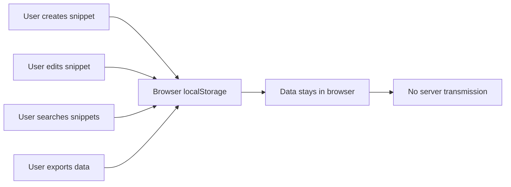

# GDPR and CCPA data protection compliance

CodeKnit is a client-side code and text snippet storage application that operates entirely within your browser using local storage. Because CodeKnit processes no data on remote servers and transmits nothing over the network, it aligns with GDPR and CCPA privacy requirements by design.

## Data processing model

CodeKnit stores all user data—code snippets, Markdown content, metadata, categories, tags, and favorites—exclusively in your browser's `localStorage`. No data leaves your device, no data is collected by servers, and no data is shared with third parties.

The dependency manifest (`package.json`) declares frontend libraries such as React, Vite, TanStack Start, Radix UI, and Zod. It includes no analytics, advertising, telemetry, or cross-site tracking libraries. See the [SPDX Software Bill of Materials](doc:c7dbfd05-3950-41a4-9ee3-24e05b895687) for the full dependency list.

Figure: Local-only data flow in CodeKnit

All reads and writes happen against the browser's local storage. Search, filtering, categories, languages, and tags operate locally on data that never leaves the device.

## Your data subject rights under GDPR

### Right to access your data

You have full access to all your snippets at any time. CodeKnit displays your complete library in the main interface, with search, category, language, and tag filters to help you locate any saved item.

**How to access:** Open CodeKnit in your browser. All your saved snippets appear in the library with full content, metadata, and formatting visible.

### Right to data portability

You can export all your snippets and their metadata in a format suitable for transfer to another application or backup storage.

**How to export:**

1. In CodeKnit, select the snippets you wish to export (or use **Select All** to export everything).
2. Use the export function to download your data in JSON format, which includes snippet content, title, description, category, tags, and language.
3. Save the JSON file to your device for archival, transfer, or import into another tool.

### Right to erasure (right to be forgotten)

You can delete any or all of your snippets permanently from your browser's local storage at any time.

**How to delete:**

1. Open a snippet in CodeKnit.
2. Select **Delete** to remove it from your library.
3. Deletion is immediate and permanent; deleted snippets cannot be recovered unless you have exported a backup.

**How to delete all data:**

- Clear your browser's local storage using your browser's **Settings** or developer tools.
- Clearing local storage removes all CodeKnit data permanently.
- If CodeKnit is installed as a browser application or Progressive Web App, remove it through your browser's app management settings.

## Your data subject rights under CCPA

### Right to know what personal information is collected

CodeKnit itself collects no personal information. No name, email, IP address, device identifier, or tracking data is collected or stored by the application. If you choose to include personal information inside a snippet, that data remains under your control in browser storage.

### Right to delete personal information

You can delete snippets and all associated data from your browser's local storage at any time. See the "Right to erasure" section above for step-by-step instructions.

### Right to opt out of the sale of personal information

CodeKnit does not sell, rent, or share any data with third parties. This right does not require action on your part because no data leaves your browser.

### Right to non-discrimination for exercising CCPA rights

CodeKnit does not use any data to discriminate against or penalize users who exercise their privacy rights. Exercising any CCPA right does not affect your access to or use of CodeKnit.

## Consent and data handling

### Consent is not required

CodeKnit does not require consent to store your snippets because:

- No personal data is collected beyond what you explicitly choose to save (snippet content and metadata).
- No data is transmitted to servers or third parties.
- You retain full control over your data at all times.

### Data retention

Data persists in your browser's local storage until you delete it, clear your browser's storage cache, or the browser's storage policy removes it. CodeKnit does not impose automatic deletion timelines because it does not maintain a server database. You are responsible for managing your data:

- **Back up your data regularly** by exporting snippets in JSON format.
- **Clear data intentionally** when you no longer need it.
- **Clear browser storage** if you uninstall CodeKnit or switch devices.

## Compliance by design

| Requirement | How CodeKnit complies |
| --- | --- |
| **Data minimization** | Only snippet content and metadata are stored; no personal identifiers, tracking, or analytics. |
| **Purpose limitation** | Data is used only for the purpose you specify when creating snippets; no secondary use. |
| **Storage limitation** | Data remains in your browser until you delete it; no copies on servers. |
| **Integrity and confidentiality** | Local storage is protected by your browser's same-origin policy and your device's file system security. |
| **Accountability** | You have full visibility and control over all stored data. |
| **No international transfers** | Data never leaves your device, so no transfers occur. |
| **No automated profiling** | CodeKnit does not build user profiles, track behavior, or use automated decision-making. |

## Browser privacy and security

Your data in CodeKnit is protected by your browser's local storage security model:

- **Same-origin policy:** CodeKnit can access only its own local storage; other websites cannot read your CodeKnit data.
- **Device file system:** Local storage is stored on your device's file system, protected by your operating system's access controls.
- **No network exposure:** Because data never leaves your browser, it cannot be intercepted in transit or accessed by remote services.

> [!TIP]
> If you use a private or incognito browsing mode, local storage is temporary and cleared when you close the browser session. Create regular backups if you use incognito mode.

## Data subject requests and contact

Because CodeKnit stores no data on servers and processes no personal information, formal data subject access requests (DSARs) under GDPR Articles 15–22 or CCPA Sections 1798.100–1798.120 do not apply. You have direct, immediate access to all your data within the application.

If you have questions about privacy or data handling, refer to the [Vulnerability Disclosure Policy](doc:a6f87b75-7355-40e3-8707-3fd6d3363e63) for responsible disclosure contact information, or consult the [Authentication and Access Control](doc:b4670717-a36e-45b5-bb25-13c2d7433b09) documentation for details on how your data is isolated within your browser session.

## Related

- [Data Privacy and User Consent for Local Snippet Storage](doc:656566fb-8d73-411f-83b6-340a89c049c6)
- [Authentication and Access Control](doc:b4670717-a36e-45b5-bb25-13c2d7433b09)
- [Vulnerability Disclosure Policy](doc:a6f87b75-7355-40e3-8707-3fd6d3363e63)
- [SPDX Software Bill of Materials](doc:c7dbfd05-3950-41a4-9ee3-24e05b895687)