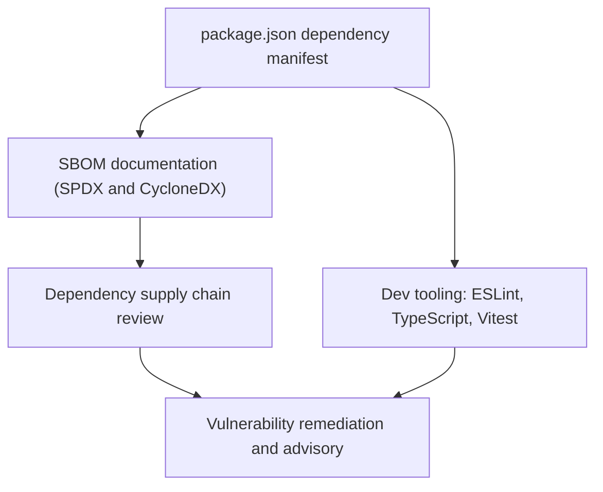
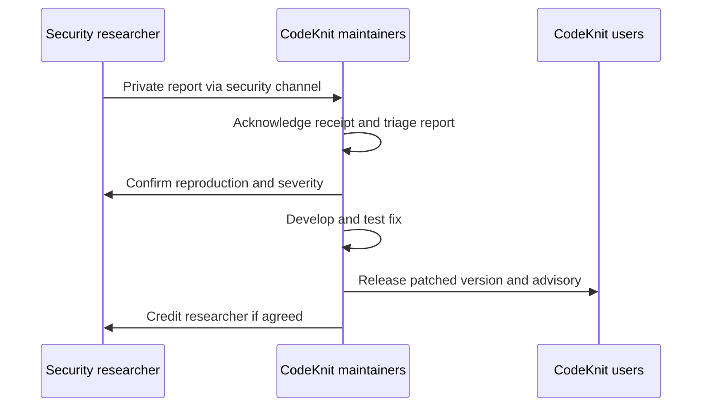

# Vulnerability disclosure policy

This policy defines how to report a security vulnerability in CodeKnit, how reports are handled, and what to expect during the process. CodeKnit's aim is to fix confirmed issues quickly while protecting users.

The source files provided for the CodeKnit documentation set, `package.json` and the user-facing documentation extracts, do not currently include a published security contact address, a `SECURITY.md` policy file, or a formally declared response-time commitment. Sections below marked as **recommended** describe practices the project encourages and should adopt as a formal policy. The **repository evidence** sections describe only what the provided files actually show.

## Current repository evidence

The `package.json` file in `Mohita111/API2` shows the following security-relevant facts:

- The package is named `tanstack_start_ts` and is `private`.
- The application is a client-side React + TanStack Start project built with Vite.
- Runtime dependencies are declared with version ranges, including React `^19.2.0`, TanStack React Start `1.168.60`, Tailwind CSS `^4.2.1`, Zod `^3.25.76`, and many Radix UI components.
- Development dependencies include TypeScript `^5.8.3`, ESLint `^9.32.0`, Vitest `^4.1.10`, and Prettier `^3.7.3`.
- The `overrides` block pins `rolldown` to `1.2.1`.
- The scripts defined are `dev`, `build`, `build:dev`, `preview`, `lint`, `format`, `test`, and `test:watch`.

No supplied file contains a security contact email address, a disclosure timeline, or an NVD/CVE tracking process. Therefore, any contact address or timeline in this policy is a recommendation for maintainers to publish, not a verified current fact.

Figure: Current repository vulnerability artifacts

The `package.json` manifest is the source of truth for dependency tracking. The [SPDX Software Bill of Materials](doc:c5fcc6f4-49bf-4a67-acf5-895954190036) and [CycloneDX Software Bill of Materials](doc:76536029-8e41-4258-8ba5-10db7718f994) documents derive their component lists from this file, and the [Dependency Supply Chain and Vulnerability Management](doc:6065a4f5-d62d-4cf2-a9b1-f5e21f8d41ab) page describes how dependencies are reviewed and updated.

## Reporting a vulnerability

If you discover a security vulnerability in CodeKnit, report it privately through the project's designated security contact channel. The provided source files do not define that channel; the maintainer team should publish a `SECURITY.md` file or equivalent contact point at the top level of the repository so researchers know where to report.

The recommended approach is to send a report containing:

- **Description** of the vulnerability and the affected component or behavior
- **Steps to reproduce** the issue, or a proof of concept when feasible
- **Impact assessment**, including what an attacker could achieve or what data could be exposed
- **Your contact information** for follow-up questions
- **Preferred disclosure timeline**, if you have one

Do not open a public issue, create a pull request, or post the vulnerability in a public forum before a fix has been prepared and a coordinated disclosure timeline has been agreed.

Figure: Recommended vulnerability disclosure flow

## Recommended response commitments

The maintainer team should adopt and publish the following commitments alongside a real security contact:

- **Initial response within 48 hours.** Confirm receipt and begin triage.
- **Regular updates.** Provide progress updates at least every 7 days for issues that require extended investigation.
- **Coordinated disclosure.** Agree a public disclosure date with the reporter. A typical target is a fix and advisory within 90 days of the initial report, though severity and complexity can change this.
- **Credit.** Acknowledge the researcher in the advisory and documentation when permitted.
- **Good-faith protection.** Not pursue legal action against researchers who report in good faith and follow this policy.

> [!IMPORTANT]
> These commitments are proposed practice, not a verified declaration. Until the repository publishes a security contact and committed response times, treat the source artifacts in this documentation as the only verified evidence.

## Vulnerability severity assessment

CodeKnit uses a severity rubric to prioritize reports. The following table is the recommended classification scheme:

| Severity | Impact | Example relevant to a client-side snippet app |
| --- | --- | --- |
| **Critical** | Unauthenticated remote code execution or full library compromise | Malicious script execution that affects all stored snippets |
| **High** | Significant data exposure or privilege escalation with minimal interaction | Cross-site scripting that exfiltrates another origin's snippet content |
| **Medium** | Requires user interaction or specific conditions; partial data exposure | Stored content injection that renders only after a specific user action |
| **Low** | Minimal real-world impact or limited non-sensitive exposure | Information disclosure limited to software version details |

## Scope

This policy applies to CodeKnit itself. Based on the source files, the in-scope surface includes:

- The CodeKnit web application built with React, TanStack Start, and Vite
- The official dependency set declared in `package.json`
- Official SBOM and security documentation maintained in this documentation set

## Out of scope

The following are outside the scope of this disclosure policy:

- Third-party services, hosting providers, or systems not under CodeKnit's control
- Attacks requiring physical access to a user's device
- Social engineering or phishing campaigns
- General security hygiene recommendations for users
- Vulnerabilities in products or services that embed CodeKnit as a dependency

## Responsible disclosure practices

When reporting a vulnerability:

- Report privately through the published security channel.
- Include enough technical detail for the maintainers to reproduce the issue without publishing an exploit.
- Allow time for a fix before any public disclosure.
- Avoid testing on production systems; use a local or staging instance.
- Do not access or modify data beyond what is needed to confirm the reported issue.
- Do not delete, encrypt, or otherwise alter any user's entrusted data during validation.

## Security advisories and updates

When the maintainers release a security fix, they should publish an advisory that includes at minimum:

- A clear description of the vulnerability
- The affected component and affected versions
- Upgrade or remediation instructions
- An assigned severity level
- Credit to the reporter, when permitted
- Links to the relevant SBOM and dependency-supply-chain documentation

The [Dependency Supply Chain and Vulnerability Management](doc:6065a4f5-d62d-4cf2-a9b1-f5e21f8d41ab) page describes the dependency review and update cycle that feeds into advisories. The [CycloneDX Software Bill of Materials](doc:76536029-8e41-4258-8ba5-10db7718f994) document tracks vulnerability metadata for components.

## Questions or clarifications

Until a dedicated security contact is published in the repository, security questions should go through the same private channel used for vulnerability reports. The maintainer team should add a `SECURITY.md` file to the repository that states:

- The preferred private reporting channel
- Any public key for encrypted reports
- The response-time commitments listed above
- The scope and out-of-scope boundaries

## Related

- [Dependency Supply Chain and Vulnerability Management](doc:6065a4f5-d62d-4cf2-a9b1-f5e21f8d41ab)
- [Authentication and Access Control](doc:b4670717-a36e-45b5-bb25-13c2d7433b09)
- [Input Validation and XSS Prevention in CodeKnit](doc:9a78c429-1e7e-4d97-a1f6-eb4843901e5b)
- [LocalStorage Data Protection and User Privacy Controls](doc:b57f1991-f1c0-4aa2-80cb-241d6c85f4ec)
- [CycloneDX Software Bill of Materials](doc:76536029-8e41-4258-8ba5-10db7718f994)