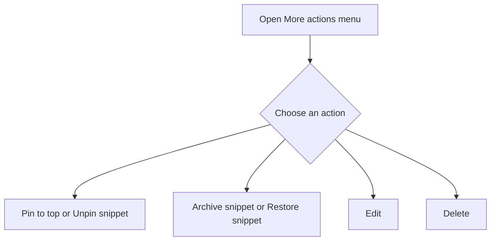

# How to use more actions on a snippet

The **More actions** menu gives you quick access to organize and manage your snippets without opening the full editor. You can pin snippets to the top, archive them, edit, or delete them all from one place.

## What you can do

When you use **More actions**, you can:

- Pin a snippet to keep it at the top of your list
- Unpin a snippet to return it to its normal position
- Archive a snippet to hide it from your active library
- Restore an archived snippet back to your active library
- Edit a snippet to change its content, title, or details
- Delete a snippet from your library

## How to access more actions

1. Find the snippet card you want to manage in your snippet library.
2. Look for the three-dot icon labeled **More actions** in the top right corner of the snippet card.
3. Click the **More actions** icon to open the dropdown menu.

The menu appears below the icon and shows all available actions for that snippet.

The following diagram shows the choices available from the **More actions** menu.

Figure: More actions menu options

## How to pin or unpin a snippet

1. Open the **More actions** menu on your snippet card.
2. Click **Pin to top** to move the snippet to the top of your library.

   When a snippet is pinned, the **More actions** menu shows **Unpin snippet** instead. Click this option anytime to return the snippet to its normal position.

A **Pinned** badge appears on the snippet card so you can easily see which snippets you have pinned.

## How to archive or restore a snippet

1. Open the **More actions** menu on your snippet card.
2. Click **Archive snippet** to hide the snippet from your active library.

   Archived snippets are stored separately and don't clutter your main view. When a snippet is archived, the **More actions** menu shows **Restore snippet** instead.

3. Click **Restore snippet** anytime to bring the snippet back to your active library.

## How to edit a snippet

1. Open the **More actions** menu on your snippet card.
2. Click **Edit** to open the snippet editor.

   The full editor opens where you can change the code, title, description, category, tags, and other details.

## How to delete a snippet

1. Open the **More actions** menu on your snippet card.
2. Click **Delete** to remove the snippet from your library.

> [!WARNING]
> Deleting a snippet removes it from your library. If you think you might need the snippet later, consider archiving it instead.

## Related guides

- [How to Duplicate Code Snippets and Manage Copies](doc:abcba59a-d04f-454b-af35-17edd3fe0503)
- [How to Customize Snippet Categories](doc:a960ef1c-6af9-4d4b-b84f-24936855e9eb)
- [How to Recover Deleted Snippets](doc:a7a9fecc-9af1-4408-a5bb-3fc0a74193f9)
