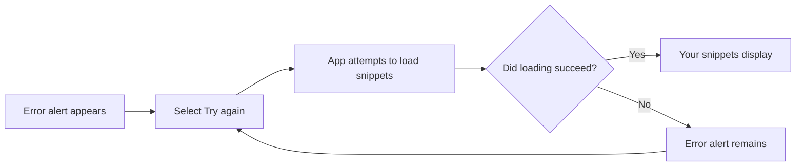

# How to try again

When you encounter an error loading your snippets, use the **Try again** button to reload your library without leaving the page.

## When to use try again

The **Try again** button appears only when the app can't load your snippets. You'll see it inside an error alert that reads **Couldn't load your snippets** and includes a short description of the problem.

## Steps

1. Find the error alert on your screen.
2. Select **Try again** in the alert.
3. Wait while the app attempts to load your snippets again.

The following diagram shows the flow from an error to a successful reload or another attempt:

Figure: Trying again after a loading error

## Expected result

After you select **Try again**, one of two outcomes occurs:

- **Success**: Your snippets load and you return to viewing your library.
- **Still failing**: The error alert remains. Wait a few moments, check your connection, and select **Try again** again.

> [!TIP]
> If repeated attempts don't help, refresh the full page in your browser using F5 or Command+R on a Mac.

## Related

- [How to Recover from Data Loss or Corruption](doc:4a3c910a-0834-42a3-aa5b-c99243c02ea1)
- [How to Recover Deleted Snippets](doc:a7a9fecc-9af1-4408-a5bb-3fc0a74193f9)
