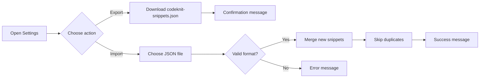

# Import and export

Import and Export lets you move your snippet library in and out of CodeKnit as a single file. Use it to back up your snippets, transfer them between browsers or devices, or share a collection with teammates.

## What it is

CodeKnit stores your snippets locally in the browser. Import and Export gives you ownership of that data. You can download your entire library for safekeeping, then restore or merge it into another CodeKnit workspace later.

Every snippet detail is preserved: title, description, code, language, tags, category, favorite status, and created or updated dates.

## Who it's for

- Developers who want local backups of important code snippets
- Teams that share snippet collections with each other
- Anyone moving to a new browser, device, or computer

## Accessing import and export

Open the gear icon at the bottom of the sidebar, next to **My workspace**. This opens the **Settings** dialog. There, you'll see three library actions:

- **Export library**
- **Import library**
- **Reset to sample data**

Export and Import are the options for moving your snippets. Reset is a separate action that replaces your library with sample data.

## Export your library

Select **Export** in the **Export library** section. CodeKnit immediately downloads a file named`codeknit-snippets.json`. This file contains every snippet in your current library.

Export is all-or-nothing. You cannot choose individual snippets, categories, or tags to export. If you have 50 snippets, all 50 are included in the same file.

A confirmation message appears after the download, showing how many snippets were exported.

## Import a library

Select **Import JSON** in the **Import library** section, then choose a previously exported CodeKnit JSON file.

Import merges snippets into your current library without replacing what is already there. Existing snippets stay exactly as they are. If the file contains a snippet that already exists in your library, that duplicate is skipped automatically. You cannot override or replace an existing snippet during import.

Before adding anything, CodeKnit validates the file. It checks that the file contains a valid CodeKnit export structure. If the file is invalid, corrupted, or from another source, the import is cancelled and none of your snippets are changed.

The **Import JSON** button changes to **Importing…** while the file is being processed. Afterward, a notification tells you how many snippets were imported and how many duplicates were skipped.

## Import and export flow

Figure: Export and import paths from Settings

## Notifications you'll see

- **Export complete**, tells you how many snippets were downloaded
- **Import ongoing**, the import button says **Importing…**
- **Import complete**, tells you how many snippets were imported and how many duplicates were skipped
- **No new snippets imported**, appears when the file contains only duplicates
- **Import failed**, appears when the file cannot be read or does not have a valid CodeKnit format

## Current limits

- Import and export are manual actions only. There is no automatic cloud backup.
- Export always includes your entire library. There is no partial or selective export.
- Import requires a file that was previously exported from CodeKnit.
- Duplicate snippets from an import are skipped. There is no option to merge conflicting content or choose whether to overwrite.
