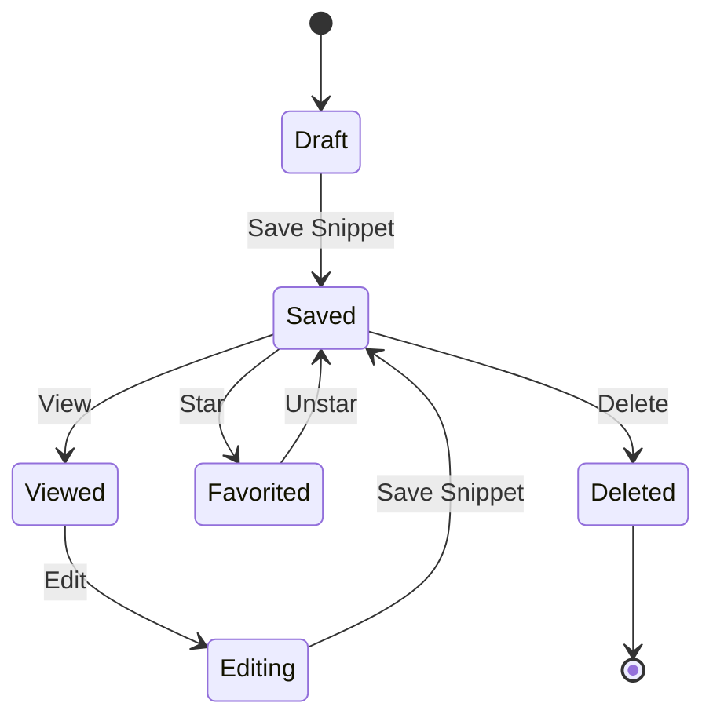
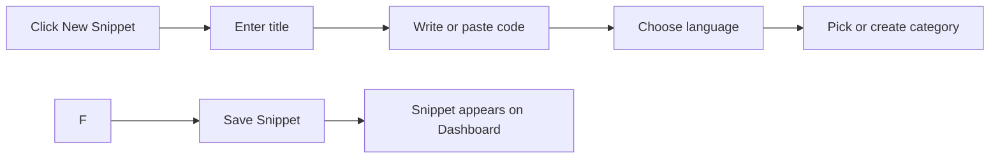

# Snippet management

Snippet management is how you build and keep a library of reusable code snippets. You can save code you write often, organize it by language, tag it for context, and return to it later without hunting through old projects.

## What snippet management does

With snippet management you can:

- **Create** a snippet by entering a title, code, language, and optional metadata.
- **Save** it so it is available the next time you open the application.
- **Find** saved snippets from the Dashboard, All Snippets, Favorites, or Recently Added views.
- **Edit** a snippet when your code, description, language, category, or tags change.
- **Mark as favorite** for quick access from the dedicated Favorites view.
- **Delete** snippets you no longer need, with a confirmation step.
- **View details** in a dedicated viewer that shows the full code, metadata, tags, and creation dates.
- **Filter and sort** your library by text, language, category, tag, and date.

The application keeps your snippets in one central place: the Dashboard. From there you can open the code editor to write or adjust a snippet, with syntax highlighting applied as you type.

## Who snippet management is for

Snippet management is for developers who reuse the same small pieces of code and want a personal code library. It is useful when you are:

- keeping quick references for SQL queries, Markdown templates, JavaScript utilities, or Python functions
- building a reference collection for your own projects
- reducing the time spent copying solutions from scattered notes
- storing code you use across multiple languages in one searchable place

## How a snippet moves through the system

The snippet lifecycle starts when you create a draft in the form, then save it. Once saved, you can view, edit, favorite, or delete it at any time.

Figure: Snippet lifecycle

When you save a snippet, the application stores it locally in your browser, and it appears on the Dashboard and in the All Snippets view.

Figure: Saving a new snippet

## Snippet options

Each snippet has the following fields:

| Field | Required | What it does |
|---|---|---|
| **Title** | Yes | A name you can recognize later. The form shows an error if you leave it empty. |
| **Code** | Yes | The content of the snippet itself. The form shows an error if you leave it empty. |
| **Language** | Yes | Choose from JavaScript, Python, SQL, or Markdown. Determines syntax highlighting and language badge color. |
| **Description** | No | A short summary of what the snippet does. |
| **Category** | Yes | Select a predefined category, choose an existing one from your library, or enter a new custom category. The default category is **Utilities**. |
| **Tags** | No | Flexible, user-defined labels for contextual searching. Add as many as you like. |
| **Favorite** | No | A toggle that marks the snippet as a favorite for quick access. |

When you fill out the form, only the title and code are strictly required. The category is also validated when you switch to entering a custom category. Everything else is optional.

## Organizing and finding snippets

Your library is structured around four views available from the sidebar:

- **Dashboard**, an overview with statistics for total snippets, favorites, and languages used.
- **All Snippets**, every snippet in your library.
- **Favorites**, only snippets you have marked as favorites.
- **Recently Added**, the 10 most recently saved snippets.

Categories are listed in the sidebar with counts, letting you filter to a specific category with one click. Languages are also listed individually, so you can quickly see all your JavaScript snippets, for example. Tags appear at the top of the filter bar and on each snippet card, giving you another way to narrow down results. For details, see Search and Filtering and Snippet Organization.

You can also switch between a grid layout and a list layout. Your layout preference is remembered on your device.

## Storage and availability

By default, snippets are saved in **browser storage** on the device where you create them. This means:

- Your snippets remain available when you close and reopen the application on the same browser.
- They are tied to the same browser and device.
- They are not automatically synced to another computer or browser.

You can export your library as a JSON backup and import it on another device from the settings dialog. For more on moving your data, see Import and Export.

## Benefits

- **Quick access to frequently used code**, save a snippet once and open it whenever you need it.
- **Less time rewriting**, reuse working code instead of recreating it from memory.
- **Organized references**, group and find snippets by language, category, or tag.
- **Favorites for the snippets you use most**, keep high-use snippets a click away.
- **A cleaner workflow**, keep small, reusable pieces separate from full projects.

## Limitations

- **Browser storage capacity**, local browser storage has a limited size, typically a few megabytes depending on your browser. Very large snippets or many stored snippets can eventually fill it.
- **Local-only storage by default**, snippets are stored on the current device and browser. They are not available on other devices unless you export and import them yourself.
- **No built-in cloud sync**, the current storage does not synchronize snippets across devices or team members automatically.
